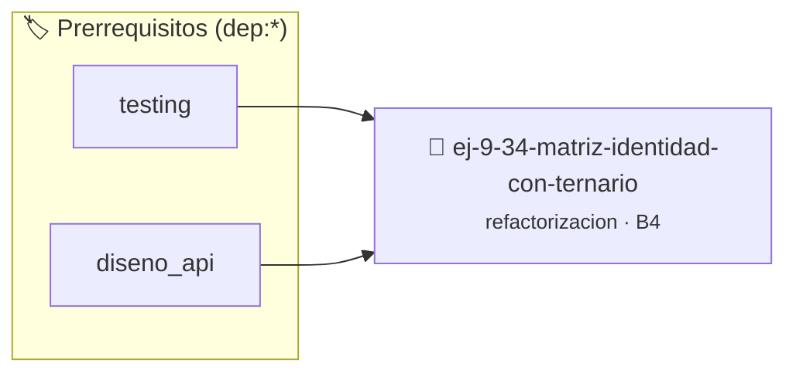

# Matriz Identidad con Ternario Críptico
> **ID:** `ej-9-34-matriz-identidad-con-ternario` · **Unidad:** 5 (Ingeniería de Software y Calidad en C)
 · **Tema:** `refactorizacion` / `matrices_2d`
 · **Bloom:** B4 (Analizar) · **Dificultad:** Avanzada
 · **Carga:** ~35 min · **Tipo:** Practica Guiada
>
> **🏷️ Prerrequisitos temáticos (tags):** `dep:testing`, `dep:diseno_api`
>
> **Etiquetas conceptuales:** `ternario`, `clean_code`, `refactorizacion`, `criptico`, `fundamentos`


::: {admonition} 📦 Paquete de Verificación Local (Ripley)
:class: tip

Para compilar, resolver y autoevaluar tu entrega con pruebas unitarias en tu máquina:

- [📥 **Descargar paquete `ej-9-34-matriz-identidad-con-ternario.ripkg`**](../../paquetes/ej-9-34-matriz-identidad-con-ternario.ripkg)

Ejecución con el asistente de cátedra:
```bash
ripley run ej-9-34-matriz-identidad-con-ternario.ripkg
```
:::


### 🗺️ Itinerario Pedagógico




## 📖 Consigna

### Ejercicio 9.34 - Matriz Identidad con Ternario Críptico ⭐⭐☆☆☆

:::{exercise}
:label: ej-ref-matriz-identidad
Refactorizá la siguiente función que determina el valor de cada celda en una
matriz identidad eliminando el ternario prohibido:

``` c
int id(int r,int c){return(r==c)?1:0;}
```
<!-- c -->

-   **[*plus ultra*]:** Escribir una función pura `int
    obtener_valor_identidad(int fila, int columna)` con validación de índices no
    negativos.
-   **[*plus ultra*]:** Testear con `assert()` celdas diagonales y fuera de la
    diagonal.

:::
<!-- {exercise} -->

:::{solution} ej-ref-matriz-identidad
:class: dropdown
**Código Refactorizado:**
```{code-block} c
:linenos:
#include <assert.h>

int obtener_valor_identidad(int fila, int columna)
{
    if (fila < 0 || columna < 0)
    {
        return -1;
    }
    if (fila == columna)
    {
        return 1;
    }
    return 0;
}

void test_valor_identidad(void)
{
    assert(obtener_valor_identidad(0, 0) == 1);
    assert(obtener_valor_identidad(2, 2) == 1);
    assert(obtener_valor_identidad(0, 3) == 0);
    assert(obtener_valor_identidad(-1, 0) == -1);
}

```
<!-- {code-block} c -->

:::
<!-- {solution} ej-ref-matriz-identidad -->

---


## 📋 Prototipos y Cabecera (`ej-9-34-matriz-identidad-con-ternario.h`)

```{code-block} c
#ifndef EJERCICIO_EJ_9_34_MATRIZ_IDENTIDAD_CON_TERNARIO_H
#define EJERCICIO_EJ_9_34_MATRIZ_IDENTIDAD_CON_TERNARIO_H

#include <stddef.h>
#include <stdbool.h>
#include <stdint.h>

/* Operación obtener_valor_identidad */
int obtener_valor_identidad(int fila, int columna);
/* Operación test_valor_identidad */
void test_valor_identidad(void);

#endif /* EJERCICIO_EJ_9_34_MATRIZ_IDENTIDAD_CON_TERNARIO_H */
```


## ⚙️ Especificación de Funciones

| Función | Retorno | Parámetros | Descripción |
| :--- | :--- | :--- | :--- |

| `obtener_valor_identidad` | `int` | `int fila, int columna` | Operación obtener_valor_identidad |

| `test_valor_identidad` | `void` | `void` | Operación test_valor_identidad |


## 🧪 Casos de Prueba

| Prueba Unitaria | Función Objetivo | Verificación |
| :--- | :--- | :--- |

| **test_obtener_valor_identidad_1** | `obtener_valor_identidad` | `/* Verificación unitaria de obtener_valor_identidad */ int res = obtener_valor_identidad(1, 2); (void)res; assert(true);` |

| **test_test_valor_identidad_2** | `test_valor_identidad` | `/* Verificación unitaria de test_valor_identidad */ test_valor_identidad(); assert(true);` |


## ✓ Solución Modelo de Cátedra

```{dropdown} 🔍 Revelar solución canónica en C
:open: false

```{code-block} c
#include <assert.h>

int obtener_valor_identidad(int fila, int columna)
{
    if (fila < 0 || columna < 0)
    {
        return -1;
    }
    if (fila == columna)
    {
        return 1;
    }
    return 0;
}

void test_valor_identidad(void)
{
    assert(obtener_valor_identidad(0, 0) == 1);
    assert(obtener_valor_identidad(2, 2) == 1);
    assert(obtener_valor_identidad(0, 3) == 0);
    assert(obtener_valor_identidad(-1, 0) == -1);
}

int main(void)
{
    return 0;
}
```
```
