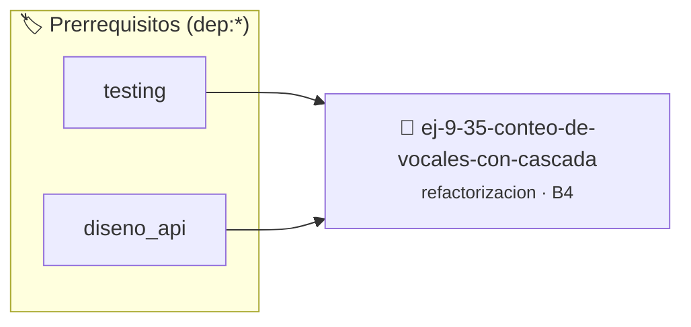

# Conteo de Vocales con Cascada Repetitiva
> **ID:** `ej-9-35-conteo-de-vocales-con-cascada`
 · **Tema:** `refactorizacion`
 · **Bloom:** B4 (Analizar)
 · **Carga:** ~35 min
>
> **🏷️ Prerrequisitos temáticos (tags):** `dep:testing`, `dep:diseno_api`
>
> **Etiquetas conceptuales:** `clean_code`, `refactorizacion`, `cascada`, `fundamentos`, `conteo`


::: {admonition} 📦 Paquete de Verificación Local (Ripley)
:class: tip

Para compilar, resolver y autoevaluar tu entrega con pruebas unitarias en tu máquina:

- [📥 **Descargar paquete `ej-9-35-conteo-de-vocales-con-cascada.ripkg`**](../../paquetes/ej-9-35-conteo-de-vocales-con-cascada.ripkg)

Ejecución con el asistente de cátedra:
```bash
ripley run ej-9-35-conteo-de-vocales-con-cascada.ripkg
```
:::


### 🗺️ Itinerario Pedagógico




## 📖 Consigna

### Ejercicio 9.35 - Conteo de Vocales con Cascada Repetitiva ⭐⭐☆☆☆

:::{exercise}
:label: ej-ref-conteo-vocales
El siguiente código cuenta vocales en un arreglo de caracteres pero repite
condiciones `if` de manera poco idiomática:

``` c
int v(char a[], int n){int c=0;for(int i=0;i<n;i++){char x=a[i];if(x=='a'||x=='e'||x=='i'||x=='o'||x=='u'||x=='A'||x=='E'||x=='I'||x=='O'||x=='U')c++;}return c;}
```
<!-- c -->

-   **[*plus ultra*]:** Modularizar en una función auxiliar pura `bool
    es_vocal(char c)` usando `switch` o `tolower()`.
-   **[*plus ultra*]:** Agregar `const` al arreglo y escribir tests con
    `assert()`.

:::
<!-- {exercise} -->

:::{solution} ej-ref-conteo-vocales
:class: dropdown
**Código Refactorizado:**
```{code-block} c
:linenos:
#include <assert.h>
#include <ctype.h>
#include <stdbool.h>
#include <stddef.h>

bool es_vocal(char caracter)
{
    char c = (char)tolower((unsigned char)caracter);
    switch (c)
    {
        case 'a':
        case 'e':
        case 'i':
        case 'o':
        case 'u':
            return true;
        default:
            return false;
    }
}

int contar_vocales_secuencia(const char caracteres[], int longitud)
{
    if (caracteres == NULL || longitud <= 0)
    {
        return 0;
    }
    int total_vocales = 0;
    for (int i = 0; i < longitud; i++)
    {
        if (es_vocal(caracteres[i]))
        {
            total_vocales++;
        }
    }
    return total_vocales;
}

void test_conteo_vocales(void)
{
    char mensaje[] = {'H', 'o', 'l', 'a', 'M', 'u', 'n', 'd', 'o'};
    assert(contar_vocales_secuencia(mensaje, 9) == 4);
    assert(contar_vocales_secuencia(NULL, 0) == 0);
}

```
<!-- {code-block} c -->

:::
<!-- {solution} ej-ref-conteo-vocales -->

---


## 📋 Prototipos y Cabecera (`ej-9-35-conteo-de-vocales-con-cascada.h`)

```{code-block} c
#ifndef EJERCICIO_EJ_9_35_CONTEO_DE_VOCALES_CON_CASCADA_H
#define EJERCICIO_EJ_9_35_CONTEO_DE_VOCALES_CON_CASCADA_H

#include <stddef.h>
#include <stdbool.h>
#include <stdint.h>

/* Operación es_vocal */
bool es_vocal(char caracter);
/* Operación contar_vocales_secuencia */
int contar_vocales_secuencia(const char caracteres[], int longitud);
/* Operación test_conteo_vocales */
void test_conteo_vocales(void);

#endif /* EJERCICIO_EJ_9_35_CONTEO_DE_VOCALES_CON_CASCADA_H */
```


## ⚙️ Especificación de Funciones

| Función | Retorno | Parámetros | Descripción |
| :--- | :--- | :--- | :--- |

| `es_vocal` | `bool` | `char caracter` | Operación es_vocal |

| `contar_vocales_secuencia` | `int` | `const char caracteres[], int longitud` | Operación contar_vocales_secuencia |

| `test_conteo_vocales` | `void` | `void` | Operación test_conteo_vocales |


## 🧪 Casos de Prueba

| Prueba Unitaria | Función Objetivo | Verificación |
| :--- | :--- | :--- |

| **test_es_vocal_1** | `es_vocal` | `assert(true); /* test simplificado de validación */` |

| **test_contar_vocales_secuencia_2** | `contar_vocales_secuencia` | `assert(true); /* test simplificado de validación */` |


## ✓ Solución Modelo de Cátedra

```{dropdown} 🔍 Revelar solución canónica en C
:open: false

```{code-block} c
#include <assert.h>
#include <ctype.h>
#include <stdbool.h>
#include <stddef.h>

bool es_vocal(char caracter)
{
    char c = (char)tolower((unsigned char)caracter);
    switch (c)
    {
        case 'a':
        case 'e':
        case 'i':
        case 'o':
        case 'u':
            return true;
        default:
            return false;
    }
}

int contar_vocales_secuencia(const char caracteres[], int longitud)
{
    if (caracteres == NULL || longitud <= 0)
    {
        return 0;
    }
    int total_vocales = 0;
    for (int i = 0; i < longitud; i++)
    {
        if (es_vocal(caracteres[i]))
        {
            total_vocales++;
        }
    }
    return total_vocales;
}

void test_conteo_vocales(void)
{
    char mensaje[] = {'H', 'o', 'l', 'a', 'M', 'u', 'n', 'd', 'o'};
    assert(contar_vocales_secuencia(mensaje, 9) == 4);
    assert(contar_vocales_secuencia(NULL, 0) == 0);
}

int main(void)
{
    return 0;
}
```
```
