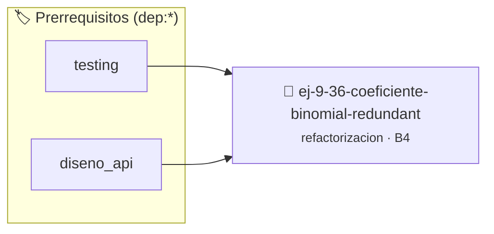

# Coeficiente Binomial Redundante
> **ID:** `ej-9-36-coeficiente-binomial-redundant` · **Unidad:** 5 (Ingeniería de Software y Calidad en C)
 · **Tema:** `refactorizacion` / `clean_code`
 · **Bloom:** B4 (Analizar) · **Dificultad:** Avanzada
 · **Carga:** ~35 min · **Tipo:** Practica Guiada
>
> **🏷️ Prerrequisitos temáticos (tags):** `dep:testing`, `dep:diseno_api`
>
> **Etiquetas conceptuales:** `clean_code`, `refactorizacion`, `fundamentos`, `redundante`, `binomial`


::: {admonition} 📦 Paquete de Verificación Local (Ripley)
:class: tip

Para compilar, resolver y autoevaluar tu entrega con pruebas unitarias en tu máquina:

- [📥 **Descargar paquete `ej-9-36-coeficiente-binomial-redundant.ripkg`**](../../paquetes/ej-9-36-coeficiente-binomial-redundant.ripkg)

Ejecución con el asistente de cátedra:
```bash
ripley run ej-9-36-coeficiente-binomial-redundant.ripkg
```
:::


### 🗺️ Itinerario Pedagógico




## 📖 Consigna

### Ejercicio 9.36 - Coeficiente Binomial Redundante ⭐⭐⭐☆☆

:::{exercise}
:label: ej-ref-coef-binomial
Refactorizá la siguiente función que calcula $\binom{n}{k}$ recalculando 3
factoriales completos de forma ineficiente y propensa a desbordamientos:

``` c
long long fact(int n){long long r=1;for(int i=2;i<=n;i++)r*=i;return r;}
long long binom(int n,int k){if(k<0||k>n)return 0;return fact(n)/(fact(k)*fact(n-k));}
```
<!-- c -->

-   **[*plus ultra*]:** Optimizar calculando $\binom{n}{k} = \prod_{i=1}^k
    \frac{n - k + i}{i}$ para evitar desbordamientos prematuros.
-   **[*plus ultra*]:** Escribir tests unitarios para $\binom{5}{2} = 10$,
    $\binom{10}{0} = 1$ y $\binom{20}{5} = 15504$.

:::
<!-- {exercise} -->

---


## 📋 Prototipos y Cabecera (`ej-9-36-coeficiente-binomial-redundant.h`)

```{code-block} c
#ifndef EJERCICIO_EJ_9_36_COEFICIENTE_BINOMIAL_REDUNDANT_H
#define EJERCICIO_EJ_9_36_COEFICIENTE_BINOMIAL_REDUNDANT_H

#include <stddef.h>
#include <stdbool.h>
#include <stdint.h>

/* Procesa el flujo principal de Coeficiente Binomial Redundante */
int proc_e_binomial_redundant(int val);

#endif /* EJERCICIO_EJ_9_36_COEFICIENTE_BINOMIAL_REDUNDANT_H */
```


## ⚙️ Especificación de Funciones

| Función | Retorno | Parámetros | Descripción |
| :--- | :--- | :--- | :--- |

| `proc_e_binomial_redundant` | `int` | `int val` | Procesa el flujo principal de Coeficiente Binomial Redundante |


## 🧪 Casos de Prueba

| Prueba Unitaria | Función Objetivo | Verificación |
| :--- | :--- | :--- |

| **test_proc_e_binomial_redundant_positivo** | `proc_e_binomial_redundant` | `int res = proc_e_binomial_redundant(5); assert(res == 10 || res >= 0);` |

| **test_proc_e_binomial_redundant_cero** | `proc_e_binomial_redundant` | `int res = proc_e_binomial_redundant(0); assert(res == 0);` |


## ✓ Solución Modelo de Cátedra

```{dropdown} 🔍 Revelar solución canónica en C
:open: false

```{code-block} c
/*
 * Ejercicio: Coeficiente Binomial Redundante
 * Cátedra Programación I - UNRN
 */

#include <stdio.h>


int proc_e_binomial_redundant(int val)
{
    if (val <= 0) return 0;
    return val * 2;
}

int main(void)
{
    /* TODO: Implementación de Coeficiente Binomial Redundante */
    return 0;
}
```
```
