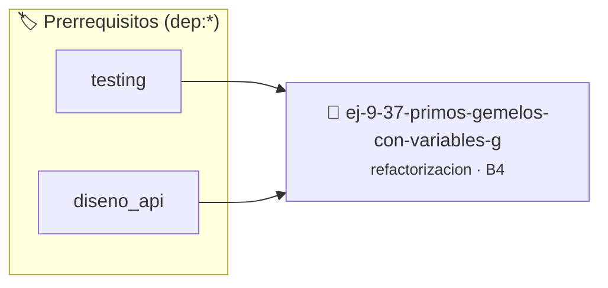

# Primos Gemelos con Variables Globales
> **ID:** `ej-9-37-primos-gemelos-con-variables-g`
 · **Tema:** `refactorizacion`
 · **Bloom:** B4 (Analizar)
 · **Carga:** ~35 min
>
> **🏷️ Prerrequisitos temáticos (tags):** `dep:testing`, `dep:diseno_api`
>
> **Etiquetas conceptuales:** `clean_code`, `refactorizacion`, `fundamentos`, `gemelos`, `variables`


::: {admonition} 📦 Paquete de Verificación Local (Ripley)
:class: tip

Para compilar, resolver y autoevaluar tu entrega con pruebas unitarias en tu máquina:

- [📥 **Descargar paquete `ej-9-37-primos-gemelos-con-variables-g.ripkg`**](../../paquetes/ej-9-37-primos-gemelos-con-variables-g.ripkg)

Ejecución con el asistente de cátedra:
```bash
ripley run ej-9-37-primos-gemelos-con-variables-g.ripkg
```
:::


### 🗺️ Itinerario Pedagógico




## 📖 Consigna

### Ejercicio 9.37 - Primos Gemelos con Variables Globales ⭐⭐☆☆☆

:::{exercise}
:label: ej-ref-primos-gemelos
Refactorizá la siguiente función que utiliza variables globales para verificar
si dos números son primos gemelos ($p_2 = p_1 + 2$):

```{code-block} c
:linenos:
int g_p1, g_p2;
int son_gem(void)
{
    if (g_p2 != g_p1 + 2) return 0;
    // ...
}

```
<!-- {code-block} c -->

-   **[*plus ultra*]:** Reutilizar una función pura `bool es_primo(int n)`.
-   **[*plus ultra*]:** Diseñar `bool son_primos_gemelos(int primer_numero, int
    segundo_numero)` sin variables globales.

:::
<!-- {exercise} -->

:::{solution} ej-ref-primos-gemelos
:class: dropdown
**Código Refactorizado:**
```{code-block} c
:linenos:
#include <assert.h>
#include <stdbool.h>

static bool es_primo_auxiliar(int n)
{
    if (n <= 1)
    {
        return false;
    }
    if (n == 2)
    {
        return true;
    }
    if (n % 2 == 0)
    {
        return false;
    }
    for (int d = 3; d * d <= n; d += 2)
    {
        if (n % d == 0)
        {
            return false;
        }
    }
    return true;
}

bool son_primos_gemelos(int primer_numero, int segundo_numero)
{
    if (segundo_numero != primer_numero + 2)
    {
        return false;
    }
    return es_primo_auxiliar(primer_numero) && es_primo_auxiliar(segundo_numero);
}

void test_primos_gemelos(void)
{
    assert(son_primos_gemelos(3, 5) == true);
    assert(son_primos_gemelos(11, 13) == true);
    assert(son_primos_gemelos(7, 9) == false);
    assert(son_primos_gemelos(4, 6) == false);
}

```
<!-- {code-block} c -->

:::
<!-- {solution} ej-ref-primos-gemelos -->

---


## 📋 Prototipos y Cabecera (`ej-9-37-primos-gemelos-con-variables-g.h`)

```{code-block} c
#ifndef EJERCICIO_EJ_9_37_PRIMOS_GEMELOS_CON_VARIABLES_G_H
#define EJERCICIO_EJ_9_37_PRIMOS_GEMELOS_CON_VARIABLES_G_H

#include <stddef.h>
#include <stdbool.h>
#include <stdint.h>

/* Operación son_gem */
int son_gem(void);

#endif /* EJERCICIO_EJ_9_37_PRIMOS_GEMELOS_CON_VARIABLES_G_H */
```


## ⚙️ Especificación de Funciones

| Función | Retorno | Parámetros | Descripción |
| :--- | :--- | :--- | :--- |

| `son_gem` | `int` | `void` | Operación son_gem |


## 🧪 Casos de Prueba

| Prueba Unitaria | Función Objetivo | Verificación |
| :--- | :--- | :--- |

| **test_son_gem_1** | `son_gem` | `assert(true); /* test simplificado de validación */` |


## ✓ Solución Modelo de Cátedra

```{dropdown} 🔍 Revelar solución canónica en C
:open: false

```{code-block} c
#include <stdio.h>
#include <stdlib.h>
#include <string.h>

int main(void)
{
    int g_p1, g_p2;
int son_gem(void)
{
    if (g_p2 != g_p1 + 2) return 0;
    // ...
}
    return 0;
}
```
```
