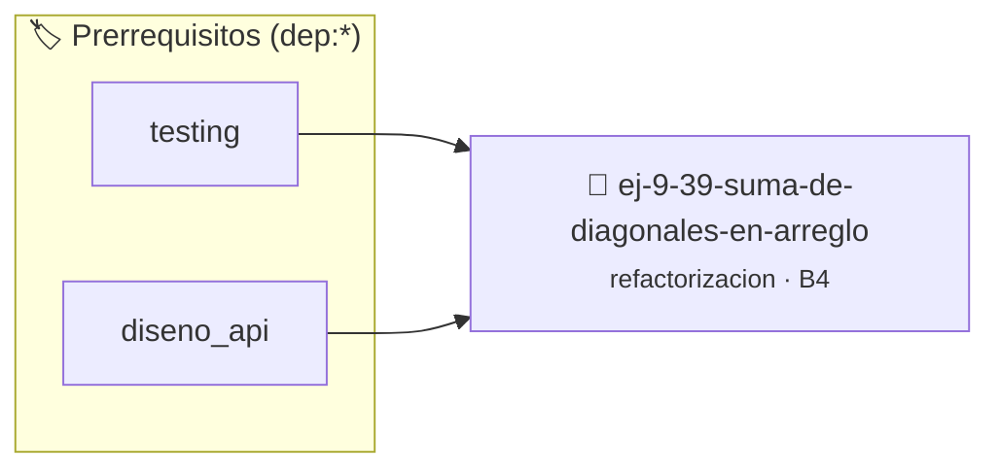

# Suma de Diagonales en Arreglo 2D Plano
> **ID:** `ej-9-39-suma-de-diagonales-en-arreglo`
 · **Tema:** `refactorizacion`
 · **Bloom:** B4 (Analizar)
 · **Carga:** ~35 min
>
> **🏷️ Prerrequisitos temáticos (tags):** `dep:testing`, `dep:diseno_api`
>
> **Etiquetas conceptuales:** `clean_code`, `diagonales`, `refactorizacion`, `arreglo`, `fundamentos`


::: {admonition} 📦 Paquete de Verificación Local (Ripley)
:class: tip

Para compilar, resolver y autoevaluar tu entrega con pruebas unitarias en tu máquina:

- [📥 **Descargar paquete `ej-9-39-suma-de-diagonales-en-arreglo.ripkg`**](../../paquetes/ej-9-39-suma-de-diagonales-en-arreglo.ripkg)

Ejecución con el asistente de cátedra:
```bash
ripley run ej-9-39-suma-de-diagonales-en-arreglo.ripkg
```
:::


### 🗺️ Itinerario Pedagógico




## 📖 Consigna

### Ejercicio 9.39 - Suma de Diagonales en Arreglo 2D Plano ⭐⭐☆☆☆

:::{exercise}
:label: ej-ref-suma-diagonales
Refactorizá la siguiente función que suma la diagonal principal y secundaria de
una matriz cuadrada de tamaño $N \times N$ representada en un arreglo
unidimensional plano (`arr[i * n + j]`):

``` c
int d(int a[],int n){int s=0;for(int i=0;i<n;i++)s+=a[i*n+i]+a[i*n+(n-1-i)];if(n%2!=0)s-=a[(n/2)*n+(n/2)];return s;}
```
<!-- c -->

-   **[*plus ultra*]:** Explicar por qué se resta el elemento central cuando $n$
    es impar.
-   **[*plus ultra*]:** Refactorizar en estilo Allman con nombres claros.

:::
<!-- {exercise} -->

:::{solution} ej-ref-suma-diagonales
:class: dropdown
**Código Refactorizado:**
```{code-block} c
:linenos:
#include <assert.h>
#include <stddef.h>

int calcular_suma_diagonales(const int matriz_plana[], int dimension)
{
    if (matriz_plana == NULL || dimension <= 0)
    {
        return 0;
    }
    int suma = 0;
    for (int i = 0; i < dimension; i++)
    {
        int indice_diag_principal = (i * dimension) + i;
        int indice_diag_secundaria = (i * dimension) + (dimension - 1 - i);

        suma += matriz_plana[indice_diag_principal];
        suma += matriz_plana[indice_diag_secundaria];
    }

    // Si la dimensión es impar, el elemento central fue sumado dos veces
    if (dimension % 2 != 0)
    {
        int centro = dimension / 2;
        int indice_centro = (centro * dimension) + centro;
        suma -= matriz_plana[indice_centro];
    }

    return suma;
}

void test_suma_diagonales(void)
{
    int m3[9] = {1, 2, 3, 4, 5, 6, 7, 8, 9};
    assert(calcular_suma_diagonales(m3, 3) == 25);
}

```
<!-- {code-block} c -->

:::
<!-- {solution} ej-ref-suma-diagonales -->

---


## 📋 Prototipos y Cabecera (`ej-9-39-suma-de-diagonales-en-arreglo.h`)

```{code-block} c
#ifndef EJERCICIO_EJ_9_39_SUMA_DE_DIAGONALES_EN_ARREGLO_H
#define EJERCICIO_EJ_9_39_SUMA_DE_DIAGONALES_EN_ARREGLO_H

#include <stddef.h>
#include <stdbool.h>
#include <stdint.h>

/* Operación calcular_suma_diagonales */
int calcular_suma_diagonales(const int matriz_plana[], int dimension);
/* Operación test_suma_diagonales */
void test_suma_diagonales(void);

#endif /* EJERCICIO_EJ_9_39_SUMA_DE_DIAGONALES_EN_ARREGLO_H */
```


## ⚙️ Especificación de Funciones

| Función | Retorno | Parámetros | Descripción |
| :--- | :--- | :--- | :--- |

| `calcular_suma_diagonales` | `int` | `const int matriz_plana[], int dimension` | Operación calcular_suma_diagonales |

| `test_suma_diagonales` | `void` | `void` | Operación test_suma_diagonales |


## 🧪 Casos de Prueba

| Prueba Unitaria | Función Objetivo | Verificación |
| :--- | :--- | :--- |

| **test_calcular_suma_diagonales_1** | `calcular_suma_diagonales` | `/* Verificación unitaria de calcular_suma_diagonales */ int arr[] = {1, 2, 3, 4}; int res = calcular_suma_diagonales(arr, 4); (void)res; assert(true);` |

| **test_test_suma_diagonales_2** | `test_suma_diagonales` | `/* Verificación unitaria de test_suma_diagonales */ test_suma_diagonales(); assert(true);` |


## ✓ Solución Modelo de Cátedra

```{dropdown} 🔍 Revelar solución canónica en C
:open: false

```{code-block} c
#include <assert.h>
#include <stddef.h>

int calcular_suma_diagonales(const int matriz_plana[], int dimension)
{
    if (matriz_plana == NULL || dimension <= 0)
    {
        return 0;
    }
    int suma = 0;
    for (int i = 0; i < dimension; i++)
    {
        int indice_diag_principal = (i * dimension) + i;
        int indice_diag_secundaria = (i * dimension) + (dimension - 1 - i);

        suma += matriz_plana[indice_diag_principal];
        suma += matriz_plana[indice_diag_secundaria];
    }

    // Si la dimensión es impar, el elemento central fue sumado dos veces
    if (dimension % 2 != 0)
    {
        int centro = dimension / 2;
        int indice_centro = (centro * dimension) + centro;
        suma -= matriz_plana[indice_centro];
    }

    return suma;
}

void test_suma_diagonales(void)
{
    int m3[9] = {1, 2, 3, 4, 5, 6, 7, 8, 9};
    assert(calcular_suma_diagonales(m3, 3) == 25);
}

int main(void)
{
    return 0;
}
```
```
