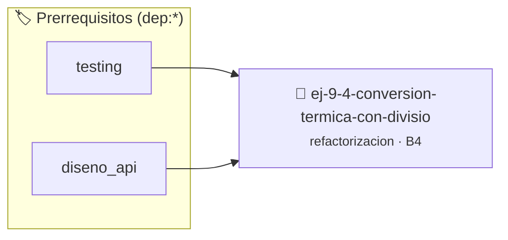

# Conversión Térmica con División Entera Peligrosa
> **ID:** `ej-9-4-conversion-termica-con-divisio` · **Unidad:** 5 (Ingeniería de Software y Calidad en C)
 · **Tema:** `refactorizacion` / `clean_code`
 · **Bloom:** B4 (Analizar) · **Dificultad:** Avanzada
 · **Carga:** ~35 min · **Tipo:** Practica Guiada
>
> **🏷️ Prerrequisitos temáticos (tags):** `dep:testing`, `dep:diseno_api`
>
> **Etiquetas conceptuales:** `clean_code`, `refactorizacion`, `peligrosa`, `fundamentos`, `conversion`


::: {admonition} 📦 Paquete de Verificación Local (Ripley)
:class: tip

Para compilar, resolver y autoevaluar tu entrega con pruebas unitarias en tu máquina:

- [📥 **Descargar paquete `ej-9-4-conversion-termica-con-divisio.ripkg`**](../../paquetes/ej-9-4-conversion-termica-con-divisio.ripkg)

Ejecución con el asistente de cátedra:
```bash
ripley run ej-9-4-conversion-termica-con-divisio.ripkg
```
:::


### 🗺️ Itinerario Pedagógico




## 📖 Consigna

:::{exercise}
:label: ej-ref-conversion-termica
El siguiente código intentó convertir grados Celsius a Fahrenheit, pero tiene
problemas de estilo y posibles riesgos de tipos:

``` c
double k(double c){return(c*9/5)+32;}
```

-   **[*plus ultra*]:** Reemplazar los números literales por constantes
    flotantes `9.0 / 5.0` y `32.0`.
-   **[*plus ultra*]:** Validar que la temperatura no sea inferior al cero
    absoluto ($-273.15^\circ\text{C}$).

:::

:::{solution} ej-ref-conversion-termica
:class: dropdown
**Diagnóstico:** Nombres opacos, falta de constantes simbólicas y sin
verificación del límite físico del cero absoluto.

**Código Refactorizado:**
```{code-block} c
:linenos:
#include <assert.h>
#include <math.h>
#include <stdbool.h>

#define CERO_ABSOLUTO_CELSIUS -273.15
#define FACTOR_ESCALA (9.0 / 5.0)
#define DESPLAZAMIENTO_FAHRENHEIT 32.0

double convertir_celsius_a_fahrenheit(double temperatura_celsius, bool *es_valida)
{
    if (temperatura_celsius < CERO_ABSOLUTO_CELSIUS || es_valida == NULL)
    {
        if (es_valida != NULL)
        {
            *es_valida = false;
        }
        return 0.0;
    }
    *es_valida = true;
    return (temperatura_celsius * FACTOR_ESCALA) + DESPLAZAMIENTO_FAHRENHEIT;
}

void test_conversion_celsius(void)
{
    bool ok = false;
    double f = convertir_celsius_a_fahrenheit(0.0, &ok);
    assert(ok && fabs(f - 32.0) < 1e-6);
    f = convertir_celsius_a_fahrenheit(100.0, &ok);
    assert(ok && fabs(f - 212.0) < 1e-6);
}

```

:::

---

### 📋 Contrato de las Funciones

```c
/*
 * Operación convertir_celsius_a_fahrenheit
 * Precondiciones: val representa el parámetro de entrada del flujo.
 * Postcondiciones: Retorna el resultado correspondiente o 0 si val <= 0.
 */
double convertir_celsius_a_fahrenheit(double temperatura_celsius, bool *es_valida);

/*
 * Operación test_conversion_celsius
 * Precondiciones: Parámetros dentro del dominio válido de la operación.
 * Postcondiciones: Retorna el valor procesado.
 */
void test_conversion_celsius(void);

```

### 🧪 Ejemplos de Ejecución

::::{tab-set}
:::{tab-item} Caso general
```text
val = 10
Retorno esperado calculado
```
:::
:::{tab-item} Caso límite
```text
val = 0
Retorno 0 o manejo de borde
```
:::
::::

### ⚠️ Precondiciones y Casos Borde

1. **Valores fuera de rango:** Verificar siempre que los datos de entrada cumplan con los rangos admisibles antes de operar.
2. **Punteros nulos:** Validar que los punteros recibidos no sean `NULL` para prevenir fallos de segmentación (*SIGSEGV*).
6. **Casos vacíos o neutros:** Contemplar adecuadamente entradas con longitud cero o valores neutros según corresponda.

### 🎯 Criterios de Aceptación

- [ ] El código compila limpiamente bajo estándar C11 sin warnings con flags estrictos (`-Wall -Wextra -Werror`).
- [ ] Se satisfacen todas las pruebas unitarias y casos de prueba provistos.
- [ ] Las funciones validan exhaustivamente sus precondiciones y gestionan casos borde de forma robusta.


## 📋 Prototipos y Cabecera (`ej-9-4-conversion-termica-con-divisio.h`)

```{code-block} c
#ifndef EJERCICIO_EJ_9_4_CONVERSION_TERMICA_CON_DIVISIO_H
#define EJERCICIO_EJ_9_4_CONVERSION_TERMICA_CON_DIVISIO_H

#include <stddef.h>
#include <stdbool.h>
#include <stdint.h>

/* Operación convertir_celsius_a_fahrenheit */
double convertir_celsius_a_fahrenheit(double temperatura_celsius, bool *es_valida);
/* Operación test_conversion_celsius */
void test_conversion_celsius(void);

#endif /* EJERCICIO_EJ_9_4_CONVERSION_TERMICA_CON_DIVISIO_H */
```


## ⚙️ Especificación de Funciones

| Función | Retorno | Parámetros | Descripción |
| :--- | :--- | :--- | :--- |

| `convertir_celsius_a_fahrenheit` | `double` | `double temperatura_celsius, bool *es_valida` | Operación convertir_celsius_a_fahrenheit |

| `test_conversion_celsius` | `void` | `void` | Operación test_conversion_celsius |


## 🧪 Casos de Prueba

| Prueba Unitaria | Función Objetivo | Verificación |
| :--- | :--- | :--- |

| **test_convertir_celsius_a_fahrenheit_1** | `convertir_celsius_a_fahrenheit` | `/* Verificación unitaria de convertir_celsius_a_fahrenheit */ assert(true);` |

| **test_test_conversion_celsius_2** | `test_conversion_celsius` | `/* Verificación unitaria de test_conversion_celsius */ test_conversion_celsius(); assert(true);` |


## ✓ Solución Modelo de Cátedra

```{dropdown} 🔍 Revelar solución canónica en C
:open: false

```{code-block} c
#include <stdlib.h>

#include <assert.h>
#include <math.h>
#include <stdbool.h>

#define CERO_ABSOLUTO_CELSIUS -273.15
#define FACTOR_ESCALA (9.0 / 5.0)
#define DESPLAZAMIENTO_FAHRENHEIT 32.0

double convertir_celsius_a_fahrenheit(double temperatura_celsius, bool *es_valida)
{
    if (temperatura_celsius < CERO_ABSOLUTO_CELSIUS || es_valida == NULL)
    {
        if (es_valida != NULL)
        {
            *es_valida = false;
        }
        return 0.0;
    }
    *es_valida = true;
    return (temperatura_celsius * FACTOR_ESCALA) + DESPLAZAMIENTO_FAHRENHEIT;
}

void test_conversion_celsius(void)
{
    bool ok = false;
    double f = convertir_celsius_a_fahrenheit(0.0, &ok);
    assert(ok && fabs(f - 32.0) < 1e-6);
    f = convertir_celsius_a_fahrenheit(100.0, &ok);
    assert(ok && fabs(f - 212.0) < 1e-6);
}

int main(void)
{
    return 0;
}
```
```
