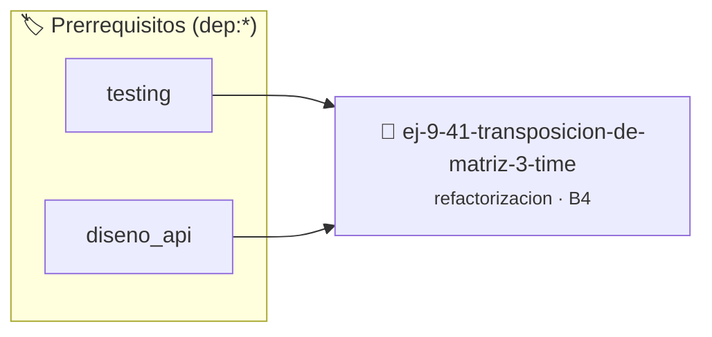

# Transposición de Matriz $3 \times 3$
> **ID:** `ej-9-41-transposicion-de-matriz-3-time` · **Unidad:** 5 (Ingeniería de Software y Calidad en C)
 · **Tema:** `refactorizacion` / `matrices_2d`
 · **Bloom:** B4 (Analizar) · **Dificultad:** Avanzada
 · **Carga:** ~35 min · **Tipo:** Practica Guiada
>
> **🏷️ Prerrequisitos temáticos (tags):** `dep:testing`, `dep:diseno_api`
>
> **Etiquetas conceptuales:** `clean_code`, `refactorizacion`, `times`, `fundamentos`, `transposicion`


::: {admonition} 📦 Paquete de Verificación Local (Ripley)
:class: tip

Para compilar, resolver y autoevaluar tu entrega con pruebas unitarias en tu máquina:

- [📥 **Descargar paquete `ej-9-41-transposicion-de-matriz-3-time.ripkg`**](../../paquetes/ej-9-41-transposicion-de-matriz-3-time.ripkg)

Ejecución con el asistente de cátedra:
```bash
ripley run ej-9-41-transposicion-de-matriz-3-time.ripkg
```
:::


### 🗺️ Itinerario Pedagógico




## 📖 Consigna

:::{exercise}
:label: ej-ref-transposicion-matriz
Refactorizá la siguiente función que transpone una matriz $3 \times 3$ en un
arreglo destino:

``` c
void t(int s[9],int d[9]){for(int i=0;i<3;i++)for(int j=0;j<3;j++)d[j*3+i]=s[i*3+j];}
```

-   **[*plus ultra*]:** Definir constantes `#define MAT_FILAS 3` y `#define
    MAT_COLUMNAS 3`.
-   **[*plus ultra*]:** Escribir una suite de tests con `assert()`.

:::

:::{solution} ej-ref-transposicion-matriz
:class: dropdown
**Código Refactorizado:**
```{code-block} c
:linenos:
#include <assert.h>
#include <stddef.h>

#define MAT_FILAS 3
#define MAT_COLUMNAS 3

void transponer_matriz_3x3(const int origen[9], int destino[9])
{
    if (origen == NULL || destino == NULL)
    {
        return;
    }
    for (int fila = 0; fila < MAT_FILAS; fila++)
    {
        for (int col = 0; col < MAT_COLUMNAS; col++)
        {
            int idx_origen = (fila * MAT_COLUMNAS) + col;
            int idx_destino = (col * MAT_FILAS) + fila;
            destino[idx_destino] = origen[idx_origen];
        }
    }
}

void test_transposicion_3x3(void)
{
    int orig[9] = {1, 2, 3, 4, 5, 6, 7, 8, 9};
    int dest[9] = {0};
    transponer_matriz_3x3(orig, dest);

    assert(dest[0] == 1 && dest[1] == 4 && dest[2] == 7);
    assert(dest[3] == 2 && dest[4] == 5 && dest[5] == 8);
    assert(dest[6] == 3 && dest[7] == 6 && dest[8] == 9);
}

```

:::

---

### 📋 Contrato de las Funciones

```c
/*
 * Operación transponer_matriz_3x3
 * Precondiciones: Parámetros dentro del dominio válido de la operación.
 * Postcondiciones: Retorna el valor procesado.
 */
void transponer_matriz_3x3(const int origen[9], int destino[9]);

/*
 * Operación test_transposicion_3x3
 * Precondiciones: Parámetros dentro del dominio válido de la operación.
 * Postcondiciones: Retorna el valor procesado.
 */
void test_transposicion_3x3(void);

```

### 🧪 Ejemplos de Ejecución

::::{tab-set}
:::{tab-item} Caso general
```text
val = 10
Retorno esperado calculado
```
:::
:::{tab-item} Caso límite
```text
val = 0
Retorno 0 o manejo de borde
```
:::
::::

### ⚠️ Precondiciones y Casos Borde

1. **Valores fuera de rango:** Verificar siempre que los datos de entrada cumplan con los rangos admisibles antes de operar.
6. **Casos vacíos o neutros:** Contemplar adecuadamente entradas con longitud cero o valores neutros según corresponda.

### 🎯 Criterios de Aceptación

- [ ] El código compila limpiamente bajo estándar C11 sin warnings con flags estrictos (`-Wall -Wextra -Werror`).
- [ ] Se satisfacen todas las pruebas unitarias y casos de prueba provistos.
- [ ] Las funciones validan exhaustivamente sus precondiciones y gestionan casos borde de forma robusta.


## 📋 Prototipos y Cabecera (`ej-9-41-transposicion-de-matriz-3-time.h`)

```{code-block} c
#ifndef EJERCICIO_EJ_9_41_TRANSPOSICION_DE_MATRIZ_3_TIME_H
#define EJERCICIO_EJ_9_41_TRANSPOSICION_DE_MATRIZ_3_TIME_H

#include <stddef.h>
#include <stdbool.h>
#include <stdint.h>

/* Operación transponer_matriz_3x3 */
void transponer_matriz_3x3(const int origen[9], int destino[9]);
/* Operación test_transposicion_3x3 */
void test_transposicion_3x3(void);

#endif /* EJERCICIO_EJ_9_41_TRANSPOSICION_DE_MATRIZ_3_TIME_H */
```


## ⚙️ Especificación de Funciones

| Función | Retorno | Parámetros | Descripción |
| :--- | :--- | :--- | :--- |

| `transponer_matriz_3x3` | `void` | `const int origen[9], int destino[9]` | Operación transponer_matriz_3x3 |

| `test_transposicion_3x3` | `void` | `void` | Operación test_transposicion_3x3 |


## 🧪 Casos de Prueba

| Prueba Unitaria | Función Objetivo | Verificación |
| :--- | :--- | :--- |

| **test_transponer_matriz_3x3_1** | `transponer_matriz_3x3` | `assert(true); /* test simplificado de validación */` |

| **test_test_transposicion_3x3_2** | `test_transposicion_3x3` | `assert(true); /* test simplificado de validación */` |


## ✓ Solución Modelo de Cátedra

```{dropdown} 🔍 Revelar solución canónica en C
:open: false

```{code-block} c
#include <assert.h>
#include <stddef.h>

#define MAT_FILAS 3
#define MAT_COLUMNAS 3

void transponer_matriz_3x3(const int origen[9], int destino[9])
{
    if (origen == NULL || destino == NULL)
    {
        return;
    }
    for (int fila = 0; fila < MAT_FILAS; fila++)
    {
        for (int col = 0; col < MAT_COLUMNAS; col++)
        {
            int idx_origen = (fila * MAT_COLUMNAS) + col;
            int idx_destino = (col * MAT_FILAS) + fila;
            destino[idx_destino] = origen[idx_origen];
        }
    }
}

void test_transposicion_3x3(void)
{
    int orig[9] = {1, 2, 3, 4, 5, 6, 7, 8, 9};
    int dest[9] = {0};
    transponer_matriz_3x3(orig, dest);

    assert(dest[0] == 1 && dest[1] == 4 && dest[2] == 7);
    assert(dest[3] == 2 && dest[4] == 5 && dest[5] == 8);
    assert(dest[6] == 3 && dest[7] == 6 && dest[8] == 9);
}

int main(void)
{
    return 0;
}
```
```
