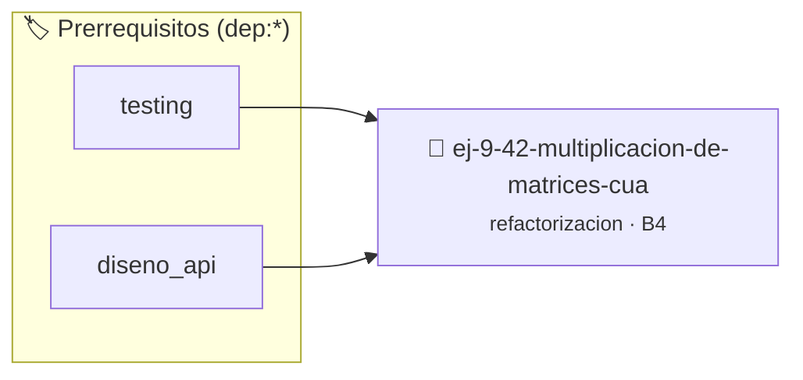

# Multiplicación de Matrices Cuadradas Comprimida
> **ID:** `ej-9-42-multiplicacion-de-matrices-cua` · **Unidad:** 5 (Ingeniería de Software y Calidad en C)
 · **Tema:** `refactorizacion` / `clean_code`
 · **Bloom:** B4 (Analizar) · **Dificultad:** Avanzada
 · **Carga:** ~35 min · **Tipo:** Practica Guiada
>
> **🏷️ Prerrequisitos temáticos (tags):** `dep:testing`, `dep:diseno_api`
>
> **Etiquetas conceptuales:** `clean_code`, `refactorizacion`, `matrices`, `fundamentos`, `comprimida`


::: {admonition} 📦 Paquete de Verificación Local (Ripley)
:class: tip

Para compilar, resolver y autoevaluar tu entrega con pruebas unitarias en tu máquina:

- [📥 **Descargar paquete `ej-9-42-multiplicacion-de-matrices-cua.ripkg`**](../../paquetes/ej-9-42-multiplicacion-de-matrices-cua.ripkg)

Ejecución con el asistente de cátedra:
```bash
ripley run ej-9-42-multiplicacion-de-matrices-cua.ripkg
```
:::


### 🗺️ Itinerario Pedagógico




## 📖 Consigna

### Ejercicio 9.42 - Multiplicación de Matrices Cuadradas Comprimida ⭐⭐⭐⭐☆

:::{exercise}
:label: ej-ref-multiplicacion-matrices
Analizá y refactorizá la siguiente función que multiplica dos matrices cuadradas
de tamaño $N \times N$ representadas en arreglos unidimensionales planos:

``` c
void mx(int a[],int b[],int c[],int n){for(int i=0;i<n;i++)for(int j=0;j<n;j++){int s=0;for(int k=0;k<n;k++)s+=a[i*n+k]*b[k*n+j];c[i*n+j]=s;}}
```
<!-- c -->

**Tu tarea:**
1. Descomponer el triple lazo anidado aplicando estilo Allman riguroso y nombres
   autoexplicativos (`fila, columna, indice_k`).
2. Validar que los punteros no sean nulos y que la dimensión $N > 0$.
3. Escribir una función auxiliar para calcular el producto escalar entre una
   fila de $A$ y una columna de $B$.
4. Diseñar pruebas unitarias con `assert()` multiplicando matrices identidad y
   matrices con números enteros conocidos.

-   **[*plus ultra*]:** Documentar con Doxygen precondiciones de no solapamiento
    de punteros.

:::
<!-- {exercise} -->

---

## 6. Validación de Formatos, Parsing y Protocolos Simples


## 📋 Prototipos y Cabecera (`ej-9-42-multiplicacion-de-matrices-cua.h`)

```{code-block} c
#ifndef EJERCICIO_EJ_9_42_MULTIPLICACION_DE_MATRICES_CUA_H
#define EJERCICIO_EJ_9_42_MULTIPLICACION_DE_MATRICES_CUA_H

#include <stddef.h>
#include <stdbool.h>
#include <stdint.h>

/* Procesa el flujo principal de Multiplicación de Matrices Cuadradas Comprimida */
int proc_cion_de_matrices_cua(int val);

#endif /* EJERCICIO_EJ_9_42_MULTIPLICACION_DE_MATRICES_CUA_H */
```


## ⚙️ Especificación de Funciones

| Función | Retorno | Parámetros | Descripción |
| :--- | :--- | :--- | :--- |

| `proc_cion_de_matrices_cua` | `int` | `int val` | Procesa el flujo principal de Multiplicación de Matrices Cuadradas Comprimida |


## 🧪 Casos de Prueba

| Prueba Unitaria | Función Objetivo | Verificación |
| :--- | :--- | :--- |

| **test_proc_cion_de_matrices_cua_positivo** | `proc_cion_de_matrices_cua` | `int res = proc_cion_de_matrices_cua(5); assert(res == 10 || res >= 0);` |

| **test_proc_cion_de_matrices_cua_cero** | `proc_cion_de_matrices_cua` | `int res = proc_cion_de_matrices_cua(0); assert(res == 0);` |


## ✓ Solución Modelo de Cátedra

```{dropdown} 🔍 Revelar solución canónica en C
:open: false

```{code-block} c
/*
 * Ejercicio: Multiplicación de Matrices Cuadradas Comprimida
 * Cátedra Programación I - UNRN
 */

#include <stdio.h>


int proc_cion_de_matrices_cua(int val)
{
    if (val <= 0) return 0;
    return val * 2;
}

int main(void)
{
    /* TODO: Implementación de Multiplicación de Matrices Cuadradas Comprimida */
    return 0;
}
```
```
