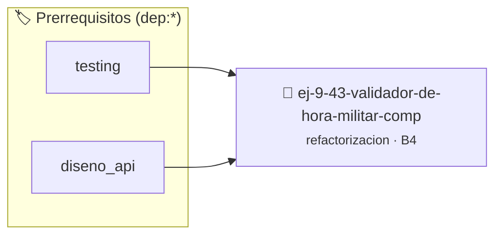

# Validador de Hora Militar Comprimido
> **ID:** `ej-9-43-validador-de-hora-militar-comp` · **Unidad:** 5 (Ingeniería de Software y Calidad en C)
 · **Tema:** `refactorizacion` / `clean_code`
 · **Bloom:** B4 (Analizar) · **Dificultad:** Avanzada
 · **Carga:** ~35 min · **Tipo:** Practica Guiada
>
> **🏷️ Prerrequisitos temáticos (tags):** `dep:testing`, `dep:diseno_api`
>
> **Etiquetas conceptuales:** `clean_code`, `refactorizacion`, `militar`, `fundamentos`, `comprimido`


::: {admonition} 📦 Paquete de Verificación Local (Ripley)
:class: tip

Para compilar, resolver y autoevaluar tu entrega con pruebas unitarias en tu máquina:

- [📥 **Descargar paquete `ej-9-43-validador-de-hora-militar-comp.ripkg`**](../../paquetes/ej-9-43-validador-de-hora-militar-comp.ripkg)

Ejecución con el asistente de cátedra:
```bash
ripley run ej-9-43-validador-de-hora-militar-comp.ripkg
```
:::


### 🗺️ Itinerario Pedagógico




## 📖 Consigna

### Ejercicio 9.43 - Validador de Hora Militar Comprimido ⭐☆☆☆☆

:::{exercise}
:label: ej-ref-hora-militar
Refactorizá la siguiente función de validación de horarios en formato 24 horas:

``` c
int ch(int h,int m,int s){return(h>=0&&h<24&&m>=0&&m<60&&s>=0&&s<60)?1:0;}
```
<!-- c -->

-   **[*plus ultra*]:** Retornar un `bool` y eliminar el operador ternario.
-   **[*plus ultra*]:** Usar constantes para los límites `#define MAX_HORAS 24`,
    `#define MAX_MINUTOS 60`.

:::
<!-- {exercise} -->

:::{solution} ej-ref-hora-militar
:class: dropdown
**Código Refactorizado:**
```{code-block} c
:linenos:
#include <assert.h>
#include <stdbool.h>

#define MIN_HORAS 0
#define MAX_HORAS 23
#define MIN_MINUTOS 0
#define MAX_MINUTOS 59
#define MIN_SEGUNDOS 0
#define MAX_SEGUNDOS 59

bool es_horario_valido(int horas, int minutos, int segundos)
{
    if (horas < MIN_HORAS || horas > MAX_HORAS)
    {
        return false;
    }
    if (minutos < MIN_MINUTOS || minutos > MAX_MINUTOS)
    {
        return false;
    }
    if (segundos < MIN_SEGUNDOS || segundos > MAX_SEGUNDOS)
    {
        return false;
    }
    return true;
}

void test_es_horario_valido(void)
{
    assert(es_horario_valido(14, 30, 0) == true);
    assert(es_horario_valido(23, 59, 59) == true);
    assert(es_horario_valido(24, 0, 0) == false);
    assert(es_horario_valido(12, -1, 0) == false);
}

```
<!-- {code-block} c -->

:::
<!-- {solution} ej-ref-hora-militar -->

---


## 📋 Prototipos y Cabecera (`ej-9-43-validador-de-hora-militar-comp.h`)

```{code-block} c
#ifndef EJERCICIO_EJ_9_43_VALIDADOR_DE_HORA_MILITAR_COMP_H
#define EJERCICIO_EJ_9_43_VALIDADOR_DE_HORA_MILITAR_COMP_H

#include <stddef.h>
#include <stdbool.h>
#include <stdint.h>

/* Operación es_horario_valido */
bool es_horario_valido(int horas, int minutos, int segundos);
/* Operación test_es_horario_valido */
void test_es_horario_valido(void);

#endif /* EJERCICIO_EJ_9_43_VALIDADOR_DE_HORA_MILITAR_COMP_H */
```


## ⚙️ Especificación de Funciones

| Función | Retorno | Parámetros | Descripción |
| :--- | :--- | :--- | :--- |

| `es_horario_valido` | `bool` | `int horas, int minutos, int segundos` | Operación es_horario_valido |

| `test_es_horario_valido` | `void` | `void` | Operación test_es_horario_valido |


## 🧪 Casos de Prueba

| Prueba Unitaria | Función Objetivo | Verificación |
| :--- | :--- | :--- |

| **test_es_horario_valido_1** | `es_horario_valido` | `/* Verificación unitaria de es_horario_valido */ bool ok = es_horario_valido(1, 2, 3); (void)ok; assert(true);` |

| **test_test_es_horario_valido_2** | `test_es_horario_valido` | `/* Verificación unitaria de test_es_horario_valido */ test_es_horario_valido(); assert(true);` |


## ✓ Solución Modelo de Cátedra

```{dropdown} 🔍 Revelar solución canónica en C
:open: false

```{code-block} c
#include <assert.h>
#include <stdbool.h>

#define MIN_HORAS 0
#define MAX_HORAS 23
#define MIN_MINUTOS 0
#define MAX_MINUTOS 59
#define MIN_SEGUNDOS 0
#define MAX_SEGUNDOS 59

bool es_horario_valido(int horas, int minutos, int segundos)
{
    if (horas < MIN_HORAS || horas > MAX_HORAS)
    {
        return false;
    }
    if (minutos < MIN_MINUTOS || minutos > MAX_MINUTOS)
    {
        return false;
    }
    if (segundos < MIN_SEGUNDOS || segundos > MAX_SEGUNDOS)
    {
        return false;
    }
    return true;
}

void test_es_horario_valido(void)
{
    assert(es_horario_valido(14, 30, 0) == true);
    assert(es_horario_valido(23, 59, 59) == true);
    assert(es_horario_valido(24, 0, 0) == false);
    assert(es_horario_valido(12, -1, 0) == false);
}

int main(void)
{
    return 0;
}
```
```
