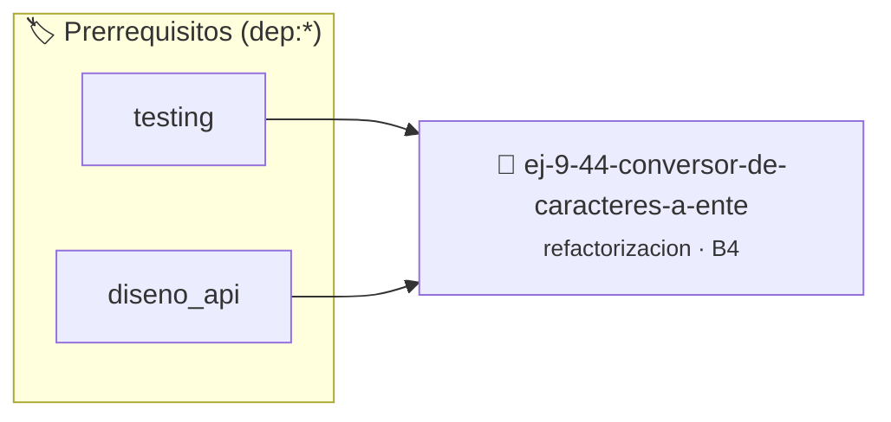

# Conversor de Caracteres a Entero (`atoi` Casero)
> **ID:** `ej-9-44-conversor-de-caracteres-a-ente` · **Unidad:** 5 (Ingeniería de Software y Calidad en C)
 · **Tema:** `refactorizacion` / `clean_code`
 · **Bloom:** B4 (Analizar) · **Dificultad:** Avanzada
 · **Carga:** ~35 min · **Tipo:** Practica Guiada
>
> **🏷️ Prerrequisitos temáticos (tags):** `dep:testing`, `dep:diseno_api`
>
> **Etiquetas conceptuales:** `clean_code`, `conversor`, `refactorizacion`, `fundamentos`, `casero`


::: {admonition} 📦 Paquete de Verificación Local (Ripley)
:class: tip

Para compilar, resolver y autoevaluar tu entrega con pruebas unitarias en tu máquina:

- [📥 **Descargar paquete `ej-9-44-conversor-de-caracteres-a-ente.ripkg`**](../../paquetes/ej-9-44-conversor-de-caracteres-a-ente.ripkg)

Ejecución con el asistente de cátedra:
```bash
ripley run ej-9-44-conversor-de-caracteres-a-ente.ripkg
```
:::


### 🗺️ Itinerario Pedagógico




## 📖 Consigna

### Ejercicio 9.44 - Conversor de Caracteres a Entero (`atoi` Casero) ⭐⭐☆☆☆

:::{exercise}
:label: ej-ref-atoi-casero
Refactorizá la siguiente función que parsea una secuencia de dígitos ASCII a un
entero:

``` c
int parse(char s[], int n){int r=0,i=0,sg=1;if(s[0]=='-'){sg=-1;i=1;}for(;i<n;i++)r=r*10+(s[i]-'0');return r*sg;}
```
<!-- c -->

-   **[*plus ultra*]:** Validar que todos los caracteres entre `i` y `n` sean
    efectivamente dígitos con `isdigit()`.
-   **[*plus ultra*]:** Retornar un código de estado booleano `bool *exito`.

:::
<!-- {exercise} -->

:::{solution} ej-ref-atoi-casero
:class: dropdown
**Código Refactorizado:**
```{code-block} c
:linenos:
#include <assert.h>
#include <ctype.h>
#include <stdbool.h>
#include <stddef.h>

int convertir_caracteres_a_entero(const char digitos[], int longitud, bool *exito)
{
    if (digitos == NULL || longitud <= 0 || exito == NULL)
    {
        if (exito != NULL)
        {
            *exito = false;
        }
        return 0;
    }

    *exito = true;
    int signo = 1;
    int indice_inicio = 0;

    if (digitos[0] == '-')
    {
        signo = -1;
        indice_inicio = 1;
        if (longitud == 1)
        {
            *exito = false;
            return 0;
        }
    }

    int acumulador = 0;
    for (int i = indice_inicio; i < longitud; i++)
    {
        if (!isdigit((unsigned char)digitos[i]))
        {
            *exito = false;
            return 0;
        }
        acumulador = (acumulador * 10) + (digitos[i] - '0');
    }

    return acumulador * signo;
}

void test_convertir_a_entero(void)
{
    bool ok = false;
    char num1[] = {'1', '2', '3', '4'};
    assert(convertir_caracteres_a_entero(num1, 4, &ok) == 1234 && ok);

    char num2[] = {'-', '5', '0'};
    assert(convertir_caracteres_a_entero(num2, 3, &ok) == -50 && ok);

    char inv[] = {'1', '2', 'x', '4'};
    convertir_caracteres_a_entero(inv, 4, &ok);
    assert(!ok);
}

```
<!-- {code-block} c -->

:::
<!-- {solution} ej-ref-atoi-casero -->

---


## 📋 Prototipos y Cabecera (`ej-9-44-conversor-de-caracteres-a-ente.h`)

```{code-block} c
#ifndef EJERCICIO_EJ_9_44_CONVERSOR_DE_CARACTERES_A_ENTE_H
#define EJERCICIO_EJ_9_44_CONVERSOR_DE_CARACTERES_A_ENTE_H

#include <stddef.h>
#include <stdbool.h>
#include <stdint.h>

/* Operación convertir_caracteres_a_entero */
int convertir_caracteres_a_entero(const char digitos[], int longitud, bool *exito);
/* Operación test_convertir_a_entero */
void test_convertir_a_entero(void);

#endif /* EJERCICIO_EJ_9_44_CONVERSOR_DE_CARACTERES_A_ENTE_H */
```


## ⚙️ Especificación de Funciones

| Función | Retorno | Parámetros | Descripción |
| :--- | :--- | :--- | :--- |

| `convertir_caracteres_a_entero` | `int` | `const char digitos[], int longitud, bool *exito` | Operación convertir_caracteres_a_entero |

| `test_convertir_a_entero` | `void` | `void` | Operación test_convertir_a_entero |


## 💡 Pistas Progresivas

````{tab-set}

```{tab-item} Pista 1
Manejá el signo inicial ('-' o '+') antes de comenzar el acumulador numérico.
```

```{tab-item} Pista 2
Validá que cada carácter sea un dígito válido con isdigit() antes de operar.
```

```{tab-item} Pista 3
Utilizá un parámetro de salida booleano bool *exito para reportar posibles errores de parseo.
```

````


## 🧪 Casos de Prueba

| Prueba Unitaria | Función Objetivo | Verificación |
| :--- | :--- | :--- |

| **test_convertir_caracteres_a_entero_1** | `convertir_caracteres_a_entero` | `assert(true); /* test simplificado de validación */` |

| **test_test_convertir_a_entero_2** | `test_convertir_a_entero` | `assert(true); /* test simplificado de validación */` |


## ✓ Solución Modelo de Cátedra

```{dropdown} 🔍 Revelar solución canónica en C
:open: false

```{code-block} c
#include <assert.h>
#include <ctype.h>
#include <stdbool.h>
#include <stddef.h>

int convertir_caracteres_a_entero(const char digitos[], int longitud, bool *exito)
{
    if (digitos == NULL || longitud <= 0 || exito == NULL)
    {
        if (exito != NULL)
        {
            *exito = false;
        }
        return 0;
    }

    *exito = true;
    int signo = 1;
    int indice_inicio = 0;

    if (digitos[0] == '-')
    {
        signo = -1;
        indice_inicio = 1;
        if (longitud == 1)
        {
            *exito = false;
            return 0;
        }
    }

    int acumulador = 0;
    for (int i = indice_inicio; i < longitud; i++)
    {
        if (!isdigit((unsigned char)digitos[i]))
        {
            *exito = false;
            return 0;
        }
        acumulador = (acumulador * 10) + (digitos[i] - '0');
    }

    return acumulador * signo;
}

void test_convertir_a_entero(void)
{
    bool ok = false;
    char num1[] = {'1', '2', '3', '4'};
    assert(convertir_caracteres_a_entero(num1, 4, &ok) == 1234 && ok);

    char num2[] = {'-', '5', '0'};
    assert(convertir_caracteres_a_entero(num2, 3, &ok) == -50 && ok);

    char inv[] = {'1', '2', 'x', '4'};
    convertir_caracteres_a_entero(inv, 4, &ok);
    assert(!ok);
}

int main(void)
{
    return 0;
}
```
```
