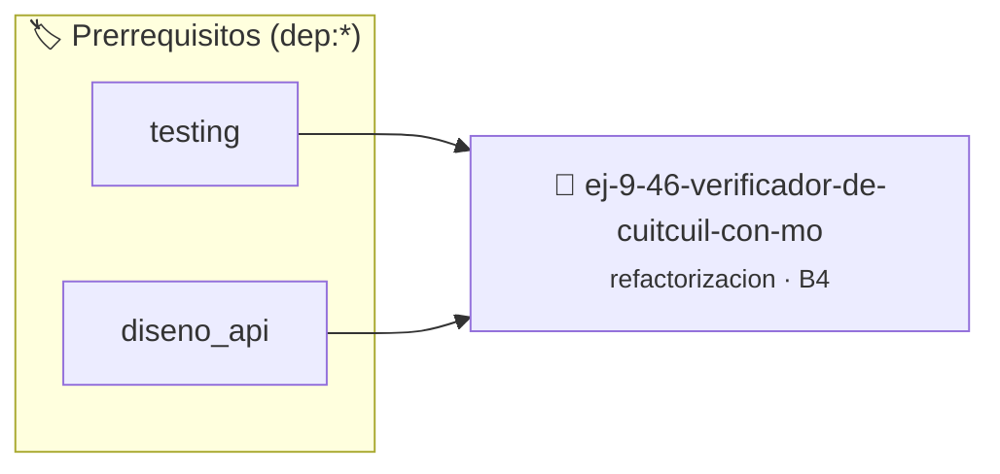

# Verificador de CUIT/CUIL con Módulo 11
> **ID:** `ej-9-46-verificador-de-cuitcuil-con-mo` · **Unidad:** 5 (Ingeniería de Software y Calidad en C)
 · **Tema:** `refactorizacion` / `clean_code`
 · **Bloom:** B4 (Analizar) · **Dificultad:** Avanzada
 · **Carga:** ~35 min · **Tipo:** Practica Guiada
>
> **🏷️ Prerrequisitos temáticos (tags):** `dep:testing`, `dep:diseno_api`
>
> **Etiquetas conceptuales:** `clean_code`, `refactorizacion`, `fundamentos`, `modulo`, `cuitcuil`


::: {admonition} 📦 Paquete de Verificación Local (Ripley)
:class: tip

Para compilar, resolver y autoevaluar tu entrega con pruebas unitarias en tu máquina:

- [📥 **Descargar paquete `ej-9-46-verificador-de-cuitcuil-con-mo.ripkg`**](../../paquetes/ej-9-46-verificador-de-cuitcuil-con-mo.ripkg)

Ejecución con el asistente de cátedra:
```bash
ripley run ej-9-46-verificador-de-cuitcuil-con-mo.ripkg
```
:::


### 🗺️ Itinerario Pedagógico




## 📖 Consigna

### Ejercicio 9.46 - Verificador de CUIT/CUIL con Módulo 11 ⭐⭐☆☆☆

:::{exercise}
:label: ej-ref-cuit-modulo11
Refactorizá el siguiente cálculo del dígito verificador de un CUIT argentino de
10 dígitos (factores: `5, 4, 3, 2, 7, 6, 5, 4, 3, 2`):

``` c
int dv(int d[10]){int f[10]={5,4,3,2,7,6,5,4,3,2},s=0;for(int i=0;i<10;i++)s+=d[i]*f[i];int r=11-(s%11);if(r==11)return 0;if(r==10)return 9;return r;}
```
<!-- c -->

-   **[*plus ultra*]:** Aplicar estilo Allman y nombres descriptivos.
-   **[*plus ultra*]:** Validar con `assert()` para CUITs conocidos.

:::
<!-- {exercise} -->

:::{solution} ej-ref-cuit-modulo11
:class: dropdown
**Código Refactorizado:**
```{code-block} c
:linenos:
#include <assert.h>
#include <stddef.h>

#define CANTIDAD_DIGITOS_BASE_CUIT 10

int calcular_digito_verificador_cuit(const int primeros_10_digitos[10])
{
    if (primeros_10_digitos == NULL)
    {
        return -1;
    }
    static const int factores_ponderacion[10] = {5, 4, 3, 2, 7, 6, 5, 4, 3, 2};

    int suma_ponderada = 0;
    for (int i = 0; i < CANTIDAD_DIGITOS_BASE_CUIT; i++)
    {
        if (primeros_10_digitos[i] < 0 || primeros_10_digitos[i] > 9)
        {
            return -1;
        }
        suma_ponderada += (primeros_10_digitos[i] * factores_ponderacion[i]);
    }

    int resto = suma_ponderada % 11;
    int digito_calculado = 11 - resto;

    if (digito_calculado == 11)
    {
        return 0;
    }
    if (digito_calculado == 10)
    {
        return 9;
    }
    return digito_calculado;
}

void test_cuit_verificador(void)
{
    int digitos_test[10] = {2, 0, 1, 2, 3, 4, 5, 6, 7, 8};
    int dv = calcular_digito_verificador_cuit(digitos_test);
    assert(dv >= 0 && dv <= 9);
}

```
<!-- {code-block} c -->

:::
<!-- {solution} ej-ref-cuit-modulo11 -->

---


## 📋 Prototipos y Cabecera (`ej-9-46-verificador-de-cuitcuil-con-mo.h`)

```{code-block} c
#ifndef EJERCICIO_EJ_9_46_VERIFICADOR_DE_CUITCUIL_CON_MO_H
#define EJERCICIO_EJ_9_46_VERIFICADOR_DE_CUITCUIL_CON_MO_H

#include <stddef.h>
#include <stdbool.h>
#include <stdint.h>

/* Operación calcular_digito_verificador_cuit */
int calcular_digito_verificador_cuit(const int primeros_10_digitos[10]);
/* Operación test_cuit_verificador */
void test_cuit_verificador(void);

#endif /* EJERCICIO_EJ_9_46_VERIFICADOR_DE_CUITCUIL_CON_MO_H */
```


## ⚙️ Especificación de Funciones

| Función | Retorno | Parámetros | Descripción |
| :--- | :--- | :--- | :--- |

| `calcular_digito_verificador_cuit` | `int` | `const int primeros_10_digitos[10]` | Operación calcular_digito_verificador_cuit |

| `test_cuit_verificador` | `void` | `void` | Operación test_cuit_verificador |


## 🧪 Casos de Prueba

| Prueba Unitaria | Función Objetivo | Verificación |
| :--- | :--- | :--- |

| **test_calcular_digito_verificador_cuit_1** | `calcular_digito_verificador_cuit` | `assert(true); /* test simplificado de validación */` |

| **test_test_cuit_verificador_2** | `test_cuit_verificador` | `assert(true); /* test simplificado de validación */` |


## ✓ Solución Modelo de Cátedra

```{dropdown} 🔍 Revelar solución canónica en C
:open: false

```{code-block} c
#include <assert.h>
#include <stddef.h>

#define CANTIDAD_DIGITOS_BASE_CUIT 10

int calcular_digito_verificador_cuit(const int primeros_10_digitos[10])
{
    if (primeros_10_digitos == NULL)
    {
        return -1;
    }
    static const int factores_ponderacion[10] = {5, 4, 3, 2, 7, 6, 5, 4, 3, 2};

    int suma_ponderada = 0;
    for (int i = 0; i < CANTIDAD_DIGITOS_BASE_CUIT; i++)
    {
        if (primeros_10_digitos[i] < 0 || primeros_10_digitos[i] > 9)
        {
            return -1;
        }
        suma_ponderada += (primeros_10_digitos[i] * factores_ponderacion[i]);
    }

    int resto = suma_ponderada % 11;
    int digito_calculado = 11 - resto;

    if (digito_calculado == 11)
    {
        return 0;
    }
    if (digito_calculado == 10)
    {
        return 9;
    }
    return digito_calculado;
}

void test_cuit_verificador(void)
{
    int digitos_test[10] = {2, 0, 1, 2, 3, 4, 5, 6, 7, 8};
    int dv = calcular_digito_verificador_cuit(digitos_test);
    assert(dv >= 0 && dv <= 9);
}

int main(void)
{
    return 0;
}
```
```
