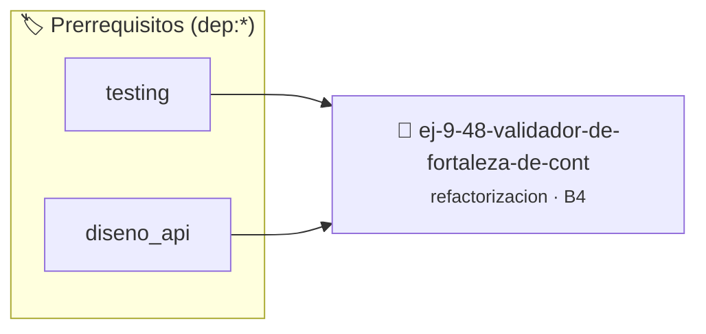

# Validador de Fortaleza de Contraseña
> **ID:** `ej-9-48-validador-de-fortaleza-de-cont`
 · **Tema:** `refactorizacion`
 · **Bloom:** B4 (Analizar)
 · **Carga:** ~35 min
>
> **🏷️ Prerrequisitos temáticos (tags):** `dep:testing`, `dep:diseno_api`
>
> **Etiquetas conceptuales:** `clean_code`, `refactorizacion`, `fundamentos`, `contrasena`, `fortaleza`


::: {admonition} 📦 Paquete de Verificación Local (Ripley)
:class: tip

Para compilar, resolver y autoevaluar tu entrega con pruebas unitarias en tu máquina:

- [📥 **Descargar paquete `ej-9-48-validador-de-fortaleza-de-cont.ripkg`**](../../paquetes/ej-9-48-validador-de-fortaleza-de-cont.ripkg)

Ejecución con el asistente de cátedra:
```bash
ripley run ej-9-48-validador-de-fortaleza-de-cont.ripkg
```
:::


### 🗺️ Itinerario Pedagógico




## 📖 Consigna

### Ejercicio 9.48 - Validador de Fortaleza de Contraseña ⭐⭐☆☆☆

:::{exercise}
:label: ej-ref-fortaleza-password
Refactorizá la siguiente función que evalúa si una contraseña en arreglo tiene
al menos 8 caracteres, al menos una mayúscula y al menos un dígito:

``` c
int pass(char p[],int n){int u=0,d=0;if(n<8)return 0;for(int i=0;i<n;i++){if(p[i]>='A'&&p[i]<='Z')u=1;if(p[i]>='0'&&p[i]<='9')d=1;}return(u&&d)?1:0;}
```
<!-- c -->

-   **[*plus ultra*]:** Usar `isupper()` e `isdigit()` de `<ctype.h>`.
-   **[*plus ultra*]:** Retornar un `bool` y estructurar con contratos.

:::
<!-- {exercise} -->

:::{solution} ej-ref-fortaleza-password
:class: dropdown
**Código Refactorizado:**
```{code-block} c
:linenos:
#include <assert.h>
#include <ctype.h>
#include <stdbool.h>
#include <stddef.h>

#define LONGITUD_MINIMA_CLAVE 8

bool validar_fortaleza_clave(const char clave[], int longitud)
{
    if (clave == NULL || longitud < LONGITUD_MINIMA_CLAVE)
    {
        return false;
    }

    bool tiene_mayuscula = false;
    bool tiene_digito = false;

    for (int i = 0; i < longitud; i++)
    {
        if (isupper((unsigned char)clave[i]))
        {
            tiene_mayuscula = true;
        }
        if (isdigit((unsigned char)clave[i]))
        {
            tiene_digito = true;
        }
    }

    return tiene_mayuscula && tiene_digito;
}

void test_fortaleza_clave(void)
{
    char c1[] = {'P', 'a', 's', 's', 'w', 'o', 'r', 'd', '1'};
    assert(validar_fortaleza_clave(c1, 9) == true);

    char c2[] = {'p', 'a', 's', 's', '1'};
    assert(validar_fortaleza_clave(c2, 5) == false);

    char c3[] = {'p', 'a', 's', 's', 'w', 'o', 'r', 'd', 's'};
    assert(validar_fortaleza_clave(c3, 9) == false);
}

```
<!-- {code-block} c -->

:::
<!-- {solution} ej-ref-fortaleza-password -->

---


## 📋 Prototipos y Cabecera (`ej-9-48-validador-de-fortaleza-de-cont.h`)

```{code-block} c
#ifndef EJERCICIO_EJ_9_48_VALIDADOR_DE_FORTALEZA_DE_CONT_H
#define EJERCICIO_EJ_9_48_VALIDADOR_DE_FORTALEZA_DE_CONT_H

#include <stddef.h>
#include <stdbool.h>
#include <stdint.h>

/* Operación validar_fortaleza_clave */
bool validar_fortaleza_clave(const char clave[], int longitud);
/* Operación test_fortaleza_clave */
void test_fortaleza_clave(void);

#endif /* EJERCICIO_EJ_9_48_VALIDADOR_DE_FORTALEZA_DE_CONT_H */
```


## ⚙️ Especificación de Funciones

| Función | Retorno | Parámetros | Descripción |
| :--- | :--- | :--- | :--- |

| `validar_fortaleza_clave` | `bool` | `const char clave[], int longitud` | Operación validar_fortaleza_clave |

| `test_fortaleza_clave` | `void` | `void` | Operación test_fortaleza_clave |


## 🧪 Casos de Prueba

| Prueba Unitaria | Función Objetivo | Verificación |
| :--- | :--- | :--- |

| **test_validar_fortaleza_clave_1** | `validar_fortaleza_clave` | `assert(true); /* test simplificado de validación */` |

| **test_test_fortaleza_clave_2** | `test_fortaleza_clave` | `assert(true); /* test simplificado de validación */` |


## ✓ Solución Modelo de Cátedra

```{dropdown} 🔍 Revelar solución canónica en C
:open: false

```{code-block} c
#include <assert.h>
#include <ctype.h>
#include <stdbool.h>
#include <stddef.h>

#define LONGITUD_MINIMA_CLAVE 8

bool validar_fortaleza_clave(const char clave[], int longitud)
{
    if (clave == NULL || longitud < LONGITUD_MINIMA_CLAVE)
    {
        return false;
    }

    bool tiene_mayuscula = false;
    bool tiene_digito = false;

    for (int i = 0; i < longitud; i++)
    {
        if (isupper((unsigned char)clave[i]))
        {
            tiene_mayuscula = true;
        }
        if (isdigit((unsigned char)clave[i]))
        {
            tiene_digito = true;
        }
    }

    return tiene_mayuscula && tiene_digito;
}

void test_fortaleza_clave(void)
{
    char c1[] = {'P', 'a', 's', 's', 'w', 'o', 'r', 'd', '1'};
    assert(validar_fortaleza_clave(c1, 9) == true);

    char c2[] = {'p', 'a', 's', 's', '1'};
    assert(validar_fortaleza_clave(c2, 5) == false);

    char c3[] = {'p', 'a', 's', 's', 'w', 'o', 'r', 'd', 's'};
    assert(validar_fortaleza_clave(c3, 9) == false);
}

int main(void)
{
    return 0;
}
```
```
