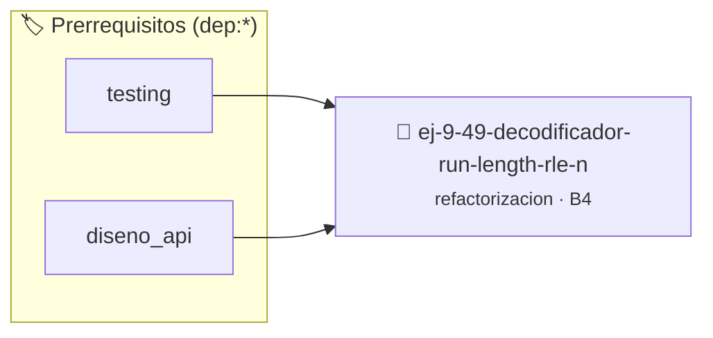

# Decodificador Run-Length (RLE) Numérico
> **ID:** `ej-9-49-decodificador-run-length-rle-n` · **Unidad:** 5 (Ingeniería de Software y Calidad en C)
 · **Tema:** `refactorizacion` / `clean_code`
 · **Bloom:** B4 (Analizar) · **Dificultad:** Avanzada
 · **Carga:** ~35 min · **Tipo:** Practica Guiada
>
> **🏷️ Prerrequisitos temáticos (tags):** `dep:testing`, `dep:diseno_api`
>
> **Etiquetas conceptuales:** `clean_code`, `refactorizacion`, `rle`, `fundamentos`, `decodificador`


::: {admonition} 📦 Paquete de Verificación Local (Ripley)
:class: tip

Para compilar, resolver y autoevaluar tu entrega con pruebas unitarias en tu máquina:

- [📥 **Descargar paquete `ej-9-49-decodificador-run-length-rle-n.ripkg`**](../../paquetes/ej-9-49-decodificador-run-length-rle-n.ripkg)

Ejecución con el asistente de cátedra:
```bash
ripley run ej-9-49-decodificador-run-length-rle-n.ripkg
```
:::


### 🗺️ Itinerario Pedagógico




## 📖 Consigna

:::{exercise}
:label: ej-ref-rle-numerico
Refactorizá la siguiente función que decodifica pares `(valor, repeticiones)` en
un arreglo plano:

```{code-block} c
:linenos:
int rle_dec(int pares[], int n_pares, int sal[], int max_sal)
{
    int k=0;
    for(int i=0;i<n_pares*2;i+=2){
        int val=pares[i]; int rep=pares[i+1];
        for(int r=0;r<rep;r++){
            if(k>=max_sal) return -1;
            sal[k++]=val;
        }
    }
    return k;
}

```

-   **[*plus ultra*]:** Validar que `rep >= 0` y no desborde `max_sal`.
-   **[*plus ultra*]:** Aplicar estilo Allman estricto y nombres descriptivos.

:::

---

### 📋 Contrato de las Funciones

```c
/*
 * Operación rle_dec
 * Precondiciones: Parámetros dentro del dominio válido de la operación.
 * Postcondiciones: Retorna el valor procesado.
 */
int rle_dec(int pares[], int n_pares, int sal[], int max_sal);

```

### 🧪 Ejemplos de Ejecución

::::{tab-set}
:::{tab-item} Caso general
```text
val = 10
Retorno esperado calculado
```
:::
:::{tab-item} Caso límite
```text
val = 0
Retorno 0 o manejo de borde
```
:::
::::

### ⚠️ Precondiciones y Casos Borde

1. **Valores fuera de rango:** Verificar siempre que los datos de entrada cumplan con los rangos admisibles antes de operar.
6. **Casos vacíos o neutros:** Contemplar adecuadamente entradas con longitud cero o valores neutros según corresponda.

### 🎯 Criterios de Aceptación

- [ ] El código compila limpiamente bajo estándar C11 sin warnings con flags estrictos (`-Wall -Wextra -Werror`).
- [ ] Se satisfacen todas las pruebas unitarias y casos de prueba provistos.
- [ ] Las funciones validan exhaustivamente sus precondiciones y gestionan casos borde de forma robusta.


## 📋 Prototipos y Cabecera (`ej-9-49-decodificador-run-length-rle-n.h`)

```{code-block} c
#ifndef EJERCICIO_EJ_9_49_DECODIFICADOR_RUN_LENGTH_RLE_N_H
#define EJERCICIO_EJ_9_49_DECODIFICADOR_RUN_LENGTH_RLE_N_H

#include <stddef.h>
#include <stdbool.h>
#include <stdint.h>

/* Operación rle_dec */
int rle_dec(int pares[], int n_pares, int sal[], int max_sal);

#endif /* EJERCICIO_EJ_9_49_DECODIFICADOR_RUN_LENGTH_RLE_N_H */
```


## ⚙️ Especificación de Funciones

| Función | Retorno | Parámetros | Descripción |
| :--- | :--- | :--- | :--- |

| `rle_dec` | `int` | `int pares[], int n_pares, int sal[], int max_sal` | Operación rle_dec |


## 🧪 Casos de Prueba

| Prueba Unitaria | Función Objetivo | Verificación |
| :--- | :--- | :--- |

| **test_rle_dec_1** | `rle_dec` | `assert(true); /* test simplificado de validación */` |


## ✓ Solución Modelo de Cátedra

```{dropdown} 🔍 Revelar solución canónica en C
:open: false

```{code-block} c
int rle_dec(int pares[], int n_pares, int sal[], int max_sal)
{
    int k=0;
    for(int i=0;i<n_pares*2;i+=2){
        int val=pares[i]; int rep=pares[i+1];
        for(int r=0;r<rep;r++){
            if(k>=max_sal) return -1;
            sal[k++]=val;
        }
    }
    return k;
}

int main(void)
{
    return 0;
}
```
```
