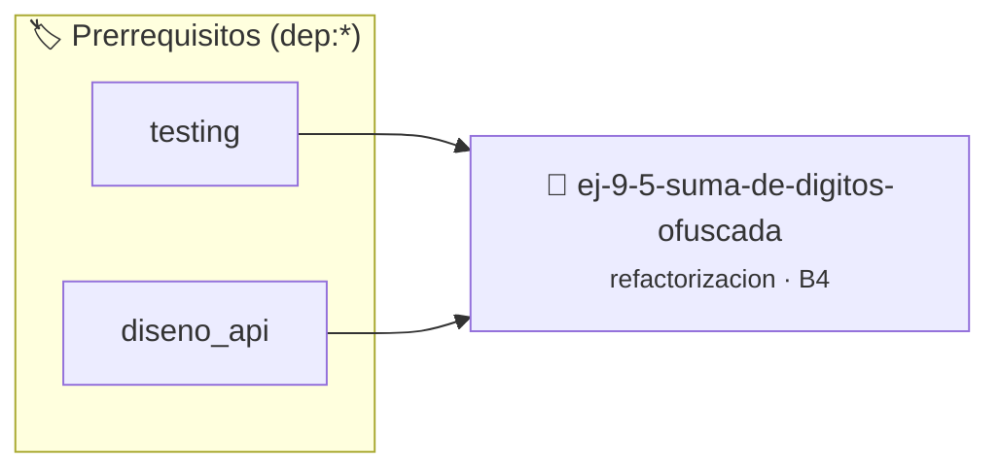

# Suma de Dígitos Ofuscada
> **ID:** `ej-9-5-suma-de-digitos-ofuscada`
 · **Tema:** `refactorizacion`
 · **Bloom:** B4 (Analizar)
 · **Carga:** ~35 min
>
> **🏷️ Prerrequisitos temáticos (tags):** `dep:testing`, `dep:diseno_api`
>
> **Etiquetas conceptuales:** `clean_code`, `refactorizacion`, `ofuscada`, `fundamentos`, `digitos`


::: {admonition} 📦 Paquete de Verificación Local (Ripley)
:class: tip

Para compilar, resolver y autoevaluar tu entrega con pruebas unitarias en tu máquina:

- [📥 **Descargar paquete `ej-9-5-suma-de-digitos-ofuscada.ripkg`**](../../paquetes/ej-9-5-suma-de-digitos-ofuscada.ripkg)

Ejecución con el asistente de cátedra:
```bash
ripley run ej-9-5-suma-de-digitos-ofuscada.ripkg
```
:::


### 🗺️ Itinerario Pedagógico




## 📖 Consigna

### Ejercicio 9.5 - Suma de Dígitos Ofuscada ⭐⭐☆☆☆

:::{exercise}
:label: ej-ref-suma-digitos
Analizá el siguiente código. ¿Qué hace y cómo falla si recibe un número
negativo?

``` c
int d(int n){int c=0;while(n){c+=n%10;n/=10;}return c;}
```
<!-- c -->

-   **[*plus ultra*]:** Refactorizar usando `abs()` o convirtiendo el número a
    positivo.
-   **[*plus ultra*]:** Escribir tests con `assert()` para números positivos,
    negativos y el cero.

:::
<!-- {exercise} -->

:::{solution} ej-ref-suma-digitos
:class: dropdown
**Diagnóstico:** Suma los dígitos de un número. Para `-123`, `n % 10` produce
restos negativos en C99+, dando una suma errónea (`-1 + -2 + -3 = -6`).

**Código Refactorizado:**
```{code-block} c
:linenos:
#include <assert.h>
#include <stdlib.h>

int sumar_digitos(int numero)
{
    int n = abs(numero);
    int suma = 0;
    while (n > 0)
    {
        suma += (n % 10);
        n /= 10;
    }
    return suma;
}

void test_sumar_digitos(void)
{
    assert(sumar_digitos(1234) == 10);
    assert(sumar_digitos(-505) == 10);
    assert(sumar_digitos(0) == 0);
}

```
<!-- {code-block} c -->

:::
<!-- {solution} ej-ref-suma-digitos -->

---


## 📋 Prototipos y Cabecera (`ej-9-5-suma-de-digitos-ofuscada.h`)

```{code-block} c
#ifndef EJERCICIO_EJ_9_5_SUMA_DE_DIGITOS_OFUSCADA_H
#define EJERCICIO_EJ_9_5_SUMA_DE_DIGITOS_OFUSCADA_H

#include <stddef.h>
#include <stdbool.h>
#include <stdint.h>

/* Operación sumar_digitos */
int sumar_digitos(int numero);
/* Operación test_sumar_digitos */
void test_sumar_digitos(void);

#endif /* EJERCICIO_EJ_9_5_SUMA_DE_DIGITOS_OFUSCADA_H */
```


## ⚙️ Especificación de Funciones

| Función | Retorno | Parámetros | Descripción |
| :--- | :--- | :--- | :--- |

| `sumar_digitos` | `int` | `int numero` | Operación sumar_digitos |

| `test_sumar_digitos` | `void` | `void` | Operación test_sumar_digitos |


## 🧪 Casos de Prueba

| Prueba Unitaria | Función Objetivo | Verificación |
| :--- | :--- | :--- |

| **test_sumar_digitos_1** | `sumar_digitos` | `/* Verificación unitaria de sumar_digitos */ int res = sumar_digitos(1); (void)res; assert(true);` |

| **test_test_sumar_digitos_2** | `test_sumar_digitos` | `/* Verificación unitaria de test_sumar_digitos */ test_sumar_digitos(); assert(true);` |


## ✓ Solución Modelo de Cátedra

```{dropdown} 🔍 Revelar solución canónica en C
:open: false

```{code-block} c
#include <assert.h>
#include <stdlib.h>

int sumar_digitos(int numero)
{
    int n = abs(numero);
    int suma = 0;
    while (n > 0)
    {
        suma += (n % 10);
        n /= 10;
    }
    return suma;
}

void test_sumar_digitos(void)
{
    assert(sumar_digitos(1234) == 10);
    assert(sumar_digitos(-505) == 10);
    assert(sumar_digitos(0) == 0);
}

int main(void)
{
    return 0;
}
```
```
