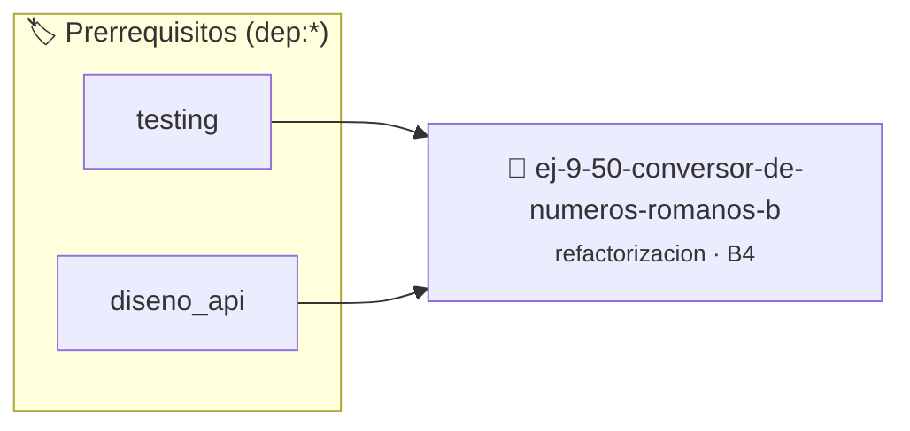

# Conversor de Números Romanos Básicos
> **ID:** `ej-9-50-conversor-de-numeros-romanos-b` · **Unidad:** 5 (Ingeniería de Software y Calidad en C)
 · **Tema:** `refactorizacion` / `clean_code`
 · **Bloom:** B4 (Analizar) · **Dificultad:** Avanzada
 · **Carga:** ~35 min · **Tipo:** Practica Guiada
>
> **🏷️ Prerrequisitos temáticos (tags):** `dep:testing`, `dep:diseno_api`
>
> **Etiquetas conceptuales:** `clean_code`, `conversor`, `refactorizacion`, `romanos`, `fundamentos`


::: {admonition} 📦 Paquete de Verificación Local (Ripley)
:class: tip

Para compilar, resolver y autoevaluar tu entrega con pruebas unitarias en tu máquina:

- [📥 **Descargar paquete `ej-9-50-conversor-de-numeros-romanos-b.ripkg`**](../../paquetes/ej-9-50-conversor-de-numeros-romanos-b.ripkg)

Ejecución con el asistente de cátedra:
```bash
ripley run ej-9-50-conversor-de-numeros-romanos-b.ripkg
```
:::


### 🗺️ Itinerario Pedagógico




## 📖 Consigna

:::{exercise}
:label: ej-ref-romanos-basicos
Refactorizá la siguiente función que convierte un carácter romano individual a
su valor numérico:

``` c
int r2d(char c){if(c=='I')return 1;if(c=='V')return 5;if(c=='X')return 10;if(c=='L')return 50;if(c=='C')return 100;if(c=='D')return 500;if(c=='M')return 1000;return 0;}
```

-   **[*plus ultra*]:** Refactorizar a un `switch` con cláusula `default`
    retornando `-1` ante error ([Regla
    0x1003h](../../reglas/1_control.md#0x1003h)).
-   **[*plus ultra*]:** Escribir tests unitarios con `assert()`.

:::

:::{solution} ej-ref-romanos-basicos
:class: dropdown
**Código Refactorizado:**
```{code-block} c
:linenos:
#include <assert.h>

int obtener_valor_simbolo_romano(char simbolo)
{
    switch (simbolo)
    {
        case 'I':
            return 1;
        case 'V':
            return 5;
        case 'X':
            return 10;
        case 'L':
            return 50;
        case 'C':
            return 100;
        case 'D':
            return 500;
        case 'M':
            return 1000;
        default:
            return -1;
    }
}

void test_simbolos_romanos(void)
{
    assert(obtener_valor_simbolo_romano('X') == 10);
    assert(obtener_valor_simbolo_romano('M') == 1000);
    assert(obtener_valor_simbolo_romano('A') == -1);
}

```

:::

---

### 📋 Contrato de las Funciones

```c
/*
 * Operación obtener_valor_simbolo_romano
 * Precondiciones: Parámetros dentro del dominio válido de la operación.
 * Postcondiciones: Retorna el valor procesado.
 */
int obtener_valor_simbolo_romano(char simbolo);

/*
 * Operación test_simbolos_romanos
 * Precondiciones: Parámetros dentro del dominio válido de la operación.
 * Postcondiciones: Retorna el valor procesado.
 */
void test_simbolos_romanos(void);

```

### 🧪 Ejemplos de Ejecución

::::{tab-set}
:::{tab-item} Valor positivo
```text
Entrada: 1
Salida / Retorno: 2
```
:::
::::

### ⚠️ Precondiciones y Casos Borde

1. **Valores fuera de rango:** Verificar siempre que los datos de entrada cumplan con los rangos admisibles antes de operar.
6. **Casos vacíos o neutros:** Contemplar adecuadamente entradas con longitud cero o valores neutros según corresponda.

### 🎯 Criterios de Aceptación

- [ ] El código compila limpiamente bajo estándar C11 sin warnings con flags estrictos (`-Wall -Wextra -Werror`).
- [ ] Se satisfacen todas las pruebas unitarias y casos de prueba provistos.
- [ ] Las funciones validan exhaustivamente sus precondiciones y gestionan casos borde de forma robusta.


## 📋 Prototipos y Cabecera (`ej-9-50-conversor-de-numeros-romanos-b.h`)

```{code-block} c
#ifndef EJERCICIO_EJ_9_50_CONVERSOR_DE_NUMEROS_ROMANOS_B_H
#define EJERCICIO_EJ_9_50_CONVERSOR_DE_NUMEROS_ROMANOS_B_H

#include <stddef.h>
#include <stdbool.h>
#include <stdint.h>

/* Operación obtener_valor_simbolo_romano */
int obtener_valor_simbolo_romano(char simbolo);
/* Operación test_simbolos_romanos */
void test_simbolos_romanos(void);

#endif /* EJERCICIO_EJ_9_50_CONVERSOR_DE_NUMEROS_ROMANOS_B_H */
```


## ⚙️ Especificación de Funciones

| Función | Retorno | Parámetros | Descripción |
| :--- | :--- | :--- | :--- |

| `obtener_valor_simbolo_romano` | `int` | `char simbolo` | Operación obtener_valor_simbolo_romano |

| `test_simbolos_romanos` | `void` | `void` | Operación test_simbolos_romanos |


## 🧪 Casos de Prueba

| Prueba Unitaria | Función Objetivo | Verificación |
| :--- | :--- | :--- |

| **test_obtener_valor_simbolo_romano_1** | `obtener_valor_simbolo_romano` | `/* Verificación unitaria de obtener_valor_simbolo_romano */ int res = obtener_valor_simbolo_romano(1); (void)res; assert(true);` |

| **test_test_simbolos_romanos_2** | `test_simbolos_romanos` | `/* Verificación unitaria de test_simbolos_romanos */ test_simbolos_romanos(); assert(true);` |


## ✓ Solución Modelo de Cátedra

```{dropdown} 🔍 Revelar solución canónica en C
:open: false

```{code-block} c
#include <assert.h>

int obtener_valor_simbolo_romano(char simbolo)
{
    switch (simbolo)
    {
        case 'I':
            return 1;
        case 'V':
            return 5;
        case 'X':
            return 10;
        case 'L':
            return 50;
        case 'C':
            return 100;
        case 'D':
            return 500;
        case 'M':
            return 1000;
        default:
            return -1;
    }
}

void test_simbolos_romanos(void)
{
    assert(obtener_valor_simbolo_romano('X') == 10);
    assert(obtener_valor_simbolo_romano('M') == 1000);
    assert(obtener_valor_simbolo_romano('A') == -1);
}

int main(void)
{
    return 0;
}
```
```
