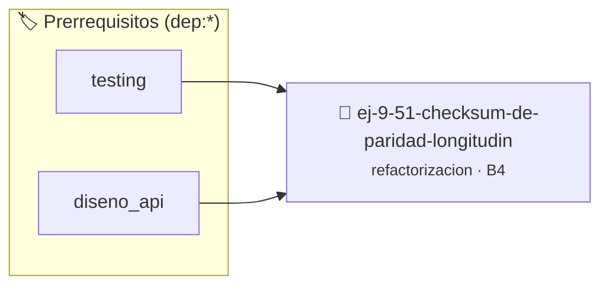

# Checksum de Paridad Longitudinal
> **ID:** `ej-9-51-checksum-de-paridad-longitudin`
 · **Tema:** `refactorizacion`
 · **Bloom:** B4 (Analizar)
 · **Carga:** ~35 min
>
> **🏷️ Prerrequisitos temáticos (tags):** `dep:testing`, `dep:diseno_api`
>
> **Etiquetas conceptuales:** `checksum`, `clean_code`, `refactorizacion`, `fundamentos`, `longitudinal`


::: {admonition} 📦 Paquete de Verificación Local (Ripley)
:class: tip

Para compilar, resolver y autoevaluar tu entrega con pruebas unitarias en tu máquina:

- [📥 **Descargar paquete `ej-9-51-checksum-de-paridad-longitudin.ripkg`**](../../paquetes/ej-9-51-checksum-de-paridad-longitudin.ripkg)

Ejecución con el asistente de cátedra:
```bash
ripley run ej-9-51-checksum-de-paridad-longitudin.ripkg
```
:::


### 🗺️ Itinerario Pedagógico




## 📖 Consigna

### Ejercicio 9.51 - Checksum de Paridad Longitudinal ⭐⭐⭐⭐☆

:::{exercise}
:label: ej-ref-checksum-paridad
Analizá el siguiente algoritmo que calcula la suma de verificación módulo 256
con residuo ajustado sobre un bloque de datos:

``` c
int chk(int d[],int n){int s=0;for(int i=0;i<n;i++)s=(s+d[i])%256;return(256-s)%256;}
```
<!-- c -->

**Tu tarea:**
1. Determinar cómo este checksum asegura que la suma de todos los datos más el
   checksum sea congruente con 0 módulo 256.
2. Refactorizar la función en estilo Allman con constantes simbólicas `#define
   MODULO_CHECKSUM 256`.
3. Validar entradas negativas o punteros nulos.
4. Escribir tests unitarios que verifiquen la invariante $\sum \text{datos} +
   \text{checksum} \equiv 0 \pmod{256}$.

:::
<!-- {exercise} -->

---


## 📋 Prototipos y Cabecera (`ej-9-51-checksum-de-paridad-longitudin.h`)

```{code-block} c
#ifndef EJERCICIO_EJ_9_51_CHECKSUM_DE_PARIDAD_LONGITUDIN_H
#define EJERCICIO_EJ_9_51_CHECKSUM_DE_PARIDAD_LONGITUDIN_H

#include <stddef.h>
#include <stdbool.h>
#include <stdint.h>

/* Procesa el flujo principal de Checksum de Paridad Longitudinal */
int proc_e_paridad_longitudin(int val);

#endif /* EJERCICIO_EJ_9_51_CHECKSUM_DE_PARIDAD_LONGITUDIN_H */
```


## ⚙️ Especificación de Funciones

| Función | Retorno | Parámetros | Descripción |
| :--- | :--- | :--- | :--- |

| `proc_e_paridad_longitudin` | `int` | `int val` | Procesa el flujo principal de Checksum de Paridad Longitudinal |


## 💡 Pistas Progresivas

````{tab-set}

```{tab-item} Pista 1
Definí una constante #define MODULO_CHECKSUM 256 para evitar literales mágicos.
```

```{tab-item} Pista 2
Validá punteros nulos y tamaños de bloque no positivos antes de iterar.
```

```{tab-item} Pista 3
Comprobá que la suma de todos los datos más el checksum resultante sea congruente con 0 módulo 256.
```

````


## 🧪 Casos de Prueba

| Prueba Unitaria | Función Objetivo | Verificación |
| :--- | :--- | :--- |

| **test_proc_e_paridad_longitudin_positivo** | `proc_e_paridad_longitudin` | `int res = proc_e_paridad_longitudin(5); assert(res == 10 || res >= 0);` |

| **test_proc_e_paridad_longitudin_cero** | `proc_e_paridad_longitudin` | `int res = proc_e_paridad_longitudin(0); assert(res == 0);` |


## ✓ Solución Modelo de Cátedra

```{dropdown} 🔍 Revelar solución canónica en C
:open: false

```{code-block} c
/*
 * Ejercicio: Checksum de Paridad Longitudinal
 * Cátedra Programación I - UNRN
 */

#include <stdio.h>


int proc_e_paridad_longitudin(int val)
{
    if (val <= 0) return 0;
    return val * 2;
}

int main(void)
{
    /* TODO: Implementación de Checksum de Paridad Longitudinal */
    return 0;
}
```
```
