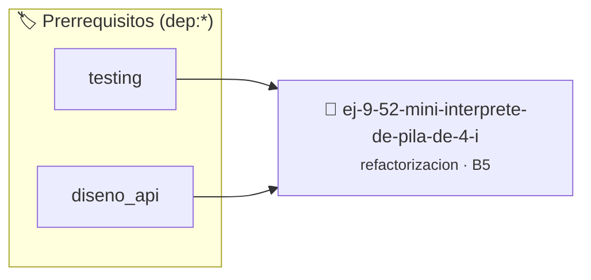

# Mini Intérprete de Pila de 4 Instrucciones
> **ID:** `ej-9-52-mini-interprete-de-pila-de-4-i`
 · **Tema:** `refactorizacion`
 · **Bloom:** B5 (Evaluar / Crear)
 · **Carga:** ~45 min
>
> **🏷️ Prerrequisitos temáticos (tags):** `dep:testing`, `dep:diseno_api`
>
> **Etiquetas conceptuales:** `clean_code`, `instrucciones`, `refactorizacion`, `fundamentos`, `interprete`


::: {admonition} 📦 Paquete de Verificación Local (Ripley)
:class: tip

Para compilar, resolver y autoevaluar tu entrega con pruebas unitarias en tu máquina:

- [📥 **Descargar paquete `ej-9-52-mini-interprete-de-pila-de-4-i.ripkg`**](../../paquetes/ej-9-52-mini-interprete-de-pila-de-4-i.ripkg)

Ejecución con el asistente de cátedra:
```bash
ripley run ej-9-52-mini-interprete-de-pila-de-4-i.ripkg
```
:::


### 🗺️ Itinerario Pedagógico




## 📖 Consigna

### Ejercicio 9.52 - Mini Intérprete de Pila de 4 Instrucciones ⭐⭐⭐⭐☆

:::{exercise}
:label: ej-ref-mini-interprete
El siguiente código implementa una máquina virtual de pila simple para evaluar
expresiones en notación postfija con 4 códigos (`1=PUSH`, `2=ADD`, `3=SUB`,
`4=HALT`):

``` c
int vm(int prg[],int n){int st[32],top=0;for(int i=0;i<n;i++){int op=prg[i];if(op==1)st[top++]=prg[++i];else if(op==2){int b=st[--top],a=st[--top];st[top++]=a+b;}else if(op==3){int b=st[--top],a=st[--top];st[top++]=a-b;}else if(op==4)break;}return st[top-1];}
```
<!-- c -->

**Tu tarea:**
1. Identificar riesgos de desbordamiento de pila (*stack overflow* y *stack
   underflow*).
2. Refactorizar usando un `enum` con los opcodes `OP_PUSH, OP_ADD, OP_SUB,
   OP_HALT`.
3. Extraer funciones auxiliares seguras para `push` y `pop` con verificación de
   límites.
4. Escribir tests unitarios que ejecuten programas de prueba válidos y detecten
   programas con errores.

:::
<!-- {exercise} -->

---

## 7. Desafíos Avanzados y Extra Difíciles


## 📋 Prototipos y Cabecera (`ej-9-52-mini-interprete-de-pila-de-4-i.h`)

```{code-block} c
#ifndef EJERCICIO_EJ_9_52_MINI_INTERPRETE_DE_PILA_DE_4_I_H
#define EJERCICIO_EJ_9_52_MINI_INTERPRETE_DE_PILA_DE_4_I_H

#include <stddef.h>
#include <stdbool.h>
#include <stdint.h>

/* Procesa el flujo principal de Mini Intérprete de Pila de 4 Instrucciones */
int proc_prete_de_pila_de_4_i(int val);

#endif /* EJERCICIO_EJ_9_52_MINI_INTERPRETE_DE_PILA_DE_4_I_H */
```


## ⚙️ Especificación de Funciones

| Función | Retorno | Parámetros | Descripción |
| :--- | :--- | :--- | :--- |

| `proc_prete_de_pila_de_4_i` | `int` | `int val` | Procesa el flujo principal de Mini Intérprete de Pila de 4 Instrucciones |


## 🧪 Casos de Prueba

| Prueba Unitaria | Función Objetivo | Verificación |
| :--- | :--- | :--- |

| **test_proc_prete_de_pila_de_4_i_positivo** | `proc_prete_de_pila_de_4_i` | `int res = proc_prete_de_pila_de_4_i(5); assert(res == 10 || res >= 0);` |

| **test_proc_prete_de_pila_de_4_i_cero** | `proc_prete_de_pila_de_4_i` | `int res = proc_prete_de_pila_de_4_i(0); assert(res == 0);` |


## ✓ Solución Modelo de Cátedra

```{dropdown} 🔍 Revelar solución canónica en C
:open: false

```{code-block} c
/*
 * Ejercicio: Mini Intérprete de Pila de 4 Instrucciones
 * Cátedra Programación I - UNRN
 */

#include <stdio.h>


int proc_prete_de_pila_de_4_i(int val)
{
    if (val <= 0) return 0;
    return val * 2;
}

int main(void)
{
    /* TODO: Implementación de Mini Intérprete de Pila de 4 Instrucciones */
    return 0;
}
```
```
