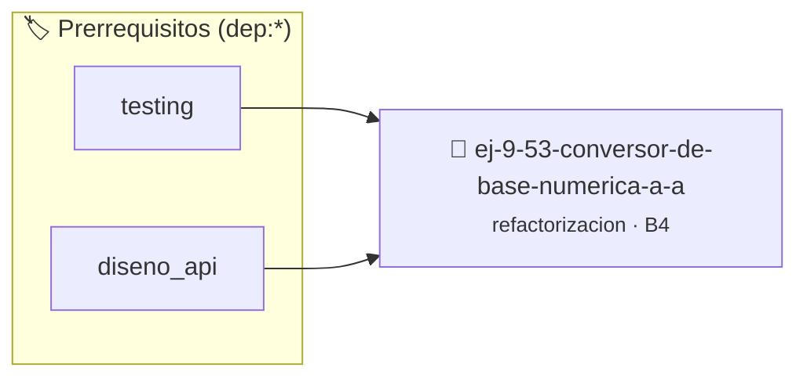

# Conversor de Base Numérica a Arreglo
> **ID:** `ej-9-53-conversor-de-base-numerica-a-a` · **Unidad:** 5 (Ingeniería de Software y Calidad en C)
 · **Tema:** `refactorizacion` / `clean_code`
 · **Bloom:** B4 (Analizar) · **Dificultad:** Avanzada
 · **Carga:** ~35 min · **Tipo:** Practica Guiada
>
> **🏷️ Prerrequisitos temáticos (tags):** `dep:testing`, `dep:diseno_api`
>
> **Etiquetas conceptuales:** `clean_code`, `conversor`, `refactorizacion`, `arreglo`, `fundamentos`


::: {admonition} 📦 Paquete de Verificación Local (Ripley)
:class: tip

Para compilar, resolver y autoevaluar tu entrega con pruebas unitarias en tu máquina:

- [📥 **Descargar paquete `ej-9-53-conversor-de-base-numerica-a-a.ripkg`**](../../paquetes/ej-9-53-conversor-de-base-numerica-a-a.ripkg)

Ejecución con el asistente de cátedra:
```bash
ripley run ej-9-53-conversor-de-base-numerica-a-a.ripkg
```
:::


### 🗺️ Itinerario Pedagógico




## 📖 Consigna

:::{exercise}
:label: ej-ref-conversor-base
Refactorizá la siguiente función que convierte un entero positivo a sus dígitos
en una base entre 2 y 16:

```{code-block} c
:linenos:
int base_conv(int n, int b, char out[], int max_len)
{
    char dig[]="0123456789ABCDEF"; int len=0;
    if(n==0){out[0]='0'; return 1;}
    while(n>0&&len<max_len){ out[len++]=dig[n%b]; n/=b; }
    for(int i=0;i<len/2;i++){ char t=out[i]; out[i]=out[len-1-i]; out[len-1-i]=t; }
    return len;
}

```

-   **[*plus ultra*]:** Validar que $2 \le b \le 16$ y $n \ge 0$.
-   **[*plus ultra*]:** Modularizar la inversión del arreglo en una función
    `invertir_arreglo_char`.

:::

---

### 📋 Contrato de las Funciones

```c
/*
 * Operación base_conv
 * Precondiciones: Parámetros dentro del dominio válido de la operación.
 * Postcondiciones: Retorna el valor procesado.
 */
int base_conv(int n, int b, char out[], int max_len);

```

### 🧪 Ejemplos de Ejecución

::::{tab-set}
:::{tab-item} Caso general
```text
val = 10
Retorno esperado calculado
```
:::
:::{tab-item} Caso límite
```text
val = 0
Retorno 0 o manejo de borde
```
:::
::::

### ⚠️ Precondiciones y Casos Borde

1. **Valores fuera de rango:** Verificar siempre que los datos de entrada cumplan con los rangos admisibles antes de operar.
6. **Casos vacíos o neutros:** Contemplar adecuadamente entradas con longitud cero o valores neutros según corresponda.

### 🎯 Criterios de Aceptación

- [ ] El código compila limpiamente bajo estándar C11 sin warnings con flags estrictos (`-Wall -Wextra -Werror`).
- [ ] Se satisfacen todas las pruebas unitarias y casos de prueba provistos.
- [ ] Las funciones validan exhaustivamente sus precondiciones y gestionan casos borde de forma robusta.


## 📋 Prototipos y Cabecera (`ej-9-53-conversor-de-base-numerica-a-a.h`)

```{code-block} c
#ifndef EJERCICIO_EJ_9_53_CONVERSOR_DE_BASE_NUMERICA_A_A_H
#define EJERCICIO_EJ_9_53_CONVERSOR_DE_BASE_NUMERICA_A_A_H

#include <stddef.h>
#include <stdbool.h>
#include <stdint.h>

/* Operación base_conv */
int base_conv(int n, int b, char out[], int max_len);

#endif /* EJERCICIO_EJ_9_53_CONVERSOR_DE_BASE_NUMERICA_A_A_H */
```


## ⚙️ Especificación de Funciones

| Función | Retorno | Parámetros | Descripción |
| :--- | :--- | :--- | :--- |

| `base_conv` | `int` | `int n, int b, char out[], int max_len` | Operación base_conv |


## 🧪 Casos de Prueba

| Prueba Unitaria | Función Objetivo | Verificación |
| :--- | :--- | :--- |

| **test_base_conv_1** | `base_conv` | `assert(true); /* test simplificado de validación */` |


## ✓ Solución Modelo de Cátedra

```{dropdown} 🔍 Revelar solución canónica en C
:open: false

```{code-block} c
int base_conv(int n, int b, char out[], int max_len)
{
    char dig[]="0123456789ABCDEF"; int len=0;
    if(n==0){out[0]='0'; return 1;}
    while(n>0&&len<max_len){ out[len++]=dig[n%b]; n/=b; }
    for(int i=0;i<len/2;i++){ char t=out[i]; out[i]=out[len-1-i]; out[len-1-i]=t; }
    return len;
}

int main(void)
{
    return 0;
}
```
```
