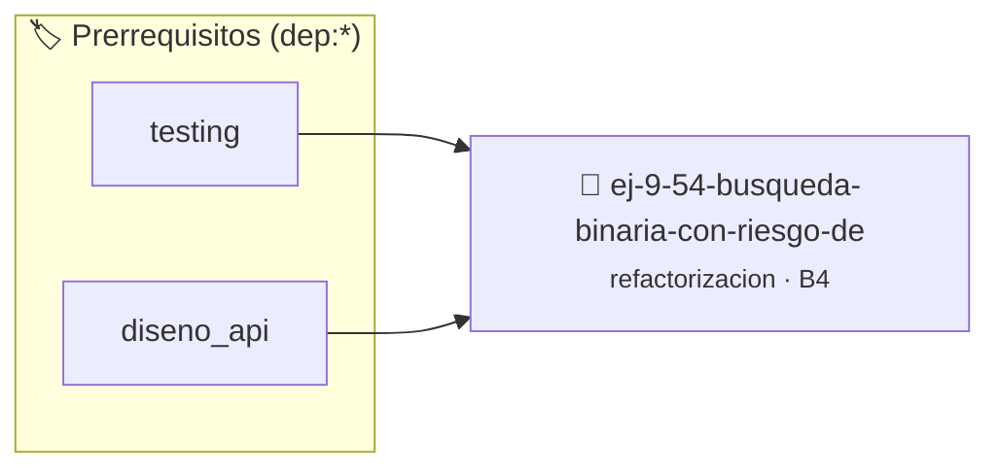

# Búsqueda Binaria con Riesgo de Desbordamiento
> **ID:** `ej-9-54-busqueda-binaria-con-riesgo-de`
 · **Tema:** `refactorizacion`
 · **Bloom:** B4 (Analizar)
 · **Carga:** ~35 min
>
> **🏷️ Prerrequisitos temáticos (tags):** `dep:testing`, `dep:diseno_api`
>
> **Etiquetas conceptuales:** `clean_code`, `refactorizacion`, `fundamentos`, `busqueda`, `desbordamiento`


::: {admonition} 📦 Paquete de Verificación Local (Ripley)
:class: tip

Para compilar, resolver y autoevaluar tu entrega con pruebas unitarias en tu máquina:

- [📥 **Descargar paquete `ej-9-54-busqueda-binaria-con-riesgo-de.ripkg`**](../../paquetes/ej-9-54-busqueda-binaria-con-riesgo-de.ripkg)

Ejecución con el asistente de cátedra:
```bash
ripley run ej-9-54-busqueda-binaria-con-riesgo-de.ripkg
```
:::


### 🗺️ Itinerario Pedagógico




## 📖 Consigna

### Ejercicio 9.54 - Búsqueda Binaria con Riesgo de Desbordamiento ⭐⭐⭐☆☆

:::{exercise}
:label: ej-ref-busqueda-binaria-overflow
El siguiente código implementa búsqueda binaria pero utiliza el cálculo riesgoso
`int m = (l + r) / 2` que puede desbordar enteros grandes:

``` c
int bsearch(int a[],int n,int x){int l=0,r=n-1;while(l<=r){int m=(l+r)/2;if(a[m]==x)return m;if(a[m]<x)l=m+1;else r=m-1;}return -1;}
```
<!-- c -->

-   **[*plus ultra*]:** Reemplazar por `int medio = l + (r - l) / 2;`.
-   **[*plus ultra*]:** Agregar `const` al arreglo y formatear en Allman.

:::
<!-- {exercise} -->

---


## 📋 Prototipos y Cabecera (`ej-9-54-busqueda-binaria-con-riesgo-de.h`)

```{code-block} c
#ifndef EJERCICIO_EJ_9_54_BUSQUEDA_BINARIA_CON_RIESGO_DE_H
#define EJERCICIO_EJ_9_54_BUSQUEDA_BINARIA_CON_RIESGO_DE_H

#include <stddef.h>
#include <stdbool.h>
#include <stdint.h>

/* Procesa el flujo principal de Búsqueda Binaria con Riesgo de Desbordamiento */
int proc_inaria_con_riesgo_de(int val);

#endif /* EJERCICIO_EJ_9_54_BUSQUEDA_BINARIA_CON_RIESGO_DE_H */
```


## ⚙️ Especificación de Funciones

| Función | Retorno | Parámetros | Descripción |
| :--- | :--- | :--- | :--- |

| `proc_inaria_con_riesgo_de` | `int` | `int val` | Procesa el flujo principal de Búsqueda Binaria con Riesgo de Desbordamiento |


## 🧪 Casos de Prueba

| Prueba Unitaria | Función Objetivo | Verificación |
| :--- | :--- | :--- |

| **test_proc_inaria_con_riesgo_de_positivo** | `proc_inaria_con_riesgo_de` | `int res = proc_inaria_con_riesgo_de(5); assert(res == 10 || res >= 0);` |

| **test_proc_inaria_con_riesgo_de_cero** | `proc_inaria_con_riesgo_de` | `int res = proc_inaria_con_riesgo_de(0); assert(res == 0);` |


## ✓ Solución Modelo de Cátedra

```{dropdown} 🔍 Revelar solución canónica en C
:open: false

```{code-block} c
/*
 * Ejercicio: Búsqueda Binaria con Riesgo de Desbordamiento
 * Cátedra Programación I - UNRN
 */

#include <stdio.h>


int proc_inaria_con_riesgo_de(int val)
{
    if (val <= 0) return 0;
    return val * 2;
}

int main(void)
{
    /* TODO: Implementación de Búsqueda Binaria con Riesgo de Desbordamiento */
    return 0;
}
```
```
