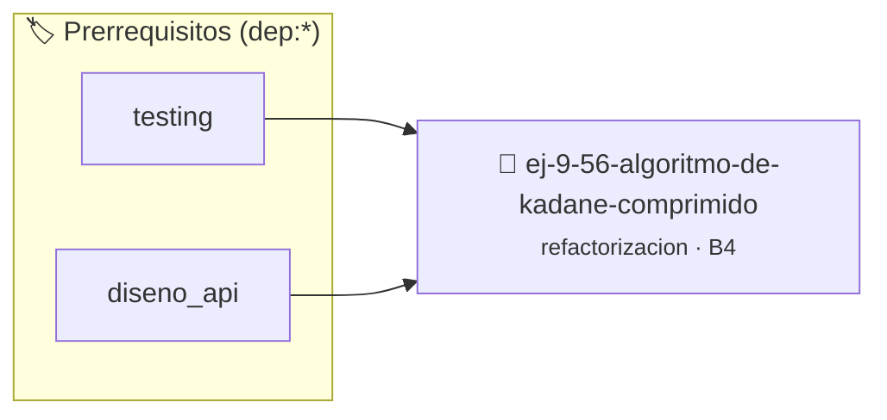

# Algoritmo de Kadane Comprimido
> **ID:** `ej-9-56-algoritmo-de-kadane-comprimido` · **Unidad:** 5 (Ingeniería de Software y Calidad en C)
 · **Tema:** `refactorizacion` / `clean_code`
 · **Bloom:** B4 (Analizar) · **Dificultad:** Avanzada
 · **Carga:** ~35 min · **Tipo:** Practica Guiada
>
> **🏷️ Prerrequisitos temáticos (tags):** `dep:testing`, `dep:diseno_api`
>
> **Etiquetas conceptuales:** `clean_code`, `refactorizacion`, `fundamentos`, `comprimido`, `kadane`


::: {admonition} 📦 Paquete de Verificación Local (Ripley)
:class: tip

Para compilar, resolver y autoevaluar tu entrega con pruebas unitarias en tu máquina:

- [📥 **Descargar paquete `ej-9-56-algoritmo-de-kadane-comprimido.ripkg`**](../../paquetes/ej-9-56-algoritmo-de-kadane-comprimido.ripkg)

Ejecución con el asistente de cátedra:
```bash
ripley run ej-9-56-algoritmo-de-kadane-comprimido.ripkg
```
:::


### 🗺️ Itinerario Pedagógico




## 📖 Consigna

### Ejercicio 9.56 - Algoritmo de Kadane Comprimido ⭐⭐⭐⭐☆

:::{exercise}
:label: ej-ref-kadane-comprimido
Analizá el siguiente algoritmo que calcula la suma máxima de un subarreglo
contiguo (Algoritmo de Kadane) en una sola línea ofuscada:

``` c
int kad(int a[],int n){int m=a[0],c=a[0];for(int i=1;i<n;i++)c=(a[i]>c+a[i])?a[i]:c+a[i],m=(c>m)?c:m;return m;}
```
<!-- c -->

**Tu tarea:**
1. Eliminar los operadores ternarios y el operador coma `,`.
2. Escribir la lógica en estilo Allman con nombres claros (`maximo_global,
   maximo_actual`).
3. Validar que $N > 0$ y puntero no nulo.
4. Escribir tests unitarios para arreglos con números positivos, negativos y
   mixtos (ej. `{-2, 1, -3, 4, -1, 2, 1, -5, 4}` da `6`).

:::
<!-- {exercise} -->

---


## 📋 Prototipos y Cabecera (`ej-9-56-algoritmo-de-kadane-comprimido.h`)

```{code-block} c
#ifndef EJERCICIO_EJ_9_56_ALGORITMO_DE_KADANE_COMPRIMIDO_H
#define EJERCICIO_EJ_9_56_ALGORITMO_DE_KADANE_COMPRIMIDO_H

#include <stddef.h>
#include <stdbool.h>
#include <stdint.h>

/* Procesa el flujo principal de Algoritmo de Kadane Comprimido */
int proc_de_kadane_comprimido(int val);

#endif /* EJERCICIO_EJ_9_56_ALGORITMO_DE_KADANE_COMPRIMIDO_H */
```


## ⚙️ Especificación de Funciones

| Función | Retorno | Parámetros | Descripción |
| :--- | :--- | :--- | :--- |

| `proc_de_kadane_comprimido` | `int` | `int val` | Procesa el flujo principal de Algoritmo de Kadane Comprimido |


## 🧪 Casos de Prueba

| Prueba Unitaria | Función Objetivo | Verificación |
| :--- | :--- | :--- |

| **test_proc_de_kadane_comprimido_positivo** | `proc_de_kadane_comprimido` | `int res = proc_de_kadane_comprimido(5); assert(res == 10 || res >= 0);` |

| **test_proc_de_kadane_comprimido_cero** | `proc_de_kadane_comprimido` | `int res = proc_de_kadane_comprimido(0); assert(res == 0);` |


## ✓ Solución Modelo de Cátedra

```{dropdown} 🔍 Revelar solución canónica en C
:open: false

```{code-block} c
/*
 * Ejercicio: Algoritmo de Kadane Comprimido
 * Cátedra Programación I - UNRN
 */

#include <stdio.h>


int proc_de_kadane_comprimido(int val)
{
    if (val <= 0) return 0;
    return val * 2;
}

int main(void)
{
    /* TODO: Implementación de Algoritmo de Kadane Comprimido */
    return 0;
}
```
```
