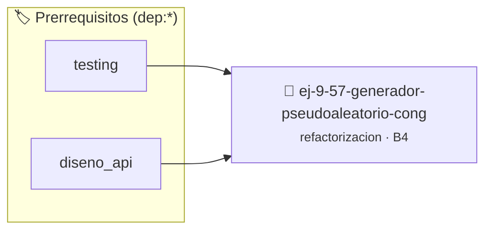

# Generador Pseudoaleatorio Congruencial (LCG)
> **ID:** `ej-9-57-generador-pseudoaleatorio-cong`
 · **Tema:** `refactorizacion`
 · **Bloom:** B4 (Analizar)
 · **Carga:** ~35 min
>
> **🏷️ Prerrequisitos temáticos (tags):** `dep:testing`, `dep:diseno_api`
>
> **Etiquetas conceptuales:** `clean_code`, `refactorizacion`, `congruencial`, `fundamentos`, `pseudoaleatorio`


::: {admonition} 📦 Paquete de Verificación Local (Ripley)
:class: tip

Para compilar, resolver y autoevaluar tu entrega con pruebas unitarias en tu máquina:

- [📥 **Descargar paquete `ej-9-57-generador-pseudoaleatorio-cong.ripkg`**](../../paquetes/ej-9-57-generador-pseudoaleatorio-cong.ripkg)

Ejecución con el asistente de cátedra:
```bash
ripley run ej-9-57-generador-pseudoaleatorio-cong.ripkg
```
:::


### 🗺️ Itinerario Pedagógico




## 📖 Consigna

### Ejercicio 9.57 - Generador Pseudoaleatorio Congruencial (LCG) ⭐⭐⭐☆☆

:::{exercise}
:label: ej-ref-lcg-pseudoaleatorio
Refactorizá la siguiente función que genera el siguiente número pseudoaleatorio
usando la fórmula $X_{n+1} = (a X_n + c) \pmod m$:

``` c
int lcg(int seed){return(seed*1103515245+12345)&0x7FFFFFFF;}
```
<!-- c -->

-   **[*plus ultra*]:** Reemplazar constantes mágicas por `#define
    LCG_MULTIPLICADOR` y `#define LCG_INCREMENTO`.
-   **[*plus ultra*]:** Diseñar la función pura `int
    generar_siguiente_aleatorio(int semilla_actual)`.

:::
<!-- {exercise} -->

---


## 📋 Prototipos y Cabecera (`ej-9-57-generador-pseudoaleatorio-cong.h`)

```{code-block} c
#ifndef EJERCICIO_EJ_9_57_GENERADOR_PSEUDOALEATORIO_CONG_H
#define EJERCICIO_EJ_9_57_GENERADOR_PSEUDOALEATORIO_CONG_H

#include <stddef.h>
#include <stdbool.h>
#include <stdint.h>

/* Procesa el flujo principal de Generador Pseudoaleatorio Congruencial (LCG) */
int proc_pseudoaleatorio_cong(int val);

#endif /* EJERCICIO_EJ_9_57_GENERADOR_PSEUDOALEATORIO_CONG_H */
```


## ⚙️ Especificación de Funciones

| Función | Retorno | Parámetros | Descripción |
| :--- | :--- | :--- | :--- |

| `proc_pseudoaleatorio_cong` | `int` | `int val` | Procesa el flujo principal de Generador Pseudoaleatorio Congruencial (LCG) |


## 🧪 Casos de Prueba

| Prueba Unitaria | Función Objetivo | Verificación |
| :--- | :--- | :--- |

| **test_proc_pseudoaleatorio_cong_positivo** | `proc_pseudoaleatorio_cong` | `int res = proc_pseudoaleatorio_cong(5); assert(res == 10 || res >= 0);` |

| **test_proc_pseudoaleatorio_cong_cero** | `proc_pseudoaleatorio_cong` | `int res = proc_pseudoaleatorio_cong(0); assert(res == 0);` |


## ✓ Solución Modelo de Cátedra

```{dropdown} 🔍 Revelar solución canónica en C
:open: false

```{code-block} c
/*
 * Ejercicio: Generador Pseudoaleatorio Congruencial (LCG)
 * Cátedra Programación I - UNRN
 */

#include <stdio.h>


int proc_pseudoaleatorio_cong(int val)
{
    if (val <= 0) return 0;
    return val * 2;
}

int main(void)
{
    /* TODO: Implementación de Generador Pseudoaleatorio Congruencial (LCG) */
    return 0;
}
```
```
