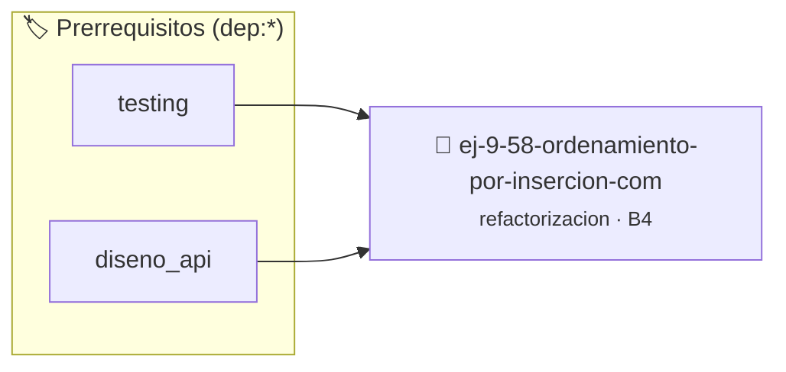

# Ordenamiento por Inserción Compacto
> **ID:** `ej-9-58-ordenamiento-por-insercion-com` · **Unidad:** 5 (Ingeniería de Software y Calidad en C)
 · **Tema:** `refactorizacion` / `ordenamiento_insercion`
 · **Bloom:** B4 (Analizar) · **Dificultad:** Avanzada
 · **Carga:** ~35 min · **Tipo:** Practica Guiada
>
> **🏷️ Prerrequisitos temáticos (tags):** `dep:testing`, `dep:diseno_api`
>
> **Etiquetas conceptuales:** `clean_code`, `refactorizacion`, `fundamentos`, `compacto`, `ordenamiento`


::: {admonition} 📦 Paquete de Verificación Local (Ripley)
:class: tip

Para compilar, resolver y autoevaluar tu entrega con pruebas unitarias en tu máquina:

- [📥 **Descargar paquete `ej-9-58-ordenamiento-por-insercion-com.ripkg`**](../../paquetes/ej-9-58-ordenamiento-por-insercion-com.ripkg)

Ejecución con el asistente de cátedra:
```bash
ripley run ej-9-58-ordenamiento-por-insercion-com.ripkg
```
:::


### 🗺️ Itinerario Pedagógico




## 📖 Consigna

:::{exercise}
:label: ej-ref-insercion-compacto
Refactorizá la siguiente implementación de Insertion Sort:

``` c
void isort(int a[],int n){for(int i=1;i<n;i++){int k=a[i],j=i-1;while(j>=0&&a[j]>k){a[j+1]=a[j];j--;}a[j+1]=k;}}
```

**Tu tarea:**
1. Formatear en estilo Allman con llaves explícitas en todos los bloques.
2. Renombrar variables (`elemento_clave, indice_anterior`).
3. Escribir tests unitarios que validen el orden no decreciente del arreglo tras
   la ejecución.

:::

---

### 📋 Contrato de las Funciones

```c
/*
 * Procesa el flujo principal de Ordenamiento por Inserción Compacto
 * Precondiciones: val representa el parámetro de entrada del flujo.
 * Postcondiciones: Retorna el resultado correspondiente o 0 si val <= 0.
 */
int proc_to_por_insercion_com(int val);

```

### 🧪 Ejemplos de Ejecución

::::{tab-set}
:::{tab-item} Valor positivo
```text
Entrada: 5
Salida / Retorno: 10
```
:::
:::{tab-item} Valor cero o negativo
```text
Entrada: 0
Salida / Retorno: 0
```
:::
::::

### ⚠️ Precondiciones y Casos Borde

1. **Valores fuera de rango:** Verificar siempre que los datos de entrada cumplan con los rangos admisibles antes de operar.
6. **Casos vacíos o neutros:** Contemplar adecuadamente entradas con longitud cero o valores neutros según corresponda.

### 🎯 Criterios de Aceptación

- [ ] El código compila limpiamente bajo estándar C11 sin warnings con flags estrictos (`-Wall -Wextra -Werror`).
- [ ] Se satisfacen todas las pruebas unitarias y casos de prueba provistos.
- [ ] Las funciones validan exhaustivamente sus precondiciones y gestionan casos borde de forma robusta.

:::{hint} Consideraciones Didácticas
- Estructurá los bloques de control con llaves explícitas y sangría consistente estilo Allman.
- Renombrá las variables crípticas por nombres descriptivos como elemento_clave e indice_anterior.
- Asegurate de que el lazo interno respete el límite inferior indice_anterior >= 0.
:::


## 📋 Prototipos y Cabecera (`ej-9-58-ordenamiento-por-insercion-com.h`)

```{code-block} c
#ifndef EJERCICIO_EJ_9_58_ORDENAMIENTO_POR_INSERCION_COM_H
#define EJERCICIO_EJ_9_58_ORDENAMIENTO_POR_INSERCION_COM_H

#include <stddef.h>
#include <stdbool.h>
#include <stdint.h>

/* Procesa el flujo principal de Ordenamiento por Inserción Compacto */
int proc_to_por_insercion_com(int val);

#endif /* EJERCICIO_EJ_9_58_ORDENAMIENTO_POR_INSERCION_COM_H */
```


## ⚙️ Especificación de Funciones

| Función | Retorno | Parámetros | Descripción |
| :--- | :--- | :--- | :--- |

| `proc_to_por_insercion_com` | `int` | `int val` | Procesa el flujo principal de Ordenamiento por Inserción Compacto |


## 💡 Pistas Progresivas

````{tab-set}

```{tab-item} Pista 1
Estructurá los bloques de control con llaves explícitas y sangría consistente estilo Allman.
```

```{tab-item} Pista 2
Renombrá las variables crípticas por nombres descriptivos como elemento_clave e indice_anterior.
```

```{tab-item} Pista 3
Asegurate de que el lazo interno respete el límite inferior indice_anterior >= 0.
```

````


## 🧪 Casos de Prueba

| Prueba Unitaria | Función Objetivo | Verificación |
| :--- | :--- | :--- |

| **test_proc_to_por_insercion_com_positivo** | `proc_to_por_insercion_com` | `int res = proc_to_por_insercion_com(5); assert(res == 10 || res >= 0);` |

| **test_proc_to_por_insercion_com_cero** | `proc_to_por_insercion_com` | `int res = proc_to_por_insercion_com(0); assert(res == 0);` |


## ✓ Solución Modelo de Cátedra

```{dropdown} 🔍 Revelar solución canónica en C
:open: false

```{code-block} c
/*
 * Ejercicio: Ordenamiento por Inserción Compacto
 * Cátedra Programación I - UNRN
 */

#include <stdio.h>


int proc_to_por_insercion_com(int val)
{
    if (val <= 0) return 0;
    return val * 2;
}

int main(void)
{
    /* TODO: Implementación de Ordenamiento por Inserción Compacto */
    return 0;
}
```
```
