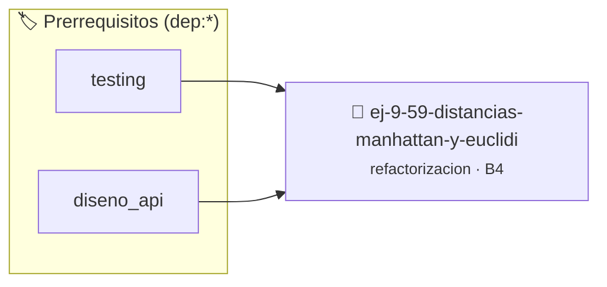

# Distancias Manhattan y Euclidiana Todo-en-Uno
> **ID:** `ej-9-59-distancias-manhattan-y-euclidi`
 · **Tema:** `refactorizacion`
 · **Bloom:** B4 (Analizar)
 · **Carga:** ~35 min
>
> **🏷️ Prerrequisitos temáticos (tags):** `dep:testing`, `dep:diseno_api`
>
> **Etiquetas conceptuales:** `clean_code`, `refactorizacion`, `fundamentos`, `todo-en-uno`, `distancias`


::: {admonition} 📦 Paquete de Verificación Local (Ripley)
:class: tip

Para compilar, resolver y autoevaluar tu entrega con pruebas unitarias en tu máquina:

- [📥 **Descargar paquete `ej-9-59-distancias-manhattan-y-euclidi.ripkg`**](../../paquetes/ej-9-59-distancias-manhattan-y-euclidi.ripkg)

Ejecución con el asistente de cátedra:
```bash
ripley run ej-9-59-distancias-manhattan-y-euclidi.ripkg
```
:::


### 🗺️ Itinerario Pedagógico




## 📖 Consigna

### Ejercicio 9.59 - Distancias Manhattan y Euclidiana Todo-en-Uno ⭐⭐⭐⭐☆

:::{exercise}
:label: ej-ref-distancias-vectores
Refactorizá la siguiente función que calcula distancias entre dos vectores de
$N$ dimensiones según un selector de modo:

``` c
double dist(double a[],double b[],int n,int m){double s=0;for(int i=0;i<n;i++){double d=fabs(a[i]-b[i]);s+=(m==1)?d:d*d;}return(m==1)?s:sqrt(s);}
```
<!-- c -->

**Tu tarea:**
1. Descomponer en dos funciones puras independientes:
   `calcular_distancia_manhattan` y `calcular_distancia_euclidiana`.
2. Eliminar el parámetro selector `m` y los operadores ternarios.
3. Escribir tests unitarios con `assert()` comparando con tolerancia `1e-6`.

:::
<!-- {exercise} -->

---


## 📋 Prototipos y Cabecera (`ej-9-59-distancias-manhattan-y-euclidi.h`)

```{code-block} c
#ifndef EJERCICIO_EJ_9_59_DISTANCIAS_MANHATTAN_Y_EUCLIDI_H
#define EJERCICIO_EJ_9_59_DISTANCIAS_MANHATTAN_Y_EUCLIDI_H

#include <stddef.h>
#include <stdbool.h>
#include <stdint.h>

/* Procesa el flujo principal de Distancias Manhattan y Euclidiana Todo-en-Uno */
int proc__manhattan_y_euclidi(int val);

#endif /* EJERCICIO_EJ_9_59_DISTANCIAS_MANHATTAN_Y_EUCLIDI_H */
```


## ⚙️ Especificación de Funciones

| Función | Retorno | Parámetros | Descripción |
| :--- | :--- | :--- | :--- |

| `proc__manhattan_y_euclidi` | `int` | `int val` | Procesa el flujo principal de Distancias Manhattan y Euclidiana Todo-en-Uno |


## 💡 Pistas Progresivas

````{tab-set}

```{tab-item} Pista 1
Dividí la función multipropósito en calcular_distancia_manhattan y calcular_distancia_euclidiana.
```

```{tab-item} Pista 2
Eliminá el parámetro selector de modo y las bifurcaciones innecesarias dentro de los lazos.
```

```{tab-item} Pista 3
Usá fabs() para diferencias absolutas y sqrt() junto con sumas de cuadrados para la norma euclídea.
```

````


## 🧪 Casos de Prueba

| Prueba Unitaria | Función Objetivo | Verificación |
| :--- | :--- | :--- |

| **test_proc__manhattan_y_euclidi_positivo** | `proc__manhattan_y_euclidi` | `int res = proc__manhattan_y_euclidi(5); assert(res == 10 || res >= 0);` |

| **test_proc__manhattan_y_euclidi_cero** | `proc__manhattan_y_euclidi` | `int res = proc__manhattan_y_euclidi(0); assert(res == 0);` |


## ✓ Solución Modelo de Cátedra

```{dropdown} 🔍 Revelar solución canónica en C
:open: false

```{code-block} c
/*
 * Ejercicio: Distancias Manhattan y Euclidiana Todo-en-Uno
 * Cátedra Programación I - UNRN
 */

#include <stdio.h>


int proc__manhattan_y_euclidi(int val)
{
    if (val <= 0) return 0;
    return val * 2;
}

int main(void)
{
    /* TODO: Implementación de Distancias Manhattan y Euclidiana Todo-en-Uno */
    return 0;
}
```
```
