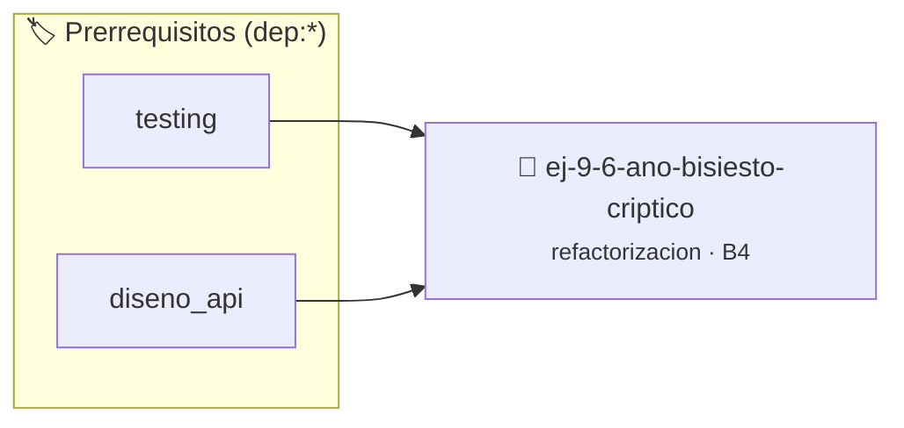

# Año Bisiesto Críptico
> **ID:** `ej-9-6-ano-bisiesto-criptico` · **Unidad:** 5 (Ingeniería de Software y Calidad en C)
 · **Tema:** `refactorizacion` / `clean_code`
 · **Bloom:** B4 (Analizar) · **Dificultad:** Avanzada
 · **Carga:** ~35 min · **Tipo:** Practica Guiada
>
> **🏷️ Prerrequisitos temáticos (tags):** `dep:testing`, `dep:diseno_api`
>
> **Etiquetas conceptuales:** `clean_code`, `refactorizacion`, `criptico`, `fundamentos`, `bisiesto`


::: {admonition} 📦 Paquete de Verificación Local (Ripley)
:class: tip

Para compilar, resolver y autoevaluar tu entrega con pruebas unitarias en tu máquina:

- [📥 **Descargar paquete `ej-9-6-ano-bisiesto-criptico.ripkg`**](../../paquetes/ej-9-6-ano-bisiesto-criptico.ripkg)

Ejecución con el asistente de cátedra:
```bash
ripley run ej-9-6-ano-bisiesto-criptico.ripkg
```
:::


### 🗺️ Itinerario Pedagógico




## 📖 Consigna

:::{exercise}
:label: ej-ref-bisiesto-criptico
El siguiente código evalúa años bisiestos en una sola línea condensada sin
validar años negativos:

``` c
bool b(int y){return(y%4==0&&y%100!=0)||(y%400==0);}
```

-   **[*plus ultra*]:** Refactorizar con cláusula de guarda para años $\le 0$.
-   **[*plus ultra*]:** Escribir una suite con tests unitarios separados para
    cada rama de decisión.

:::

:::{solution} ej-ref-bisiesto-criptico
:class: dropdown
**Código Refactorizado:**
```{code-block} c
:linenos:
#include <assert.h>
#include <stdbool.h>

bool es_anio_bisiesto(int anio)
{
    if (anio <= 0)
    {
        return false;
    }
    bool es_div_4 = (anio % 4 == 0);
    bool es_div_100 = (anio % 100 == 0);
    bool es_div_400 = (anio % 400 == 0);

    return (es_div_4 && !es_div_100) || es_div_400;
}

void test_es_anio_bisiesto(void)
{
    assert(es_anio_bisiesto(2024) == true);
    assert(es_anio_bisiesto(2023) == false);
    assert(es_anio_bisiesto(1900) == false);
    assert(es_anio_bisiesto(2000) == true);
    assert(es_anio_bisiesto(-4) == false);
}

```

:::

---

### 📋 Contrato de las Funciones

```c
/*
 * Operación es_anio_bisiesto
 * Precondiciones: Parámetros dentro del dominio válido de la operación.
 * Postcondiciones: Retorna el valor procesado.
 */
bool es_anio_bisiesto(int anio);

/*
 * Operación test_es_anio_bisiesto
 * Precondiciones: Parámetros dentro del dominio válido de la operación.
 * Postcondiciones: Retorna el valor procesado.
 */
void test_es_anio_bisiesto(void);

```

### 🧪 Ejemplos de Ejecución

::::{tab-set}
:::{tab-item} Valor positivo
```text
Entrada: 1
Salida / Retorno: 2
```
:::
::::

### ⚠️ Precondiciones y Casos Borde

1. **Valores fuera de rango:** Verificar siempre que los datos de entrada cumplan con los rangos admisibles antes de operar.
6. **Casos vacíos o neutros:** Contemplar adecuadamente entradas con longitud cero o valores neutros según corresponda.

### 🎯 Criterios de Aceptación

- [ ] El código compila limpiamente bajo estándar C11 sin warnings con flags estrictos (`-Wall -Wextra -Werror`).
- [ ] Se satisfacen todas las pruebas unitarias y casos de prueba provistos.
- [ ] Las funciones validan exhaustivamente sus precondiciones y gestionan casos borde de forma robusta.


## 📋 Prototipos y Cabecera (`ej-9-6-ano-bisiesto-criptico.h`)

```{code-block} c
#ifndef EJERCICIO_EJ_9_6_ANO_BISIESTO_CRIPTICO_H
#define EJERCICIO_EJ_9_6_ANO_BISIESTO_CRIPTICO_H

#include <stddef.h>
#include <stdbool.h>
#include <stdint.h>

/* Operación es_anio_bisiesto */
bool es_anio_bisiesto(int anio);
/* Operación test_es_anio_bisiesto */
void test_es_anio_bisiesto(void);

#endif /* EJERCICIO_EJ_9_6_ANO_BISIESTO_CRIPTICO_H */
```


## ⚙️ Especificación de Funciones

| Función | Retorno | Parámetros | Descripción |
| :--- | :--- | :--- | :--- |

| `es_anio_bisiesto` | `bool` | `int anio` | Operación es_anio_bisiesto |

| `test_es_anio_bisiesto` | `void` | `void` | Operación test_es_anio_bisiesto |


## 🧪 Casos de Prueba

| Prueba Unitaria | Función Objetivo | Verificación |
| :--- | :--- | :--- |

| **test_es_anio_bisiesto_1** | `es_anio_bisiesto` | `/* Verificación unitaria de es_anio_bisiesto */ bool ok = es_anio_bisiesto(1); (void)ok; assert(true);` |

| **test_test_es_anio_bisiesto_2** | `test_es_anio_bisiesto` | `/* Verificación unitaria de test_es_anio_bisiesto */ test_es_anio_bisiesto(); assert(true);` |


## ✓ Solución Modelo de Cátedra

```{dropdown} 🔍 Revelar solución canónica en C
:open: false

```{code-block} c
#include <assert.h>
#include <stdbool.h>

bool es_anio_bisiesto(int anio)
{
    if (anio <= 0)
    {
        return false;
    }
    bool es_div_4 = (anio % 4 == 0);
    bool es_div_100 = (anio % 100 == 0);
    bool es_div_400 = (anio % 400 == 0);

    return (es_div_4 && !es_div_100) || es_div_400;
}

void test_es_anio_bisiesto(void)
{
    assert(es_anio_bisiesto(2024) == true);
    assert(es_anio_bisiesto(2023) == false);
    assert(es_anio_bisiesto(1900) == false);
    assert(es_anio_bisiesto(2000) == true);
    assert(es_anio_bisiesto(-4) == false);
}

int main(void)
{
    return 0;
}
```
```
