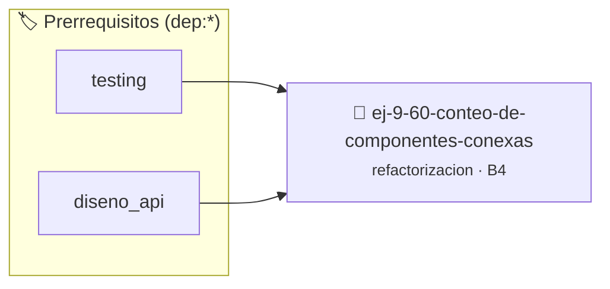

# Conteo de Componentes Conexas 1D
> **ID:** `ej-9-60-conteo-de-componentes-conexas` · **Unidad:** 5 (Ingeniería de Software y Calidad en C)
 · **Tema:** `refactorizacion` / `conexas`
 · **Bloom:** B4 (Analizar) · **Dificultad:** Avanzada
 · **Carga:** ~35 min · **Tipo:** Practica Guiada
>
> **🏷️ Prerrequisitos temáticos (tags):** `dep:testing`, `dep:diseno_api`
>
> **Etiquetas conceptuales:** `conexas`, `clean_code`, `refactorizacion`, `fundamentos`, `componentes`


::: {admonition} 📦 Paquete de Verificación Local (Ripley)
:class: tip

Para compilar, resolver y autoevaluar tu entrega con pruebas unitarias en tu máquina:

- [📥 **Descargar paquete `ej-9-60-conteo-de-componentes-conexas.ripkg`**](../../paquetes/ej-9-60-conteo-de-componentes-conexas.ripkg)

Ejecución con el asistente de cátedra:
```bash
ripley run ej-9-60-conteo-de-componentes-conexas.ripkg
```
:::


### 🗺️ Itinerario Pedagógico




## 📖 Consigna

### Ejercicio 9.60 - Conteo de Componentes Conexas 1D ⭐⭐⭐⭐☆

:::{exercise}
:label: ej-ref-componentes-conexas-1d
El siguiente código cuenta cuántas secuencias continuas de números positivos
existen en un arreglo:

``` c
int comp1d(int a[],int n){int c=0,in=0;for(int i=0;i<n;i++){if(a[i]>0&&!in){c++;in=1;}else if(a[i]<=0){in=0;}}return c;}
```
<!-- c -->

**Tu tarea:**
1. Refactorizar aplicando estilo Allman y nombres booleanos claros
   (`en_segmento_positivo`).
2. Validar casos de borde: todo positivo, todo negativo, arreglo vacío.
3. Escribir tests unitarios estructurados.

:::
<!-- {exercise} -->

---


## 📋 Prototipos y Cabecera (`ej-9-60-conteo-de-componentes-conexas.h`)

```{code-block} c
#ifndef EJERCICIO_EJ_9_60_CONTEO_DE_COMPONENTES_CONEXAS_H
#define EJERCICIO_EJ_9_60_CONTEO_DE_COMPONENTES_CONEXAS_H

#include <stddef.h>
#include <stdbool.h>
#include <stdint.h>

/* Procesa el flujo principal de Conteo de Componentes Conexas 1D */
int proc__componentes_conexas(int val);

#endif /* EJERCICIO_EJ_9_60_CONTEO_DE_COMPONENTES_CONEXAS_H */
```


## ⚙️ Especificación de Funciones

| Función | Retorno | Parámetros | Descripción |
| :--- | :--- | :--- | :--- |

| `proc__componentes_conexas` | `int` | `int val` | Procesa el flujo principal de Conteo de Componentes Conexas 1D |


## 💡 Pistas Progresivas

````{tab-set}

```{tab-item} Pista 1
Utilizá una bandera booleana en_segmento_positivo para rastrear cuándo se transita un componente.
```

```{tab-item} Pista 2
Incrementá el contador únicamente al entrar a un nuevo segmento positivo.
```

```{tab-item} Pista 3
Validá casos de borde: arreglo vacío (n=0), todos números positivos y todos números negativos.
```

````


## 🧪 Casos de Prueba

| Prueba Unitaria | Función Objetivo | Verificación |
| :--- | :--- | :--- |

| **test_proc__componentes_conexas_positivo** | `proc__componentes_conexas` | `int res = proc__componentes_conexas(5); assert(res == 10 || res >= 0);` |

| **test_proc__componentes_conexas_cero** | `proc__componentes_conexas` | `int res = proc__componentes_conexas(0); assert(res == 0);` |


## ✓ Solución Modelo de Cátedra

```{dropdown} 🔍 Revelar solución canónica en C
:open: false

```{code-block} c
/*
 * Ejercicio: Conteo de Componentes Conexas 1D
 * Cátedra Programación I - UNRN
 */

#include <stdio.h>


int proc__componentes_conexas(int val)
{
    if (val <= 0) return 0;
    return val * 2;
}

int main(void)
{
    /* TODO: Implementación de Conteo de Componentes Conexas 1D */
    return 0;
}
```
```
