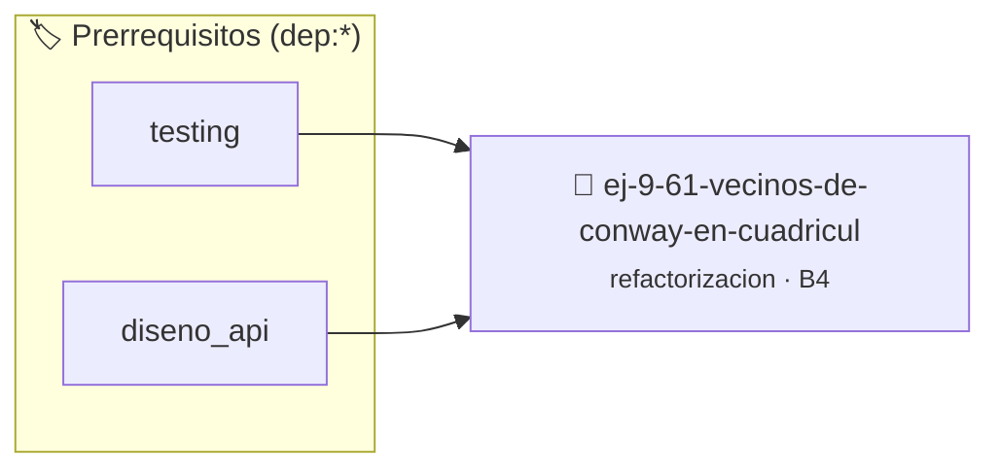

# Vecinos de Conway en Cuadrícula $5 \times 5$
> **ID:** `ej-9-61-vecinos-de-conway-en-cuadricul` · **Unidad:** 5 (Ingeniería de Software y Calidad en C)
 · **Tema:** `refactorizacion` / `clean_code`
 · **Bloom:** B4 (Analizar) · **Dificultad:** Avanzada
 · **Carga:** ~35 min · **Tipo:** Practica Guiada
>
> **🏷️ Prerrequisitos temáticos (tags):** `dep:testing`, `dep:diseno_api`
>
> **Etiquetas conceptuales:** `clean_code`, `vecinos`, `refactorizacion`, `times`, `fundamentos`


::: {admonition} 📦 Paquete de Verificación Local (Ripley)
:class: tip

Para compilar, resolver y autoevaluar tu entrega con pruebas unitarias en tu máquina:

- [📥 **Descargar paquete `ej-9-61-vecinos-de-conway-en-cuadricul.ripkg`**](../../paquetes/ej-9-61-vecinos-de-conway-en-cuadricul.ripkg)

Ejecución con el asistente de cátedra:
```bash
ripley run ej-9-61-vecinos-de-conway-en-cuadricul.ripkg
```
:::


### 🗺️ Itinerario Pedagógico




## 📖 Consigna

### Ejercicio 9.61 - Vecinos de Conway en Cuadrícula $5 \times 5$ ⭐⭐⭐⭐☆

:::{exercise}
:label: ej-ref-conway-vecinos
Analizá y refactorizá la siguiente función que cuenta los vecinos vivos (valor
1) alrededor de una celda $(r, c)$ en una cuadrícula $5 \times 5$:

``` c
int nb(int g[25],int r,int c){int cnt=0;for(int dr=-1;dr<=1;dr++)for(int dc=-1;dc<=1;dc++){if(!dr&&!dc)continue;int nr=r+dr,nc=c+dc;if(nr>=0&&nr<5&&nc>=0&&nc<5)cnt+=g[nr*5+nc];}return cnt;}
```
<!-- c -->

**Tu tarea:**
1. Formatear la doble iteración en estilo Allman.
2. Definir constantes `#define GRILLA_DIMENSION 5`.
3. Extraer la función `bool esta_dentro_de_grilla(int fila, int columna)`.
4. Escribir tests con `assert()` para celdas esquinas, bordes y centrales.

:::
<!-- {exercise} -->

---


## 📋 Prototipos y Cabecera (`ej-9-61-vecinos-de-conway-en-cuadricul.h`)

```{code-block} c
#ifndef EJERCICIO_EJ_9_61_VECINOS_DE_CONWAY_EN_CUADRICUL_H
#define EJERCICIO_EJ_9_61_VECINOS_DE_CONWAY_EN_CUADRICUL_H

#include <stddef.h>
#include <stdbool.h>
#include <stdint.h>

/* Procesa el flujo principal de Vecinos de Conway en Cuadrícula $5 \times 5$ */
int proc__conway_en_cuadricul(int val);

#endif /* EJERCICIO_EJ_9_61_VECINOS_DE_CONWAY_EN_CUADRICUL_H */
```


## ⚙️ Especificación de Funciones

| Función | Retorno | Parámetros | Descripción |
| :--- | :--- | :--- | :--- |

| `proc__conway_en_cuadricul` | `int` | `int val` | Procesa el flujo principal de Vecinos de Conway en Cuadrícula $5 \times 5$ |


## 🧪 Casos de Prueba

| Prueba Unitaria | Función Objetivo | Verificación |
| :--- | :--- | :--- |

| **test_proc__conway_en_cuadricul_positivo** | `proc__conway_en_cuadricul` | `int res = proc__conway_en_cuadricul(5); assert(res == 10 || res >= 0);` |

| **test_proc__conway_en_cuadricul_cero** | `proc__conway_en_cuadricul` | `int res = proc__conway_en_cuadricul(0); assert(res == 0);` |


## ✓ Solución Modelo de Cátedra

```{dropdown} 🔍 Revelar solución canónica en C
:open: false

```{code-block} c
/*
 * Ejercicio: Vecinos de Conway en Cuadrícula $5 \times 5$
 * Cátedra Programación I - UNRN
 */

#include <stdio.h>


int proc__conway_en_cuadricul(int val)
{
    if (val <= 0) return 0;
    return val * 2;
}

int main(void)
{
    /* TODO: Implementación de Vecinos de Conway en Cuadrícula $5 \times 5$ */
    return 0;
}
```
```
