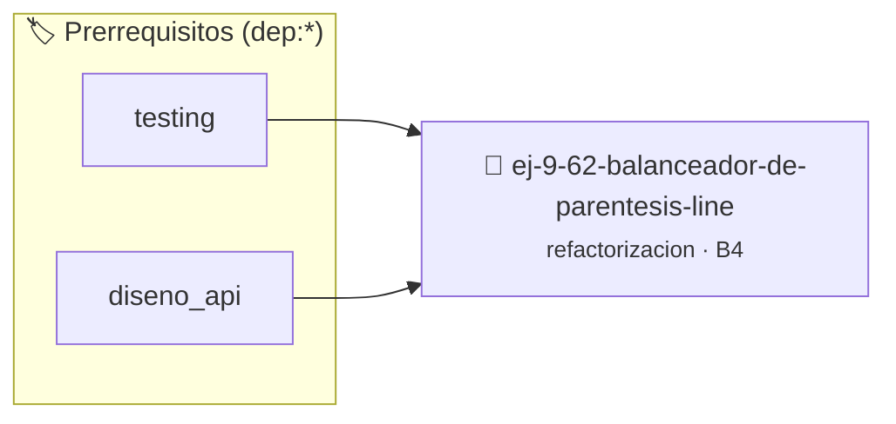

# Balanceador de Paréntesis Lineal
> **ID:** `ej-9-62-balanceador-de-parentesis-line`
 · **Tema:** `refactorizacion`
 · **Bloom:** B4 (Analizar)
 · **Carga:** ~35 min
>
> **🏷️ Prerrequisitos temáticos (tags):** `dep:testing`, `dep:diseno_api`
>
> **Etiquetas conceptuales:** `clean_code`, `lineal`, `refactorizacion`, `fundamentos`, `balanceador`


::: {admonition} 📦 Paquete de Verificación Local (Ripley)
:class: tip

Para compilar, resolver y autoevaluar tu entrega con pruebas unitarias en tu máquina:

- [📥 **Descargar paquete `ej-9-62-balanceador-de-parentesis-line.ripkg`**](../../paquetes/ej-9-62-balanceador-de-parentesis-line.ripkg)

Ejecución con el asistente de cátedra:
```bash
ripley run ej-9-62-balanceador-de-parentesis-line.ripkg
```
:::


### 🗺️ Itinerario Pedagógico




## 📖 Consigna

### Ejercicio 9.62 - Balanceador de Paréntesis Lineal ⭐⭐⭐⭐☆

:::{exercise}
:label: ej-ref-parentesis-balanceados
Refactorizá la siguiente función que verifica si los paréntesis `(` y `)` de una
cadena están correctamente balanceados:

``` c
int bal(char s[],int n){int d=0;for(int i=0;i<n;i++){if(s[i]=='(')d++;else if(s[i]==')'){d--;if(d<0)return 0;}}return(d==0)?1:0;}
```
<!-- c -->

**Tu tarea:**
1. Eliminar el operador ternario y retornar un `bool`.
2. Validar que un cierre sin apertura previa (`d < 0`) corte inmediatamente
   retornando `false`.
3. Escribir tests unitarios para `"(())"`, `"())("`, `"("` y `""`.

:::
<!-- {exercise} -->

---


## 📋 Prototipos y Cabecera (`ej-9-62-balanceador-de-parentesis-line.h`)

```{code-block} c
#ifndef EJERCICIO_EJ_9_62_BALANCEADOR_DE_PARENTESIS_LINE_H
#define EJERCICIO_EJ_9_62_BALANCEADOR_DE_PARENTESIS_LINE_H

#include <stddef.h>
#include <stdbool.h>
#include <stdint.h>

/* Procesa el flujo principal de Balanceador de Paréntesis Lineal */
int proc_r_de_parentesis_line(int val);

#endif /* EJERCICIO_EJ_9_62_BALANCEADOR_DE_PARENTESIS_LINE_H */
```


## ⚙️ Especificación de Funciones

| Función | Retorno | Parámetros | Descripción |
| :--- | :--- | :--- | :--- |

| `proc_r_de_parentesis_line` | `int` | `int val` | Procesa el flujo principal de Balanceador de Paréntesis Lineal |


## 🧪 Casos de Prueba

| Prueba Unitaria | Función Objetivo | Verificación |
| :--- | :--- | :--- |

| **test_proc_r_de_parentesis_line_positivo** | `proc_r_de_parentesis_line` | `int res = proc_r_de_parentesis_line(5); assert(res == 10 || res >= 0);` |

| **test_proc_r_de_parentesis_line_cero** | `proc_r_de_parentesis_line` | `int res = proc_r_de_parentesis_line(0); assert(res == 0);` |


## ✓ Solución Modelo de Cátedra

```{dropdown} 🔍 Revelar solución canónica en C
:open: false

```{code-block} c
/*
 * Ejercicio: Balanceador de Paréntesis Lineal
 * Cátedra Programación I - UNRN
 */

#include <stdio.h>


int proc_r_de_parentesis_line(int val)
{
    if (val <= 0) return 0;
    return val * 2;
}

int main(void)
{
    /* TODO: Implementación de Balanceador de Paréntesis Lineal */
    return 0;
}
```
```
