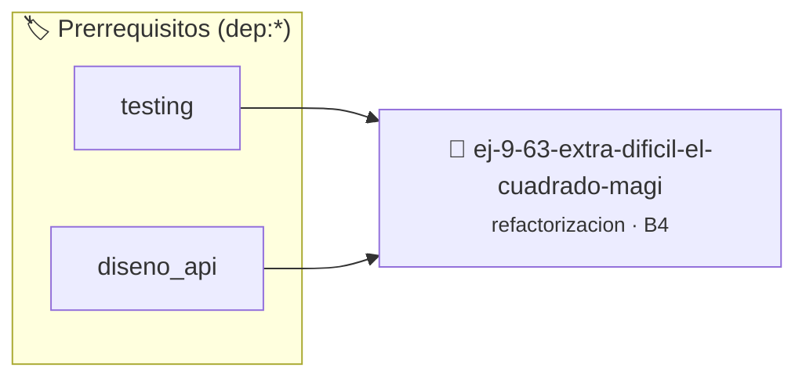

# [EXTRA DIFÍCIL] El Cuadrado Mágico y Verificador de Sudoku $3 \times 3$
> **ID:** `ej-9-63-extra-dificil-el-cuadrado-magi` · **Unidad:** 5 (Ingeniería de Software y Calidad en C)
 · **Tema:** `refactorizacion` / `clean_code`
 · **Bloom:** B4 (Analizar) · **Dificultad:** Avanzada
 · **Carga:** ~35 min · **Tipo:** Practica Guiada
>
> **🏷️ Prerrequisitos temáticos (tags):** `dep:testing`, `dep:diseno_api`
>
> **Etiquetas conceptuales:** `clean_code`, `refactorizacion`, `times`, `fundamentos`, `sudoku`


::: {admonition} 📦 Paquete de Verificación Local (Ripley)
:class: tip

Para compilar, resolver y autoevaluar tu entrega con pruebas unitarias en tu máquina:

- [📥 **Descargar paquete `ej-9-63-extra-dificil-el-cuadrado-magi.ripkg`**](../../paquetes/ej-9-63-extra-dificil-el-cuadrado-magi.ripkg)

Ejecución con el asistente de cátedra:
```bash
ripley run ej-9-63-extra-dificil-el-cuadrado-magi.ripkg
```
:::


### 🗺️ Itinerario Pedagógico




## 📖 Consigna

### Ejercicio 9.63 - [EXTRA DIFÍCIL] El Cuadrado Mágico y Verificador de Sudoku $3 \times 3$ ⭐⭐⭐⭐⭐

:::{exercise}
:label: ej-ref-cuadrado-magico-sudoku
El siguiente código evalúa si una matriz $3 \times 3$ plana de 9 elementos
contiene exactamente los dígitos del 1 al 9 sin repetir y si las sumas de todas
sus filas, columnas y diagonales son iguales a 15 (Cuadrado Mágico / Mini
Sudoku):

``` c
int sm(int m[9]){int u[10]={0},s=0;for(int i=0;i<9;i++){int v=m[i];if(v<1||v>9||u[v])return 0;u[v]=1;}for(int i=0;i<3;i++){int r=m[i*3]+m[i*3+1]+m[i*3+2],c=m[i]+m[i+3]+m[i+6];if(r!=15||c!=15)return 0;}int d1=m[0]+m[4]+m[8],d2=m[2]+m[4]+m[6];return(d1==15&&d2==15)?1:0;}
```
<!-- c -->

**Tu tarea:**
1. Desarmar la lógica monolítica identificando los tres pasos:
   - Verificación de permutación de dígitos 1 a 9.
   - Verificación de sumas de las 3 filas y 3 columnas igual a 15.
   - Verificación de las 2 diagonales igual a 15.
2. Descomponer el algoritmo en funciones auxiliares puras y modulares:
   - `bool contiene_digitos_1_a_9_unicos(const int matriz[9])`
   - `bool verificar_filas_y_columnas_magicas(const int matriz[9], int
     suma_esperada)`
   - `bool verificar_diagonales_magicas(const int matriz[9], int suma_esperada)`
   - `bool es_cuadrado_magico_3x3(const int matriz[9])`
3. Aplicar estilo Allman riguroso, constantes `#define CONSTANTE_MAGICA_3X3 15`
   y contratos Doxygen.
4. Escribir una suite de pruebas con `assert()` para el cuadrado mágico clásico
   de Lo Shu:
   $$\begin{pmatrix} 4 & 9 & 2 \\ 3 & 5 & 7 \\ 8 & 1 & 6 \end{pmatrix}$$

:::
<!-- {exercise} -->

---


## 📋 Prototipos y Cabecera (`ej-9-63-extra-dificil-el-cuadrado-magi.h`)

```{code-block} c
#ifndef EJERCICIO_EJ_9_63_EXTRA_DIFICIL_EL_CUADRADO_MAGI_H
#define EJERCICIO_EJ_9_63_EXTRA_DIFICIL_EL_CUADRADO_MAGI_H

#include <stddef.h>
#include <stdbool.h>
#include <stdint.h>

/* Procesa el flujo principal de [EXTRA DIFÍCIL] El Cuadrado Mágico y Verificador de Sudoku $3 \times 3$ */
int proc_cil_el_cuadrado_magi(int val);

#endif /* EJERCICIO_EJ_9_63_EXTRA_DIFICIL_EL_CUADRADO_MAGI_H */
```


## ⚙️ Especificación de Funciones

| Función | Retorno | Parámetros | Descripción |
| :--- | :--- | :--- | :--- |

| `proc_cil_el_cuadrado_magi` | `int` | `int val` | Procesa el flujo principal de [EXTRA DIFÍCIL] El Cuadrado Mágico y Verificador de Sudoku $3 \times 3$ |


## 🧪 Casos de Prueba

| Prueba Unitaria | Función Objetivo | Verificación |
| :--- | :--- | :--- |

| **test_proc_cil_el_cuadrado_magi_positivo** | `proc_cil_el_cuadrado_magi` | `int res = proc_cil_el_cuadrado_magi(5); assert(res == 10 || res >= 0);` |

| **test_proc_cil_el_cuadrado_magi_cero** | `proc_cil_el_cuadrado_magi` | `int res = proc_cil_el_cuadrado_magi(0); assert(res == 0);` |


## ✓ Solución Modelo de Cátedra

```{dropdown} 🔍 Revelar solución canónica en C
:open: false

```{code-block} c
/*
 * Ejercicio: [EXTRA DIFÍCIL] El Cuadrado Mágico y Verificador de Sudoku $3 \times 3$
 * Cátedra Programación I - UNRN
 */

#include <stdio.h>


int proc_cil_el_cuadrado_magi(int val)
{
    if (val <= 0) return 0;
    return val * 2;
}

int main(void)
{
    /* TODO: Implementación de [EXTRA DIFÍCIL] El Cuadrado Mágico y Verificador de Sudoku $3 \times 3$ */
    return 0;
}
```
```
