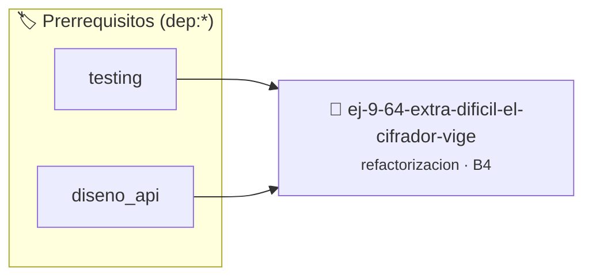

# [EXTRA DIFÍCIL] El Cifrador Vigenère Aritmético Cripto-Comprimido
> **ID:** `ej-9-64-extra-dificil-el-cifrador-vige` · **Unidad:** 5 (Ingeniería de Software y Calidad en C)
 · **Tema:** `refactorizacion` / `clean_code`
 · **Bloom:** B4 (Analizar) · **Dificultad:** Avanzada
 · **Carga:** ~35 min · **Tipo:** Practica Guiada
>
> **🏷️ Prerrequisitos temáticos (tags):** `dep:testing`, `dep:diseno_api`
>
> **Etiquetas conceptuales:** `clean_code`, `cifrador`, `refactorizacion`, `cripto-comprimido`, `fundamentos`


::: {admonition} 📦 Paquete de Verificación Local (Ripley)
:class: tip

Para compilar, resolver y autoevaluar tu entrega con pruebas unitarias en tu máquina:

- [📥 **Descargar paquete `ej-9-64-extra-dificil-el-cifrador-vige.ripkg`**](../../paquetes/ej-9-64-extra-dificil-el-cifrador-vige.ripkg)

Ejecución con el asistente de cátedra:
```bash
ripley run ej-9-64-extra-dificil-el-cifrador-vige.ripkg
```
:::


### 🗺️ Itinerario Pedagógico




## 📖 Consigna

### Ejercicio 9.64 - [EXTRA DIFÍCIL] El Cifrador Vigenère Aritmético Cripto-Comprimido ⭐⭐⭐⭐⭐

:::{exercise}
:label: ej-ref-vigenere-aritmetico
Analizá el siguiente bloque de código. Aplica el cifrado de Vigenère sobre un
arreglo de caracteres usando una clave alfabética repetida, ajustando las letras
mayúsculas y minúsculas módulo 26, pero fue condensado en 5 líneas de
expresiones confusas:

``` c
void vig(char t[],int n,char k[],int m,int dec){for(int i=0,j=0;i<n;i++){char c=t[i];if((c>='A'&&c<='Z')||(c>='a'&&c<='z')){int base=(c>='a')?'a':'A';int kbase=(k[j%m]>='a')?'a':'A';int sh=k[j%m]-kbase;if(dec)sh=26-(sh%26);t[i]=(char)(base+((c-base+sh)%26));j++;}}}
```
<!-- c -->

**Tu tarea:**
1. Desentrañar la aritmética modular del desplazamiento tanto para cifrado (`dec
   = 0`) como para descifrado (`dec = 1`).
2. Identificar todos los code smells (ternarios anidados, falta de llaves
   Allman, nombres mudos `t, n, k, m, dec, sh`).
3. Refactorizar el algoritmo en funciones puras y desacopladas:
   - `char desplazar_caracter(char c, int desplazamiento, bool descifrar)`
   - `int obtener_desplazamiento_clave(char c_clave)`
   - `void cifrar_vigenere(char texto[], int long_texto, const char clave[], int
     long_clave)`
   - `void descifrar_vigenere(char texto[], int long_texto, const char clave[],
     int long_clave)`
4. Escribir una suite completa de pruebas unitarias con `assert()` que verifique
   que descifrar un texto cifrado recupere exactamente el mensaje original
   (propiedad de reversibilidad).

:::
<!-- {exercise} -->

---

## Notas Finales

:::{tip} Criterios de Calidad para una Buena Refactorización

- **Preservación del comportamiento:** Todo refactor debe garantizar que los
  resultados matemáticos y lógicos sean idénticos a los del código original.
- **Auto-documentación:** La combinación de nombres descriptivos en `snake_case`
  y funciones con responsabilidad única hace que el código se explique por sí
  mismo sin necesidad de comentarios redundantes.
- **Cobertura con pruebas:** Toda función refactorizada debe acompañarse de su
  respectiva función de prueba automatizada con `assert()`.

:::
<!-- {tip} Criterios de Calidad para una Buena Refactorización -->


## 📋 Prototipos y Cabecera (`ej-9-64-extra-dificil-el-cifrador-vige.h`)

```{code-block} c
#ifndef EJERCICIO_EJ_9_64_EXTRA_DIFICIL_EL_CIFRADOR_VIGE_H
#define EJERCICIO_EJ_9_64_EXTRA_DIFICIL_EL_CIFRADOR_VIGE_H

#include <stddef.h>
#include <stdbool.h>
#include <stdint.h>

/* Procesa el flujo principal de [EXTRA DIFÍCIL] El Cifrador Vigenère Aritmético Cripto-Comprimido */
int proc_cil_el_cifrador_vige(int val);

#endif /* EJERCICIO_EJ_9_64_EXTRA_DIFICIL_EL_CIFRADOR_VIGE_H */
```


## ⚙️ Especificación de Funciones

| Función | Retorno | Parámetros | Descripción |
| :--- | :--- | :--- | :--- |

| `proc_cil_el_cifrador_vige` | `int` | `int val` | Procesa el flujo principal de [EXTRA DIFÍCIL] El Cifrador Vigenère Aritmético Cripto-Comprimido |


## 💡 Pistas Progresivas

````{tab-set}

```{tab-item} Pista 1
**Preservación del comportamiento:** Todo refactor debe garantizar que los resultados matemáticos y lógicos sean idénticos a los del código original.
```

```{tab-item} Pista 2
**Auto-documentación:** La combinación de nombres descriptivos en `snake_case` y funciones con responsabilidad única hace que el código se explique por sí mismo sin necesidad de comentarios redundantes.
```

```{tab-item} Pista 3
**Cobertura con pruebas:** Toda función refactorizada debe acompañarse de su respectiva función de prueba automatizada con `assert()`.
```

````


## 🧪 Casos de Prueba

| Prueba Unitaria | Función Objetivo | Verificación |
| :--- | :--- | :--- |

| **test_proc_cil_el_cifrador_vige_positivo** | `proc_cil_el_cifrador_vige` | `int res = proc_cil_el_cifrador_vige(5); assert(res == 10 || res >= 0);` |

| **test_proc_cil_el_cifrador_vige_cero** | `proc_cil_el_cifrador_vige` | `int res = proc_cil_el_cifrador_vige(0); assert(res == 0);` |


## ✓ Solución Modelo de Cátedra

```{dropdown} 🔍 Revelar solución canónica en C
:open: false

```{code-block} c
/*
 * Ejercicio: [EXTRA DIFÍCIL] El Cifrador Vigenère Aritmético Cripto-Comprimido
 * Cátedra Programación I - UNRN
 */

#include <stdio.h>


int proc_cil_el_cifrador_vige(int val)
{
    if (val <= 0) return 0;
    return val * 2;
}

int main(void)
{
    /* TODO: Implementación de [EXTRA DIFÍCIL] El Cifrador Vigenère Aritmético Cripto-Comprimido */
    return 0;
}
```
```
