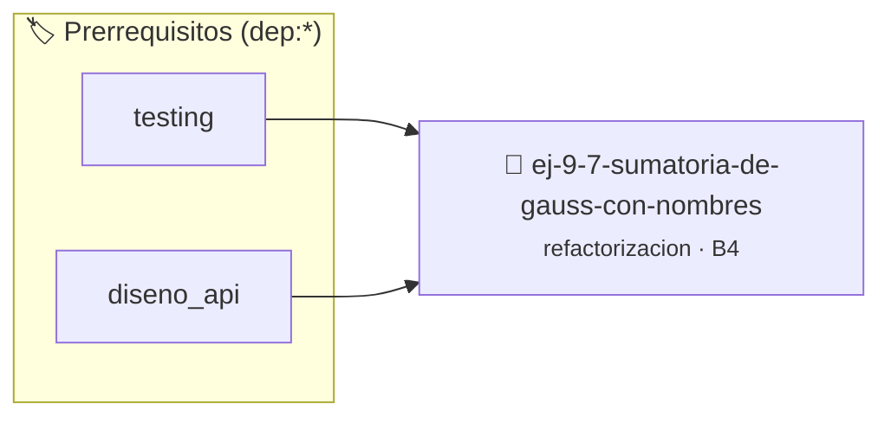

# Sumatoria de Gauss con Nombres Inadecuados
> **ID:** `ej-9-7-sumatoria-de-gauss-con-nombres` · **Unidad:** 5 (Ingeniería de Software y Calidad en C)
 · **Tema:** `refactorizacion` / `clean_code`
 · **Bloom:** B4 (Analizar) · **Dificultad:** Avanzada
 · **Carga:** ~35 min · **Tipo:** Practica Guiada
>
> **🏷️ Prerrequisitos temáticos (tags):** `dep:testing`, `dep:diseno_api`
>
> **Etiquetas conceptuales:** `clean_code`, `sumatoria`, `refactorizacion`, `nombres`, `inadecuados`


::: {admonition} 📦 Paquete de Verificación Local (Ripley)
:class: tip

Para compilar, resolver y autoevaluar tu entrega con pruebas unitarias en tu máquina:

- [📥 **Descargar paquete `ej-9-7-sumatoria-de-gauss-con-nombres.ripkg`**](../../paquetes/ej-9-7-sumatoria-de-gauss-con-nombres.ripkg)

Ejecución con el asistente de cátedra:
```bash
ripley run ej-9-7-sumatoria-de-gauss-con-nombres.ripkg
```
:::


### 🗺️ Itinerario Pedagógico




## 📖 Consigna

:::{exercise}
:label: ej-ref-gauss-inadecuado
Refactorizá la siguiente fórmula de Gauss:

``` c
int s(int n){return n*(n+1)/2;}
```

-   **[*plus ultra*]:** Validar que $n \ge 0$.
-   **[*plus ultra*]:** Usar el tipo `long long` para evitar desbordamientos
    enteros en valores de $n > 65535$.

:::

:::{solution} ej-ref-gauss-inadecuado
:class: dropdown
**Código Refactorizado:**
```{code-block} c
:linenos:
#include <assert.h>

long long calcular_sumatoria_gauss(int limite_superior)
{
    if (limite_superior < 0)
    {
        return -1;
    }
    long long n = limite_superior;
    return (n * (n + 1)) / 2;
}

void test_sumatoria_gauss(void)
{
    assert(calcular_sumatoria_gauss(0) == 0);
    assert(calcular_sumatoria_gauss(10) == 55);
    assert(calcular_sumatoria_gauss(100) == 5050);
    assert(calcular_sumatoria_gauss(-5) == -1);
}

```

:::

---

### 📋 Contrato de las Funciones

```c
/*
 * Operación calcular_sumatoria_gauss
 * Precondiciones: Parámetros dentro del dominio válido de la operación.
 * Postcondiciones: Retorna el valor procesado.
 */
long long calcular_sumatoria_gauss(int limite_superior);

/*
 * Operación test_sumatoria_gauss
 * Precondiciones: Parámetros dentro del dominio válido de la operación.
 * Postcondiciones: Retorna el valor procesado.
 */
void test_sumatoria_gauss(void);

```

### 🧪 Ejemplos de Ejecución

::::{tab-set}
:::{tab-item} Valor positivo
```text
Entrada: 1
Salida / Retorno: 2
```
:::
::::

### ⚠️ Precondiciones y Casos Borde

1. **Valores fuera de rango:** Verificar siempre que los datos de entrada cumplan con los rangos admisibles antes de operar.
6. **Casos vacíos o neutros:** Contemplar adecuadamente entradas con longitud cero o valores neutros según corresponda.

### 🎯 Criterios de Aceptación

- [ ] El código compila limpiamente bajo estándar C11 sin warnings con flags estrictos (`-Wall -Wextra -Werror`).
- [ ] Se satisfacen todas las pruebas unitarias y casos de prueba provistos.
- [ ] Las funciones validan exhaustivamente sus precondiciones y gestionan casos borde de forma robusta.


## 📋 Prototipos y Cabecera (`ej-9-7-sumatoria-de-gauss-con-nombres.h`)

```{code-block} c
#ifndef EJERCICIO_EJ_9_7_SUMATORIA_DE_GAUSS_CON_NOMBRES_H
#define EJERCICIO_EJ_9_7_SUMATORIA_DE_GAUSS_CON_NOMBRES_H

#include <stddef.h>
#include <stdbool.h>
#include <stdint.h>

/* Operación calcular_sumatoria_gauss */
long long calcular_sumatoria_gauss(int limite_superior);
/* Operación test_sumatoria_gauss */
void test_sumatoria_gauss(void);

#endif /* EJERCICIO_EJ_9_7_SUMATORIA_DE_GAUSS_CON_NOMBRES_H */
```


## ⚙️ Especificación de Funciones

| Función | Retorno | Parámetros | Descripción |
| :--- | :--- | :--- | :--- |

| `calcular_sumatoria_gauss` | `long long` | `int limite_superior` | Operación calcular_sumatoria_gauss |

| `test_sumatoria_gauss` | `void` | `void` | Operación test_sumatoria_gauss |


## 🧪 Casos de Prueba

| Prueba Unitaria | Función Objetivo | Verificación |
| :--- | :--- | :--- |

| **test_calcular_sumatoria_gauss_1** | `calcular_sumatoria_gauss` | `/* Verificación unitaria de calcular_sumatoria_gauss */ long long res = calcular_sumatoria_gauss(1); (void)res; assert(true);` |

| **test_test_sumatoria_gauss_2** | `test_sumatoria_gauss` | `/* Verificación unitaria de test_sumatoria_gauss */ test_sumatoria_gauss(); assert(true);` |


## ✓ Solución Modelo de Cátedra

```{dropdown} 🔍 Revelar solución canónica en C
:open: false

```{code-block} c
#include <assert.h>

long long calcular_sumatoria_gauss(int limite_superior)
{
    if (limite_superior < 0)
    {
        return -1;
    }
    long long n = limite_superior;
    return (n * (n + 1)) / 2;
}

void test_sumatoria_gauss(void)
{
    assert(calcular_sumatoria_gauss(0) == 0);
    assert(calcular_sumatoria_gauss(10) == 55);
    assert(calcular_sumatoria_gauss(100) == 5050);
    assert(calcular_sumatoria_gauss(-5) == -1);
}

int main(void)
{
    return 0;
}
```
```
