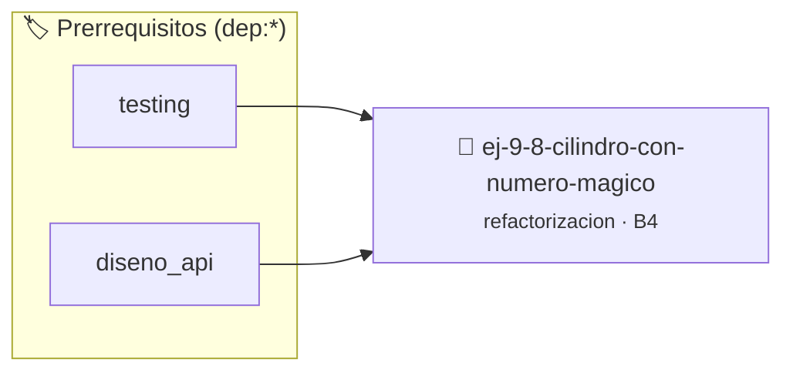

# Cilindro con Número Mágico
> **ID:** `ej-9-8-cilindro-con-numero-magico` · **Unidad:** 5 (Ingeniería de Software y Calidad en C)
 · **Tema:** `refactorizacion` / `clean_code`
 · **Bloom:** B4 (Analizar) · **Dificultad:** Avanzada
 · **Carga:** ~35 min · **Tipo:** Practica Guiada
>
> **🏷️ Prerrequisitos temáticos (tags):** `dep:testing`, `dep:diseno_api`
>
> **Etiquetas conceptuales:** `clean_code`, `refactorizacion`, `fundamentos`, `magico`, `numero`


::: {admonition} 📦 Paquete de Verificación Local (Ripley)
:class: tip

Para compilar, resolver y autoevaluar tu entrega con pruebas unitarias en tu máquina:

- [📥 **Descargar paquete `ej-9-8-cilindro-con-numero-magico.ripkg`**](../../paquetes/ej-9-8-cilindro-con-numero-magico.ripkg)

Ejecución con el asistente de cátedra:
```bash
ripley run ej-9-8-cilindro-con-numero-magico.ripkg
```
:::


### 🗺️ Itinerario Pedagógico




## 📖 Consigna

### Ejercicio 9.8 - Cilindro con Número Mágico ⭐⭐☆☆☆

:::{exercise}
:label: ej-ref-cilindro-magico
Refactorizá la siguiente función que calcula el volumen de un cilindro
eliminando la constante mágica y aplicando contratos:

``` c
double v(double r,double h){return 3.14159265*r*r*h;}
```
<!-- c -->

-   **[*plus ultra*]:** Definir `#define CONSTANTE_PI 3.141592653589793`.
-   **[*plus ultra*]:** Validar que radio y altura sean mayores a cero.

:::
<!-- {exercise} -->

:::{solution} ej-ref-cilindro-magico
:class: dropdown
**Código Refactorizado:**
```{code-block} c
:linenos:
#include <assert.h>
#include <math.h>

#define CONSTANTE_PI 3.14159265358979323846

double calcular_volumen_cilindro(double radio, double altura)
{
    if (radio <= 0.0 || altura <= 0.0)
    {
        return -1.0;
    }
    return CONSTANTE_PI * radio * radio * altura;
}

void test_volumen_cilindro(void)
{
    double vol = calcular_volumen_cilindro(1.0, 10.0);
    assert(fabs(vol - (CONSTANTE_PI * 10.0)) < 1e-6);
    assert(calcular_volumen_cilindro(-1.0, 5.0) == -1.0);
}

```
<!-- {code-block} c -->

:::
<!-- {solution} ej-ref-cilindro-magico -->

---

## 2. Control de Flujo Espagueti y Anidaciones Profundas


## 📋 Prototipos y Cabecera (`ej-9-8-cilindro-con-numero-magico.h`)

```{code-block} c
#ifndef EJERCICIO_EJ_9_8_CILINDRO_CON_NUMERO_MAGICO_H
#define EJERCICIO_EJ_9_8_CILINDRO_CON_NUMERO_MAGICO_H

#include <stddef.h>
#include <stdbool.h>
#include <stdint.h>

/* Operación calcular_volumen_cilindro */
double calcular_volumen_cilindro(double radio, double altura);
/* Operación test_volumen_cilindro */
void test_volumen_cilindro(void);

#endif /* EJERCICIO_EJ_9_8_CILINDRO_CON_NUMERO_MAGICO_H */
```


## ⚙️ Especificación de Funciones

| Función | Retorno | Parámetros | Descripción |
| :--- | :--- | :--- | :--- |

| `calcular_volumen_cilindro` | `double` | `double radio, double altura` | Operación calcular_volumen_cilindro |

| `test_volumen_cilindro` | `void` | `void` | Operación test_volumen_cilindro |


## 🧪 Casos de Prueba

| Prueba Unitaria | Función Objetivo | Verificación |
| :--- | :--- | :--- |

| **test_calcular_volumen_cilindro_1** | `calcular_volumen_cilindro` | `/* Verificación unitaria de calcular_volumen_cilindro */ double res = calcular_volumen_cilindro(1, 2); (void)res; assert(true);` |

| **test_test_volumen_cilindro_2** | `test_volumen_cilindro` | `/* Verificación unitaria de test_volumen_cilindro */ test_volumen_cilindro(); assert(true);` |


## ✓ Solución Modelo de Cátedra

```{dropdown} 🔍 Revelar solución canónica en C
:open: false

```{code-block} c
#include <stdlib.h>

#include <assert.h>
#include <math.h>

#define CONSTANTE_PI 3.14159265358979323846

double calcular_volumen_cilindro(double radio, double altura)
{
    if (radio <= 0.0 || altura <= 0.0)
    {
        return -1.0;
    }
    return CONSTANTE_PI * radio * radio * altura;
}

void test_volumen_cilindro(void)
{
    double vol = calcular_volumen_cilindro(1.0, 10.0);
    assert(fabs(vol - (CONSTANTE_PI * 10.0)) < 1e-6);
    assert(calcular_volumen_cilindro(-1.0, 5.0) == -1.0);
}

int main(void)
{
    return 0;
}
```
```
