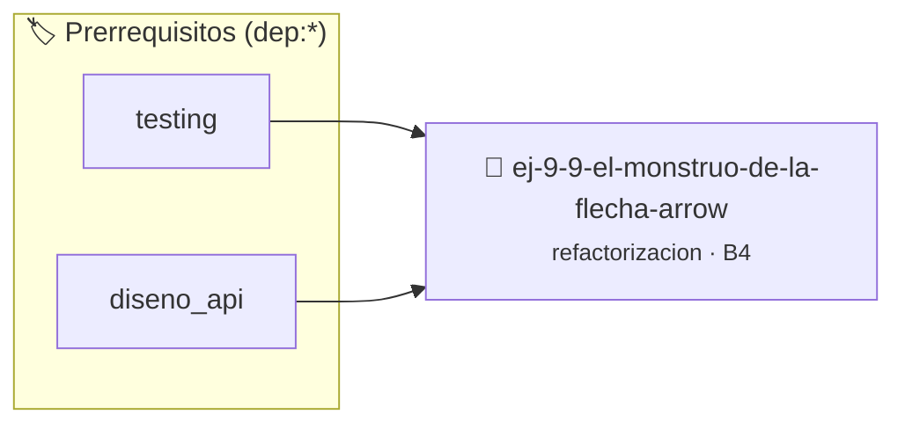

# El Monstruo de la Flecha (Arrow Code)
> **ID:** `ej-9-9-el-monstruo-de-la-flecha-arrow` · **Unidad:** 5 (Ingeniería de Software y Calidad en C)
 · **Tema:** `refactorizacion` / `clean_code`
 · **Bloom:** B4 (Analizar) · **Dificultad:** Avanzada
 · **Carga:** ~35 min · **Tipo:** Practica Guiada
>
> **🏷️ Prerrequisitos temáticos (tags):** `dep:testing`, `dep:diseno_api`
>
> **Etiquetas conceptuales:** `clean_code`, `code`, `refactorizacion`, `fundamentos`, `flecha`


::: {admonition} 📦 Paquete de Verificación Local (Ripley)
:class: tip

Para compilar, resolver y autoevaluar tu entrega con pruebas unitarias en tu máquina:

- [📥 **Descargar paquete `ej-9-9-el-monstruo-de-la-flecha-arrow.ripkg`**](../../paquetes/ej-9-9-el-monstruo-de-la-flecha-arrow.ripkg)

Ejecución con el asistente de cátedra:
```bash
ripley run ej-9-9-el-monstruo-de-la-flecha-arrow.ripkg
```
:::


### 🗺️ Itinerario Pedagógico




## 📖 Consigna

:::{exercise}
:label: ej-ref-arrow-code
Refactorizá la siguiente función anidada en forma de flecha aplicando
**cláusulas de guarda** según la [Regla
0x2001h](../../reglas/2_funciones.md#0x2001h):

```{code-block} c
:linenos:
int calificar(int nota, int asistencia)
{
    int r = 0;
    if (asistencia >= 75)
    {
        if (nota >= 0)
        {
            if (nota <= 100)
            {
                if (nota >= 60)
                {
                    if (nota >= 90)
                    {
                        r = 3; // Sobresaliente
                    }
                    else
                    {
                        r = 2; // Aprobado
                    }
                }
                else
                {
                    r = 1; // Reprobado
                }
            }
            else
            {
                r = -1; // Error nota
            }
        }
        else
        {
            r = -1; // Error nota
        }
    }
    else
    {
        r = 0; // Libre
    }
    return r;
}

```

-   **[*plus ultra*]:** Reducir la profundidad máxima de indentación a 1 nivel
    dentro de la función.
-   **[*plus ultra*]:** Escribir pruebas unitarias para cada uno de los valores
    de retorno.

:::

:::{solution} ej-ref-arrow-code
:class: dropdown
**Diagnóstico:** Anidación excesiva de 5 niveles que dificulta el seguimiento de
los casos de error.

**Código Refactorizado:**
```{code-block} c
:linenos:
#include <assert.h>

#define ESTADO_NOTA_INVALIDA -1
#define ESTADO_LIBRE 0
#define ESTADO_REPROBADO 1
#define ESTADO_APROBADO 2
#define ESTADO_SOBRESALIENTE 3

int clasificar_desempenio(int nota, int asistencia_porcentaje)
{
    if (nota < 0 || nota > 100)
    {
        return ESTADO_NOTA_INVALIDA;
    }
    if (asistencia_porcentaje < 75)
    {
        return ESTADO_LIBRE;
    }
    if (nota >= 90)
    {
        return ESTADO_SOBRESALIENTE;
    }
    if (nota >= 60)
    {
        return ESTADO_APROBADO;
    }
    return ESTADO_REPROBADO;
}

void test_clasificar_desempenio(void)
{
    assert(clasificar_desempenio(95, 80) == ESTADO_SOBRESALIENTE);
    assert(clasificar_desempenio(70, 80) == ESTADO_APROBADO);
    assert(clasificar_desempenio(50, 80) == ESTADO_REPROBADO);
    assert(clasificar_desempenio(80, 50) == ESTADO_LIBRE);
    assert(clasificar_desempenio(105, 80) == ESTADO_NOTA_INVALIDA);
}

```

:::

---

### 📋 Contrato de las Funciones

```c
/*
 * Operación calificar
 * Precondiciones: Parámetros dentro del dominio válido de la operación.
 * Postcondiciones: Retorna el valor procesado.
 */
int calificar(int nota, int asistencia);

```

### 🧪 Ejemplos de Ejecución

::::{tab-set}
:::{tab-item} Caso general
```text
val = 10
Retorno esperado calculado
```
:::
:::{tab-item} Caso límite
```text
val = 0
Retorno 0 o manejo de borde
```
:::
::::

### ⚠️ Precondiciones y Casos Borde

1. **Valores fuera de rango:** Verificar siempre que los datos de entrada cumplan con los rangos admisibles antes de operar.
6. **Casos vacíos o neutros:** Contemplar adecuadamente entradas con longitud cero o valores neutros según corresponda.

### 🎯 Criterios de Aceptación

- [ ] El código compila limpiamente bajo estándar C11 sin warnings con flags estrictos (`-Wall -Wextra -Werror`).
- [ ] Se satisfacen todas las pruebas unitarias y casos de prueba provistos.
- [ ] Las funciones validan exhaustivamente sus precondiciones y gestionan casos borde de forma robusta.


## 📋 Prototipos y Cabecera (`ej-9-9-el-monstruo-de-la-flecha-arrow.h`)

```{code-block} c
#ifndef EJERCICIO_EJ_9_9_EL_MONSTRUO_DE_LA_FLECHA_ARROW_H
#define EJERCICIO_EJ_9_9_EL_MONSTRUO_DE_LA_FLECHA_ARROW_H

#include <stddef.h>
#include <stdbool.h>
#include <stdint.h>

/* Operación calificar */
int calificar(int nota, int asistencia);

#endif /* EJERCICIO_EJ_9_9_EL_MONSTRUO_DE_LA_FLECHA_ARROW_H */
```


## ⚙️ Especificación de Funciones

| Función | Retorno | Parámetros | Descripción |
| :--- | :--- | :--- | :--- |

| `calificar` | `int` | `int nota, int asistencia` | Operación calificar |


## 🧪 Casos de Prueba

| Prueba Unitaria | Función Objetivo | Verificación |
| :--- | :--- | :--- |

| **test_calificar_1** | `calificar` | `/* Verificación unitaria de calificar */ int res = calificar(1, 2); (void)res; assert(true);` |


## ✓ Solución Modelo de Cátedra

```{dropdown} 🔍 Revelar solución canónica en C
:open: false

```{code-block} c
int calificar(int nota, int asistencia)
{
    int r = 0;
    if (asistencia >= 75)
    {
        if (nota >= 0)
        {
            if (nota <= 100)
            {
                if (nota >= 60)
                {
                    if (nota >= 90)
                    {
                        r = 3; // Sobresaliente
                    }
                    else
                    {
                        r = 2; // Aprobado
                    }
                }
                else
                {
                    r = 1; // Reprobado
                }
            }
            else
            {
                r = -1; // Error nota
            }
        }
        else
        {
            r = -1; // Error nota
        }
    }
    else
    {
        r = 0; // Libre
    }
    return r;
}

int main(void)
{
    return 0;
}
```
```
