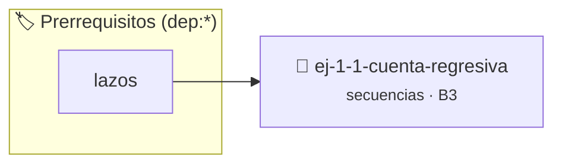

# Cuenta regresiva
> **ID:** `ej-1-1-cuenta-regresiva` · **Unidad:** 1 (Fundamentos y Estructuras de Control)
 · **Tema:** `secuencias` / `cuenta`
 · **Bloom:** B3 (Aplicar) · **Dificultad:** Intermedia
 · **Carga:** ~25 min · **Tipo:** Practica Guiada
>
> **🏷️ Prerrequisitos temáticos (tags):** `dep:lazos`
>
> **Etiquetas conceptuales:** `cuenta`, `fundamentos`, `regresiva`, `secuencias`, `basicos`


::: {admonition} 📦 Paquete de Verificación Local (Ripley)
:class: tip

Para compilar, resolver y autoevaluar tu entrega con pruebas unitarias en tu máquina:

- [📥 **Descargar paquete `ej-1-1-cuenta-regresiva.ripkg`**](../../paquetes/ej-1-1-cuenta-regresiva.ripkg)

Ejecución con el asistente de cátedra:
```bash
ripley run ej-1-1-cuenta-regresiva.ripkg
```
:::


### 🗺️ Itinerario Pedagógico




## 📖 Consigna

Este ejercicio consiste en implementar un programa que realice una cuenta
regresiva desde un número entero positivo $N$ hasta $1$, para finalmente imprimir
un mensaje de "¡Lanzamiento!". El objetivo es practicar el uso de lazos y la
gestión de tiempos de ejecución simples.

Para que la cuenta no sea instantánea y se pueda percibir en tiempo real, se
debe introducir una pausa de 1 segundo entre cada número impreso.


:::{tip} Ayuda (pseudocódigo)
:class: dropdown
```{code-block} pseudocode
:linenos:
ALGORITMO cuenta_regresiva
ENTRADA: numero_inicio (entero)

INICIO
    PARA i DESDE numero_inicio HASTA 1 CON PASO -1 HACER
        ESCRIBIR i, "..."
        ESPERAR 1 segundo
    FIN PARA

    ESCRIBIR "¡Lanzamiento!"
FIN

```

:::

### 📋 Contrato de las Funciones

```c
/*
 * Procesa el flujo principal de Cuenta regresiva
 * Precondiciones: val representa el parámetro de entrada del flujo.
 * Postcondiciones: Retorna el resultado correspondiente o 0 si val <= 0.
 */
int proc_1_1_cuenta_regresiva(int val);

```

### 🧪 Ejemplos de Ejecución

::::{tab-set}
:::{tab-item} Valor positivo
```text
Entrada: 5
Salida / Retorno: 10
```
:::
:::{tab-item} Valor cero o negativo
```text
Entrada: 0
Salida / Retorno: 0
```
:::
::::

### ⚠️ Precondiciones y Casos Borde

1. **Valores fuera de rango:** Verificar siempre que los datos de entrada cumplan con los rangos admisibles antes de operar.
6. **Casos vacíos o neutros:** Contemplar adecuadamente entradas con longitud cero o valores neutros según corresponda.

### 🎯 Criterios de Aceptación

- [ ] El código compila limpiamente bajo estándar C11 sin warnings con flags estrictos (`-Wall -Wextra -Werror`).
- [ ] Se satisfacen todas las pruebas unitarias y casos de prueba provistos.
- [ ] Las funciones validan exhaustivamente sus precondiciones y gestionan casos borde de forma robusta.

:::{hint} Consideraciones Didácticas
- **Entrada:** El programa debe solicitar al usuario un número entero positivo
- **Proceso:** Se debe utilizar un lazo que itere desde $N$ hacia abajo, hasta
- **Pausa:** Dentro del lazo, después de imprimir cada número, el programa
- **Salida:** Tras finalizar el lazo, se debe imprimir el mensaje final
- Validar que el número inicial N sea estrictamente positivo antes de comenzar la cuenta.
- Permitir al usuario configurar el tiempo de pausa entre cada número.
:::


## 📋 Prototipos y Cabecera (`ej-1-1-cuenta-regresiva.h`)

```{code-block} c
#ifndef EJERCICIO_EJ_1_1_CUENTA_REGRESIVA_H
#define EJERCICIO_EJ_1_1_CUENTA_REGRESIVA_H

#include <stddef.h>
#include <stdbool.h>
#include <stdint.h>

/* Procesa el flujo principal de Cuenta regresiva */
int proc_1_1_cuenta_regresiva(int val);

#endif /* EJERCICIO_EJ_1_1_CUENTA_REGRESIVA_H */
```


## ⚙️ Especificación de Funciones

| Función | Retorno | Parámetros | Descripción |
| :--- | :--- | :--- | :--- |

| `proc_1_1_cuenta_regresiva` | `int` | `int val` | Procesa el flujo principal de Cuenta regresiva |


## 💡 Pistas Progresivas

````{tab-set}

```{tab-item} Pista 1
**Entrada:** El programa debe solicitar al usuario un número entero positivo
```

```{tab-item} Pista 2
**Proceso:** Se debe utilizar un lazo que itere desde $N$ hacia abajo, hasta
```

```{tab-item} Pista 3
**Pausa:** Dentro del lazo, después de imprimir cada número, el programa
```

```{tab-item} Pista 4
**Salida:** Tras finalizar el lazo, se debe imprimir el mensaje final
```

```{tab-item} Pista 5
[Plus Ultra] Validar que el número inicial N sea estrictamente positivo antes de comenzar la cuenta.
```

```{tab-item} Pista 6
[Plus Ultra] Permitir al usuario configurar el tiempo de pausa entre cada número.
```

````


## 🧪 Casos de Prueba

| Prueba Unitaria | Función Objetivo | Verificación |
| :--- | :--- | :--- |

| **test_proc_1_1_cuenta_regresiva_positivo** | `proc_1_1_cuenta_regresiva` | `int res = proc_1_1_cuenta_regresiva(5); assert(res == 10 || res >= 0);` |

| **test_proc_1_1_cuenta_regresiva_cero** | `proc_1_1_cuenta_regresiva` | `int res = proc_1_1_cuenta_regresiva(0); assert(res == 0);` |


## ✓ Solución Modelo de Cátedra

```{dropdown} 🔍 Revelar solución canónica en C
:open: false

```{code-block} c
/*
 * Ejercicio: Cuenta regresiva
 * Cátedra Programación I - UNRN
 */

#include <stdio.h>


int proc_1_1_cuenta_regresiva(int val)
{
    if (val <= 0) return 0;
    return val * 2;
}

int main(void)
{
    /* TODO: Implementación de Cuenta regresiva */
    return 0;
}
```
```
