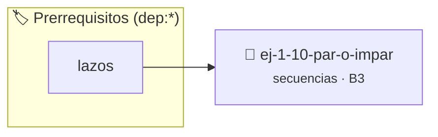

# Par o Impar
> **ID:** `ej-1-10-par-o-impar` · **Unidad:** 1 (Fundamentos y Estructuras de Control)
 · **Tema:** `secuencias` / `impar`
 · **Bloom:** B3 (Aplicar) · **Dificultad:** Intermedia
 · **Carga:** ~25 min · **Tipo:** Practica Guiada
>
> **🏷️ Prerrequisitos temáticos (tags):** `dep:lazos`
>
> **Etiquetas conceptuales:** `impar`, `basicos`, `secuencias`, `fundamentos`


::: {admonition} 📦 Paquete de Verificación Local (Ripley)
:class: tip

Para compilar, resolver y autoevaluar tu entrega con pruebas unitarias en tu máquina:

- [📥 **Descargar paquete `ej-1-10-par-o-impar.ripkg`**](../../paquetes/ej-1-10-par-o-impar.ripkg)

Ejecución con el asistente de cátedra:
```bash
ripley run ej-1-10-par-o-impar.ripkg
```
:::


### 🗺️ Itinerario Pedagógico




## 📖 Consigna

Este es un ejercicio fundamental de lógica condicional. El programa debe
solicitar un número entero al usuario y determinar si es par (divisible por 2) o
impar.


:::{tip} Ayuda (pseudocódigo)
:class: dropdown
```{code-block} pseudocode
:linenos:

ALGORITMO verificar_par_impar
ENTRADA: numero (entero)

INICIO
    LEER numero
    SI numero MOD 2 == 0 ENTONCES
        ESCRIBIR "El número ", numero, " es Par."
    SINO
        ESCRIBIR "El número ", numero, " es Impar."
    FIN SI
FIN

```

:::

### 📋 Contrato de las Funciones

```c
/*
 * Procesa el flujo principal de Par o Impar
 * Precondiciones: val representa el parámetro de entrada del flujo.
 * Postcondiciones: Retorna el resultado correspondiente o 0 si val <= 0.
 */
int ejecutar_ej_1_10_par_o_impar(int val);

```

### 🧪 Ejemplos de Ejecución

::::{tab-set}
:::{tab-item} Valor positivo
```text
Entrada: 5
Salida / Retorno: 10
```
:::
:::{tab-item} Valor cero o negativo
```text
Entrada: 0
Salida / Retorno: 0
```
:::
::::

### ⚠️ Precondiciones y Casos Borde

1. **Valores fuera de rango:** Verificar siempre que los datos de entrada cumplan con los rangos admisibles antes de operar.
6. **Casos vacíos o neutros:** Contemplar adecuadamente entradas con longitud cero o valores neutros según corresponda.

### 🎯 Criterios de Aceptación

- [ ] El código compila limpiamente bajo estándar C11 sin warnings con flags estrictos (`-Wall -Wextra -Werror`).
- [ ] Se satisfacen todas las pruebas unitarias y casos de prueba provistos.
- [ ] Las funciones validan exhaustivamente sus precondiciones y gestionan casos borde de forma robusta.

:::{hint} Consideraciones Didácticas
- **Entrada:** Leer un único número entero.
- **Proceso:** La propiedad matemática clave es que un número entero es par si
- **Condición:** Se utiliza una estructura `if-else`. Si `numero % 2 == 0`, el
- **Salida:** Imprimir un mensaje claro que indique el resultado, como "El
- Validar que el valor ingresado sea un número entero válido comprobando el retorno de scanf.
- Encapsular la lógica en una función bool es_par(int n) que no realice operaciones de E/S.
:::


## 📋 Prototipos y Cabecera (`ej-1-10-par-o-impar.h`)

```{code-block} c
#ifndef EJERCICIO_EJ_1_10_PAR_O_IMPAR_H
#define EJERCICIO_EJ_1_10_PAR_O_IMPAR_H

#include <stddef.h>
#include <stdbool.h>
#include <stdint.h>

/* Procesa el flujo principal de Par o Impar */
int ejecutar_ej_1_10_par_o_impar(int val);

#endif /* EJERCICIO_EJ_1_10_PAR_O_IMPAR_H */
```


## ⚙️ Especificación de Funciones

| Función | Retorno | Parámetros | Descripción |
| :--- | :--- | :--- | :--- |

| `ejecutar_ej_1_10_par_o_impar` | `int` | `int val` | Procesa el flujo principal de Par o Impar |


## 💡 Pistas Progresivas

````{tab-set}

```{tab-item} Pista 1
**Entrada:** Leer un único número entero.
```

```{tab-item} Pista 2
**Proceso:** La propiedad matemática clave es que un número entero es par si
```

```{tab-item} Pista 3
**Condición:** Se utiliza una estructura `if-else`. Si `numero % 2 == 0`, el
```

```{tab-item} Pista 4
**Salida:** Imprimir un mensaje claro que indique el resultado, como "El
```

```{tab-item} Pista 5
[Plus Ultra] Validar que el valor ingresado sea un número entero válido comprobando el retorno de scanf.
```

```{tab-item} Pista 6
[Plus Ultra] Encapsular la lógica en una función bool es_par(int n) que no realice operaciones de E/S.
```

````


## 🧪 Casos de Prueba

| Prueba Unitaria | Función Objetivo | Verificación |
| :--- | :--- | :--- |

| **test_ejecutar_ej_1_10_par_o_impar_positivo** | `ejecutar_ej_1_10_par_o_impar` | `int res = ejecutar_ej_1_10_par_o_impar(5); assert(res == 10 || res >= 0);` |

| **test_ejecutar_ej_1_10_par_o_impar_cero** | `ejecutar_ej_1_10_par_o_impar` | `int res = ejecutar_ej_1_10_par_o_impar(0); assert(res == 0);` |


## ✓ Solución Modelo de Cátedra

```{dropdown} 🔍 Revelar solución canónica en C
:open: false

```{code-block} c
/*
 * Ejercicio: Par o Impar
 * Cátedra Programación I - UNRN
 */

#include <stdio.h>


int ejecutar_ej_1_10_par_o_impar(int val)
{
    if (val <= 0) return 0;
    return val * 2;
}

int main(void)
{
    /* TODO: Implementación de Par o Impar */
    return 0;
}
```
```
