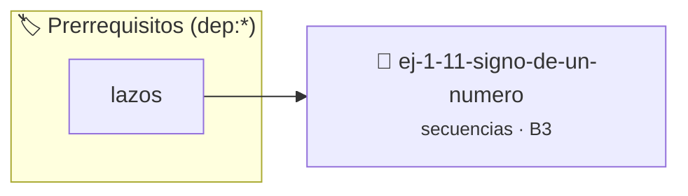

# Signo de un Número
> **ID:** `ej-1-11-signo-de-un-numero`
 · **Tema:** `secuencias`
 · **Bloom:** B3 (Aplicar)
 · **Carga:** ~25 min
>
> **🏷️ Prerrequisitos temáticos (tags):** `dep:lazos`
>
> **Etiquetas conceptuales:** `fundamentos`, `secuencias`, `numero`, `basicos`, `signo`


::: {admonition} 📦 Paquete de Verificación Local (Ripley)
:class: tip

Para compilar, resolver y autoevaluar tu entrega con pruebas unitarias en tu máquina:

- [📥 **Descargar paquete `ej-1-11-signo-de-un-numero.ripkg`**](../../paquetes/ej-1-11-signo-de-un-numero.ripkg)

Ejecución con el asistente de cátedra:
```bash
ripley run ej-1-11-signo-de-un-numero.ripkg
```
:::


### 🗺️ Itinerario Pedagógico




## 📖 Consigna

### Ejercicio 1.11 - Signo de un Número ⭐⭐☆☆☆


El programa debe clasificar un número real (de punto flotante) ingresado por el
usuario en una de tres categorías: positivo, negativo o cero.

:::{hint} Lógica y Consideraciones
-   **Entrada:** Leer un número que puede tener decimales (tipo `float` o
-   **Proceso:** Utilizar una estructura de condicionales anidados o `if-else
-   **Condiciones:**
-   **Salida:** Imprimir el mensaje correspondiente a la categoría.

-   **[*plus ultra*]:** Encapsular la clasificación en una función que retorne 1 (positivo), -1 (negativo) o 0 (cero).
-   **[*plus ultra*]:** Manejar valores muy cercanos a cero dentro de un margen de tolerancia (epsilon) si se usan reales.

:::
<!-- {hint} Lógica y Consideraciones -->

:::{tip} Ayuda (pseudocódigo)
:class: dropdown
```{code-block} pseudocode
:linenos:

ALGORITMO clasificar_signo
ENTRADA: numero (real)

INICIO
    LEER numero
    SI numero > 0 ENTONCES
        ESCRIBIR "El número es Positivo."
    SINO SI numero < 0 ENTONCES
        ESCRIBIR "El número es Negativo."
    SINO
        ESCRIBIR "El número es Cero."
    FIN SI
FIN

```
<!-- {code-block} pseudocode -->

:::
<!-- {tip} Ayuda (pseudocódigo) -->

---

## Fórmulas Geométricas


## 📋 Prototipos y Cabecera (`ej-1-11-signo-de-un-numero.h`)

```{code-block} c
#ifndef EJERCICIO_EJ_1_11_SIGNO_DE_UN_NUMERO_H
#define EJERCICIO_EJ_1_11_SIGNO_DE_UN_NUMERO_H

#include <stddef.h>
#include <stdbool.h>
#include <stdint.h>

/* Procesa el flujo principal de Signo de un Número */
int proc_1_signo_de_un_numero(int val);

#endif /* EJERCICIO_EJ_1_11_SIGNO_DE_UN_NUMERO_H */
```


## ⚙️ Especificación de Funciones

| Función | Retorno | Parámetros | Descripción |
| :--- | :--- | :--- | :--- |

| `proc_1_signo_de_un_numero` | `int` | `int val` | Procesa el flujo principal de Signo de un Número |


## 💡 Pistas Progresivas

````{tab-set}

```{tab-item} Pista 1
**Entrada:** Leer un número que puede tener decimales (tipo `float` o
```

```{tab-item} Pista 2
**Proceso:** Utilizar una estructura de condicionales anidados o `if-else
```

```{tab-item} Pista 3
**Condiciones:**
```

```{tab-item} Pista 4
**Salida:** Imprimir el mensaje correspondiente a la categoría.
```

```{tab-item} Pista 5
[Plus Ultra] Encapsular la clasificación en una función que retorne 1 (positivo), -1 (negativo) o 0 (cero).
```

```{tab-item} Pista 6
[Plus Ultra] Manejar valores muy cercanos a cero dentro de un margen de tolerancia (epsilon) si se usan reales.
```

````


## 🧪 Casos de Prueba

| Prueba Unitaria | Función Objetivo | Verificación |
| :--- | :--- | :--- |

| **test_proc_1_signo_de_un_numero_positivo** | `proc_1_signo_de_un_numero` | `int res = proc_1_signo_de_un_numero(5); assert(res == 10 || res >= 0);` |

| **test_proc_1_signo_de_un_numero_cero** | `proc_1_signo_de_un_numero` | `int res = proc_1_signo_de_un_numero(0); assert(res == 0);` |


## ✓ Solución Modelo de Cátedra

```{dropdown} 🔍 Revelar solución canónica en C
:open: false

```{code-block} c
/*
 * Ejercicio: Signo de un Número
 * Cátedra Programación I - UNRN
 */

#include <stdio.h>


int proc_1_signo_de_un_numero(int val)
{
    if (val <= 0) return 0;
    return val * 2;
}

int main(void)
{
    /* TODO: Implementación de Signo de un Número */
    return 0;
}
```
```
