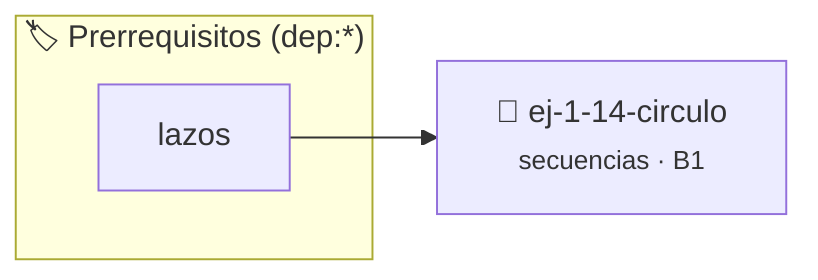

# Círculo
> **ID:** `ej-1-14-circulo`
 · **Tema:** `secuencias`
 · **Bloom:** B1 (Recordar)
 · **Carga:** ~10 min
>
> **🏷️ Prerrequisitos temáticos (tags):** `dep:lazos`
>
> **Etiquetas conceptuales:** `basicos`, `circulo`, `secuencias`, `fundamentos`


::: {admonition} 📦 Paquete de Verificación Local (Ripley)
:class: tip

Para compilar, resolver y autoevaluar tu entrega con pruebas unitarias en tu máquina:

- [📥 **Descargar paquete `ej-1-14-circulo.ripkg`**](../../paquetes/ej-1-14-circulo.ripkg)

Ejecución con el asistente de cátedra:
```bash
ripley run ej-1-14-circulo.ripkg
```
:::


### 🗺️ Itinerario Pedagógico




## 📖 Consigna

### Ejercicio 1.14 - Círculo ⭐⭐☆☆☆


Calcular el área y la circunferencia (perímetro) de un círculo a partir de su
radio.

:::{hint} Lógica y Consideraciones
-   **Constantes:** Se necesita el valor de $\pi$. Se puede definir como una
-   **Entrada:** Solicitar al usuario el valor del radio (`r`).
-   **Proceso:**
-   **Salida:** Mostrar ambos resultados de forma clara.

-   **[*plus ultra*]:** Validar que el radio sea positivo y definir PI como una constante con precisión de double.
-   **[*plus ultra*]:** Calcular también el área del sector circular para un ángulo ingresado por el usuario.

:::
<!-- {hint} Lógica y Consideraciones -->

:::{tip} Ayuda (pseudocódigo)
:class: dropdown
```{code-block} pseudocode
:linenos:

ALGORITMO circulo_calculos
ENTRADA: radio (real)
CONSTANTES:
    PI = 3.14159

VARIABLES:
    area, circunferencia (reales)

INICIO
    LEER radio
    area = PI * radio * radio
    circunferencia = 2 * PI * radio
    ESCRIBIR "Área: ", area
    ESCRIBIR "Circunferencia: ", circunferencia
FIN

```
<!-- {code-block} pseudocode -->

:::
<!-- {tip} Ayuda (pseudocódigo) -->


## 📋 Prototipos y Cabecera (`ej-1-14-circulo.h`)

```{code-block} c
#ifndef EJERCICIO_EJ_1_14_CIRCULO_H
#define EJERCICIO_EJ_1_14_CIRCULO_H

#include <stddef.h>
#include <stdbool.h>
#include <stdint.h>

/* Procesa el flujo principal de Círculo */
int ejecutar_ej_1_14_circulo(int val);

#endif /* EJERCICIO_EJ_1_14_CIRCULO_H */
```


## ⚙️ Especificación de Funciones

| Función | Retorno | Parámetros | Descripción |
| :--- | :--- | :--- | :--- |

| `ejecutar_ej_1_14_circulo` | `int` | `int val` | Procesa el flujo principal de Círculo |


## 💡 Pistas Progresivas

````{tab-set}

```{tab-item} Pista 1
**Constantes:** Se necesita el valor de $\pi$. Se puede definir como una
```

```{tab-item} Pista 2
**Entrada:** Solicitar al usuario el valor del radio (`r`).
```

```{tab-item} Pista 3
**Proceso:**
```

```{tab-item} Pista 4
**Salida:** Mostrar ambos resultados de forma clara.
```

```{tab-item} Pista 5
[Plus Ultra] Validar que el radio sea positivo y definir PI como una constante con precisión de double.
```

```{tab-item} Pista 6
[Plus Ultra] Calcular también el área del sector circular para un ángulo ingresado por el usuario.
```

````


## 🧪 Casos de Prueba

| Prueba Unitaria | Función Objetivo | Verificación |
| :--- | :--- | :--- |

| **test_ejecutar_ej_1_14_circulo_positivo** | `ejecutar_ej_1_14_circulo` | `int res = ejecutar_ej_1_14_circulo(5); assert(res == 10 || res >= 0);` |

| **test_ejecutar_ej_1_14_circulo_cero** | `ejecutar_ej_1_14_circulo` | `int res = ejecutar_ej_1_14_circulo(0); assert(res == 0);` |


## ✓ Solución Modelo de Cátedra

```{dropdown} 🔍 Revelar solución canónica en C
:open: false

```{code-block} c
/*
 * Ejercicio: Círculo
 * Cátedra Programación I - UNRN
 */

#include <stdio.h>


int ejecutar_ej_1_14_circulo(int val)
{
    if (val <= 0) return 0;
    return val * 2;
}

int main(void)
{
    /* TODO: Implementación de Círculo */
    return 0;
}
```
```
