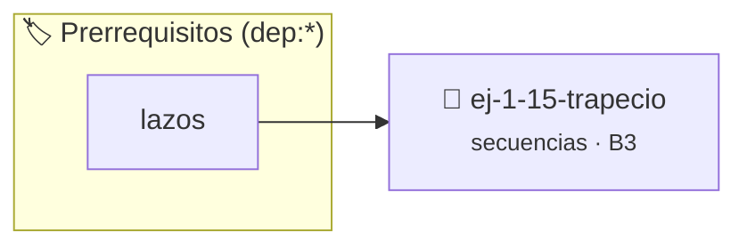

# Trapecio
> **ID:** `ej-1-15-trapecio` · **Unidad:** 1 (Fundamentos y Estructuras de Control)
 · **Tema:** `secuencias` / `basicos`
 · **Bloom:** B3 (Aplicar) · **Dificultad:** Intermedia
 · **Carga:** ~25 min · **Tipo:** Practica Guiada
>
> **🏷️ Prerrequisitos temáticos (tags):** `dep:lazos`
>
> **Etiquetas conceptuales:** `basicos`, `trapecio`, `secuencias`, `fundamentos`


::: {admonition} 📦 Paquete de Verificación Local (Ripley)
:class: tip

Para compilar, resolver y autoevaluar tu entrega con pruebas unitarias en tu máquina:

- [📥 **Descargar paquete `ej-1-15-trapecio.ripkg`**](../../paquetes/ej-1-15-trapecio.ripkg)

Ejecución con el asistente de cátedra:
```bash
ripley run ej-1-15-trapecio.ripkg
```
:::


### 🗺️ Itinerario Pedagógico




## 📖 Consigna

### Ejercicio 1.15 - Trapecio ⭐⭐☆☆☆


Calcular el área de un trapecio dadas las longitudes de sus dos bases paralelas
y su altura.

:::{hint} Lógica y Consideraciones
-   **Entrada:** Solicitar al usuario tres valores: la base mayor (`B`), la base
-   **Proceso:** Aplicar la fórmula del área del trapecio: $A = \frac{B+b}{2}
-   **Salida:** Mostrar el área calculada.

-   **[*plus ultra*]:** Validar que ambas bases y la altura sean estrictamente positivas y que la base mayor sea mayor que la menor.
-   **[*plus ultra*]:** Modularizar la operación en una función independiente.

:::
<!-- {hint} Lógica y Consideraciones -->

:::{tip} Ayuda (pseudocódigo)
:class: dropdown
```{code-block} pseudocode
:linenos:

ALGORITMO area_trapecio
ENTRADA: base_mayor, base_menor, altura (reales)
VARIABLES:
    area (real)

INICIO
    LEER base_mayor, base_menor, altura
    area = ((base_mayor + base_menor) / 2) * altura
    ESCRIBIR "El área del trapecio es: ", area
FIN

```
<!-- {code-block} pseudocode -->

:::
<!-- {tip} Ayuda (pseudocódigo) -->


## 📋 Prototipos y Cabecera (`ej-1-15-trapecio.h`)

```{code-block} c
#ifndef EJERCICIO_EJ_1_15_TRAPECIO_H
#define EJERCICIO_EJ_1_15_TRAPECIO_H

#include <stddef.h>
#include <stdbool.h>
#include <stdint.h>

/* Procesa el flujo principal de Trapecio */
int ejecutar_ej_1_15_trapecio(int val);

#endif /* EJERCICIO_EJ_1_15_TRAPECIO_H */
```


## ⚙️ Especificación de Funciones

| Función | Retorno | Parámetros | Descripción |
| :--- | :--- | :--- | :--- |

| `ejecutar_ej_1_15_trapecio` | `int` | `int val` | Procesa el flujo principal de Trapecio |


## 💡 Pistas Progresivas

````{tab-set}

```{tab-item} Pista 1
**Entrada:** Solicitar al usuario tres valores: la base mayor (`B`), la base
```

```{tab-item} Pista 2
**Proceso:** Aplicar la fórmula del área del trapecio: $A = \frac{B+b}{2}
```

```{tab-item} Pista 3
**Salida:** Mostrar el área calculada.
```

```{tab-item} Pista 4
[Plus Ultra] Validar que ambas bases y la altura sean estrictamente positivas y que la base mayor sea mayor que la menor.
```

```{tab-item} Pista 5
[Plus Ultra] Modularizar la operación en una función independiente.
```

````


## 🧪 Casos de Prueba

| Prueba Unitaria | Función Objetivo | Verificación |
| :--- | :--- | :--- |

| **test_ejecutar_ej_1_15_trapecio_positivo** | `ejecutar_ej_1_15_trapecio` | `int res = ejecutar_ej_1_15_trapecio(5); assert(res == 10 || res >= 0);` |

| **test_ejecutar_ej_1_15_trapecio_cero** | `ejecutar_ej_1_15_trapecio` | `int res = ejecutar_ej_1_15_trapecio(0); assert(res == 0);` |


## ✓ Solución Modelo de Cátedra

```{dropdown} 🔍 Revelar solución canónica en C
:open: false

```{code-block} c
/*
 * Ejercicio: Trapecio
 * Cátedra Programación I - UNRN
 */

#include <stdio.h>


int ejecutar_ej_1_15_trapecio(int val)
{
    if (val <= 0) return 0;
    return val * 2;
}

int main(void)
{
    /* TODO: Implementación de Trapecio */
    return 0;
}
```
```
