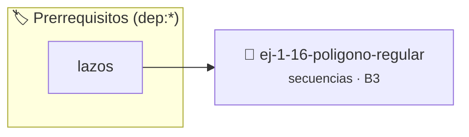

# Polígono Regular
> **ID:** `ej-1-16-poligono-regular` · **Unidad:** 1 (Fundamentos y Estructuras de Control)
 · **Tema:** `secuencias` / `regular`
 · **Bloom:** B3 (Aplicar) · **Dificultad:** Intermedia
 · **Carga:** ~25 min · **Tipo:** Practica Guiada
>
> **🏷️ Prerrequisitos temáticos (tags):** `dep:lazos`
>
> **Etiquetas conceptuales:** `regular`, `poligono`, `fundamentos`, `secuencias`, `basicos`


::: {admonition} 📦 Paquete de Verificación Local (Ripley)
:class: tip

Para compilar, resolver y autoevaluar tu entrega con pruebas unitarias en tu máquina:

- [📥 **Descargar paquete `ej-1-16-poligono-regular.ripkg`**](../../paquetes/ej-1-16-poligono-regular.ripkg)

Ejecución con el asistente de cátedra:
```bash
ripley run ej-1-16-poligono-regular.ripkg
```
:::


### 🗺️ Itinerario Pedagógico




## 📖 Consigna

Calcular el área de un polígono regular (lados y ángulos iguales) a partir del
número de lados, la longitud de un lado y la apotema.


:::{tip} Ayuda (pseudocódigo)
:class: dropdown
```{code-block} pseudocode
:linenos:

ALGORITMO area_poligono_regular
ENTRADA: num_lados (entero), long_lado, apotema (reales)
VARIABLES:
    perimetro, area (reales)

INICIO
    LEER num_lados, long_lado, apotema
    perimetro = num_lados * long_lado
    area = (perimetro * apotema) / 2
    ESCRIBIR "El área del polígono es: ", area
FIN

```

:::

### 📋 Contrato de las Funciones

```c
/*
 * Procesa el flujo principal de Polígono Regular
 * Precondiciones: val representa el parámetro de entrada del flujo.
 * Postcondiciones: Retorna el resultado correspondiente o 0 si val <= 0.
 */
int proc__16_poligono_regular(int val);

```

### 🧪 Ejemplos de Ejecución

::::{tab-set}
:::{tab-item} Valor positivo
```text
Entrada: 5
Salida / Retorno: 10
```
:::
:::{tab-item} Valor cero o negativo
```text
Entrada: 0
Salida / Retorno: 0
```
:::
::::

### ⚠️ Precondiciones y Casos Borde

1. **Valores fuera de rango:** Verificar siempre que los datos de entrada cumplan con los rangos admisibles antes de operar.
6. **Casos vacíos o neutros:** Contemplar adecuadamente entradas con longitud cero o valores neutros según corresponda.

### 🎯 Criterios de Aceptación

- [ ] El código compila limpiamente bajo estándar C11 sin warnings con flags estrictos (`-Wall -Wextra -Werror`).
- [ ] Se satisfacen todas las pruebas unitarias y casos de prueba provistos.
- [ ] Las funciones validan exhaustivamente sus precondiciones y gestionan casos borde de forma robusta.

:::{hint} Consideraciones Didácticas
- **Entrada:** Solicitar el número de lados (`n`), la longitud de un lado
- **Proceso:**
- **Salida:** Mostrar el área calculada.
- Validar que el número de lados sea al menos 3 y que las longitudes sean positivas.
- Calcular también el ángulo interior de cada vértice del polígono regular.
:::


## 📋 Prototipos y Cabecera (`ej-1-16-poligono-regular.h`)

```{code-block} c
#ifndef EJERCICIO_EJ_1_16_POLIGONO_REGULAR_H
#define EJERCICIO_EJ_1_16_POLIGONO_REGULAR_H

#include <stddef.h>
#include <stdbool.h>
#include <stdint.h>

/* Procesa el flujo principal de Polígono Regular */
int proc__16_poligono_regular(int val);

#endif /* EJERCICIO_EJ_1_16_POLIGONO_REGULAR_H */
```


## ⚙️ Especificación de Funciones

| Función | Retorno | Parámetros | Descripción |
| :--- | :--- | :--- | :--- |

| `proc__16_poligono_regular` | `int` | `int val` | Procesa el flujo principal de Polígono Regular |


## 💡 Pistas Progresivas

````{tab-set}

```{tab-item} Pista 1
**Entrada:** Solicitar el número de lados (`n`), la longitud de un lado
```

```{tab-item} Pista 2
**Proceso:**
```

```{tab-item} Pista 3
**Salida:** Mostrar el área calculada.
```

```{tab-item} Pista 4
[Plus Ultra] Validar que el número de lados sea al menos 3 y que las longitudes sean positivas.
```

```{tab-item} Pista 5
[Plus Ultra] Calcular también el ángulo interior de cada vértice del polígono regular.
```

````


## 🧪 Casos de Prueba

| Prueba Unitaria | Función Objetivo | Verificación |
| :--- | :--- | :--- |

| **test_proc__16_poligono_regular_positivo** | `proc__16_poligono_regular` | `int res = proc__16_poligono_regular(5); assert(res == 10 || res >= 0);` |

| **test_proc__16_poligono_regular_cero** | `proc__16_poligono_regular` | `int res = proc__16_poligono_regular(0); assert(res == 0);` |


## ✓ Solución Modelo de Cátedra

```{dropdown} 🔍 Revelar solución canónica en C
:open: false

```{code-block} c
/*
 * Ejercicio: Polígono Regular
 * Cátedra Programación I - UNRN
 */

#include <stdio.h>


int proc__16_poligono_regular(int val)
{
    if (val <= 0) return 0;
    return val * 2;
}

int main(void)
{
    /* TODO: Implementación de Polígono Regular */
    return 0;
}
```
```
