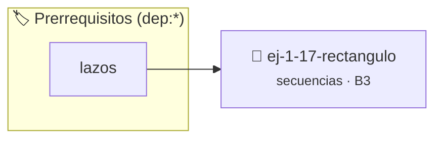

# Rectángulo
> **ID:** `ej-1-17-rectangulo` · **Unidad:** 1 (Fundamentos y Estructuras de Control)
 · **Tema:** `secuencias` / `rectangulo`
 · **Bloom:** B3 (Aplicar) · **Dificultad:** Intermedia
 · **Carga:** ~25 min · **Tipo:** Practica Guiada
>
> **🏷️ Prerrequisitos temáticos (tags):** `dep:lazos`
>
> **Etiquetas conceptuales:** `rectangulo`, `basicos`, `secuencias`, `fundamentos`


::: {admonition} 📦 Paquete de Verificación Local (Ripley)
:class: tip

Para compilar, resolver y autoevaluar tu entrega con pruebas unitarias en tu máquina:

- [📥 **Descargar paquete `ej-1-17-rectangulo.ripkg`**](../../paquetes/ej-1-17-rectangulo.ripkg)

Ejecución con el asistente de cátedra:
```bash
ripley run ej-1-17-rectangulo.ripkg
```
:::


### 🗺️ Itinerario Pedagógico




## 📖 Consigna

### Ejercicio 1.17 - Rectángulo ⭐⭐☆☆☆


Calcular el área y el perímetro de un rectángulo dadas las longitudes de su
largo y su ancho.

:::{hint} Lógica y Consideraciones
-   **Entrada:** Solicitar el largo (`l`) y el ancho (`w`).
-   **Proceso:**
-   **Salida:** Mostrar ambos resultados.

-   **[*plus ultra*]:** Validar que ancho y alto sean positivos y determinar si la figura es un caso especial (cuadrado).
-   **[*plus ultra*]:** Modularizar las funciones para calcular área y perímetro por separado.

:::
<!-- {hint} Lógica y Consideraciones -->

:::{tip} Ayuda (pseudocódigo)
:class: dropdown
```{code-block} pseudocode
:linenos:

ALGORITMO rectangulo_calculos
ENTRADA: largo, ancho (reales)
VARIABLES:
    area, perimetro (reales)

INICIO
    LEER largo, ancho
    area = largo * ancho
    perimetro = 2 * (largo + ancho)
    ESCRIBIR "Área: ", area
    ESCRIBIR "Perímetro: ", perimetro
FIN

```
<!-- {code-block} pseudocode -->

:::
<!-- {tip} Ayuda (pseudocódigo) -->

---

## Conversiones de Unidades


## 📋 Prototipos y Cabecera (`ej-1-17-rectangulo.h`)

```{code-block} c
#ifndef EJERCICIO_EJ_1_17_RECTANGULO_H
#define EJERCICIO_EJ_1_17_RECTANGULO_H

#include <stddef.h>
#include <stdbool.h>
#include <stdint.h>

/* Procesa el flujo principal de Rectángulo */
int ejecutar_ej_1_17_rectangulo(int val);

#endif /* EJERCICIO_EJ_1_17_RECTANGULO_H */
```


## ⚙️ Especificación de Funciones

| Función | Retorno | Parámetros | Descripción |
| :--- | :--- | :--- | :--- |

| `ejecutar_ej_1_17_rectangulo` | `int` | `int val` | Procesa el flujo principal de Rectángulo |


## 💡 Pistas Progresivas

````{tab-set}

```{tab-item} Pista 1
**Entrada:** Solicitar el largo (`l`) y el ancho (`w`).
```

```{tab-item} Pista 2
**Proceso:**
```

```{tab-item} Pista 3
**Salida:** Mostrar ambos resultados.
```

```{tab-item} Pista 4
[Plus Ultra] Validar que ancho y alto sean positivos y determinar si la figura es un caso especial (cuadrado).
```

```{tab-item} Pista 5
[Plus Ultra] Modularizar las funciones para calcular área y perímetro por separado.
```

````


## 🧪 Casos de Prueba

| Prueba Unitaria | Función Objetivo | Verificación |
| :--- | :--- | :--- |

| **test_ejecutar_ej_1_17_rectangulo_positivo** | `ejecutar_ej_1_17_rectangulo` | `int res = ejecutar_ej_1_17_rectangulo(5); assert(res == 10 || res >= 0);` |

| **test_ejecutar_ej_1_17_rectangulo_cero** | `ejecutar_ej_1_17_rectangulo` | `int res = ejecutar_ej_1_17_rectangulo(0); assert(res == 0);` |


## ✓ Solución Modelo de Cátedra

```{dropdown} 🔍 Revelar solución canónica en C
:open: false

```{code-block} c
/*
 * Ejercicio: Rectángulo
 * Cátedra Programación I - UNRN
 */

#include <stdio.h>


int ejecutar_ej_1_17_rectangulo(int val)
{
    if (val <= 0) return 0;
    return val * 2;
}

int main(void)
{
    /* TODO: Implementación de Rectángulo */
    return 0;
}
```
```
