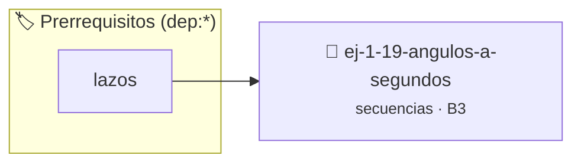

# Ángulos a Segundos
> **ID:** `ej-1-19-angulos-a-segundos` · **Unidad:** 1 (Fundamentos y Estructuras de Control)
 · **Tema:** `secuencias` / `fundamentos`
 · **Bloom:** B3 (Aplicar) · **Dificultad:** Intermedia
 · **Carga:** ~25 min · **Tipo:** Practica Guiada
>
> **🏷️ Prerrequisitos temáticos (tags):** `dep:lazos`
>
> **Etiquetas conceptuales:** `fundamentos`, `angulos`, `secuencias`, `basicos`, `segundos`


::: {admonition} 📦 Paquete de Verificación Local (Ripley)
:class: tip

Para compilar, resolver y autoevaluar tu entrega con pruebas unitarias en tu máquina:

- [📥 **Descargar paquete `ej-1-19-angulos-a-segundos.ripkg`**](../../paquetes/ej-1-19-angulos-a-segundos.ripkg)

Ejecución con el asistente de cátedra:
```bash
ripley run ej-1-19-angulos-a-segundos.ripkg
```
:::


### 🗺️ Itinerario Pedagógico




## 📖 Consigna

### Ejercicio 1.19 - Ángulos a Segundos ⭐⭐☆☆☆


Convertir una medida de ángulo dada en formato sexagesimal (grados, minutos y
segundos) a su valor total equivalente en segundos.

:::{hint} Lógica y Consideraciones
-   **Relaciones:** Recordar que 1 grado = 60 minutos y 1 minuto = 60 segundos.
-   **Entrada:** Solicitar al usuario tres valores enteros: grados, minutos y
-   **Proceso:** Aplicar la fórmula de conversión: $total = (grados \times 3600)
-   **Salida:** Mostrar el total de segundos.

-   **[*plus ultra*]:** Validar que los minutos y segundos estén en el rango [0, 59].
-   **[*plus ultra*]:** Implementar la operación inversa: convertir segundos totales a grados, minutos y segundos.

:::
<!-- {hint} Lógica y Consideraciones -->

:::{tip} Ayuda (pseudocódigo)
:class: dropdown
```{code-block} pseudocode
:linenos:

ALGORITMO angulo_a_segundos
ENTRADA: grados, minutos, segundos (enteros)
VARIABLES:
    total_segundos (entero)

INICIO
    LEER grados, minutos, segundos
    total_segundos = (grados * 3600) + (minutos * 60) + segundos
    ESCRIBIR "El total en segundos es: ", total_segundos
FIN

```
<!-- {code-block} pseudocode -->

:::
<!-- {tip} Ayuda (pseudocódigo) -->

---

## Control de Flujo Avanzado


## 📋 Prototipos y Cabecera (`ej-1-19-angulos-a-segundos.h`)

```{code-block} c
#ifndef EJERCICIO_EJ_1_19_ANGULOS_A_SEGUNDOS_H
#define EJERCICIO_EJ_1_19_ANGULOS_A_SEGUNDOS_H

#include <stddef.h>
#include <stdbool.h>
#include <stdint.h>

/* Procesa el flujo principal de Ángulos a Segundos */
int proc_9_angulos_a_segundos(int val);

#endif /* EJERCICIO_EJ_1_19_ANGULOS_A_SEGUNDOS_H */
```


## ⚙️ Especificación de Funciones

| Función | Retorno | Parámetros | Descripción |
| :--- | :--- | :--- | :--- |

| `proc_9_angulos_a_segundos` | `int` | `int val` | Procesa el flujo principal de Ángulos a Segundos |


## 💡 Pistas Progresivas

````{tab-set}

```{tab-item} Pista 1
**Relaciones:** Recordar que 1 grado = 60 minutos y 1 minuto = 60 segundos.
```

```{tab-item} Pista 2
**Entrada:** Solicitar al usuario tres valores enteros: grados, minutos y
```

```{tab-item} Pista 3
**Proceso:** Aplicar la fórmula de conversión: $total = (grados \times 3600)
```

```{tab-item} Pista 4
**Salida:** Mostrar el total de segundos.
```

```{tab-item} Pista 5
[Plus Ultra] Validar que los minutos y segundos estén en el rango [0, 59].
```

```{tab-item} Pista 6
[Plus Ultra] Implementar la operación inversa: convertir segundos totales a grados, minutos y segundos.
```

````


## 🧪 Casos de Prueba

| Prueba Unitaria | Función Objetivo | Verificación |
| :--- | :--- | :--- |

| **test_proc_9_angulos_a_segundos_positivo** | `proc_9_angulos_a_segundos` | `int res = proc_9_angulos_a_segundos(5); assert(res == 10 || res >= 0);` |

| **test_proc_9_angulos_a_segundos_cero** | `proc_9_angulos_a_segundos` | `int res = proc_9_angulos_a_segundos(0); assert(res == 0);` |


## ✓ Solución Modelo de Cátedra

```{dropdown} 🔍 Revelar solución canónica en C
:open: false

```{code-block} c
/*
 * Ejercicio: Ángulos a Segundos
 * Cátedra Programación I - UNRN
 */

#include <stdio.h>


int proc_9_angulos_a_segundos(int val)
{
    if (val <= 0) return 0;
    return val * 2;
}

int main(void)
{
    /* TODO: Implementación de Ángulos a Segundos */
    return 0;
}
```
```
