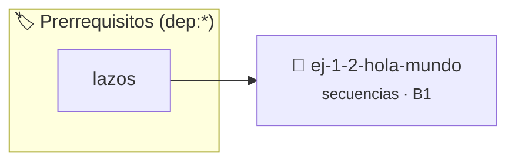

# ¡Hola mundo!
> **ID:** `ej-1-2-hola-mundo` · **Unidad:** 1 (Fundamentos y Estructuras de Control)
 · **Tema:** `secuencias` / `mundo`
 · **Bloom:** B1 (Recordar) · **Dificultad:** Inicial
 · **Carga:** ~10 min · **Tipo:** Concepto
>
> **🏷️ Prerrequisitos temáticos (tags):** `dep:lazos`
>
> **Etiquetas conceptuales:** `mundo`, `hola`, `fundamentos`, `secuencias`, `basicos`


::: {admonition} 📦 Paquete de Verificación Local (Ripley)
:class: tip

Para compilar, resolver y autoevaluar tu entrega con pruebas unitarias en tu máquina:

- [📥 **Descargar paquete `ej-1-2-hola-mundo.ripkg`**](../../paquetes/ej-1-2-hola-mundo.ripkg)

Ejecución con el asistente de cátedra:
```bash
ripley run ej-1-2-hola-mundo.ripkg
```
:::


### 🗺️ Itinerario Pedagógico




## 📖 Consigna

### Ejercicio 1.2 - ¡Hola mundo! ⭐⭐☆☆☆


El "Hola, mundo!" es el primer paso tradicional en el aprendizaje de un nuevo
lenguaje de programación. El objetivo es escribir el programa más simple posible
que produzca una salida visible en la pantalla, confirmando que el compilador y
el entorno de desarrollo están configurados y funcionando correctamente.

:::{hint} Lógica y Consideraciones
-   **Entrada:** Este programa no requiere ninguna entrada del usuario.
-   **Proceso:** Se utiliza una función de la biblioteca estándar para enviar
-   **Salida:** El programa debe imprimir la cadena de texto "Hola, mundo!"

-   **[*plus ultra*]:** Imprimir un marco decorativo alrededor del saludo usando caracteres ASCII estándar.
-   **[*plus ultra*]:** Modularizar la impresión dentro de una función con una firma clara.

:::
<!-- {hint} Lógica y Consideraciones -->

:::{tip} Ayuda (pseudocódigo)
:class: dropdown
```{code-block} pseudocode

ALGORITMO hola_mundo

INICIO
    ESCRIBIR "Hola, mundo!"
FIN

```
<!-- {code-block} pseudocode -->

:::
<!-- {tip} Ayuda (pseudocódigo) -->


## 📋 Prototipos y Cabecera (`ej-1-2-hola-mundo.h`)

```{code-block} c
#ifndef EJERCICIO_EJ_1_2_HOLA_MUNDO_H
#define EJERCICIO_EJ_1_2_HOLA_MUNDO_H

#include <stddef.h>
#include <stdbool.h>
#include <stdint.h>

/* Procesa el flujo principal de ¡Hola mundo! */
int ejecutar_ej_1_2_hola_mundo(int val);

#endif /* EJERCICIO_EJ_1_2_HOLA_MUNDO_H */
```


## ⚙️ Especificación de Funciones

| Función | Retorno | Parámetros | Descripción |
| :--- | :--- | :--- | :--- |

| `ejecutar_ej_1_2_hola_mundo` | `int` | `int val` | Procesa el flujo principal de ¡Hola mundo! |


## 💡 Pistas Progresivas

````{tab-set}

```{tab-item} Pista 1
**Entrada:** Este programa no requiere ninguna entrada del usuario.
```

```{tab-item} Pista 2
**Proceso:** Se utiliza una función de la biblioteca estándar para enviar
```

```{tab-item} Pista 3
**Salida:** El programa debe imprimir la cadena de texto "Hola, mundo!"
```

```{tab-item} Pista 4
[Plus Ultra] Imprimir un marco decorativo alrededor del saludo usando caracteres ASCII estándar.
```

```{tab-item} Pista 5
[Plus Ultra] Modularizar la impresión dentro de una función con una firma clara.
```

````


## 🧪 Casos de Prueba

| Prueba Unitaria | Función Objetivo | Verificación |
| :--- | :--- | :--- |

| **test_ejecutar_ej_1_2_hola_mundo_positivo** | `ejecutar_ej_1_2_hola_mundo` | `int res = ejecutar_ej_1_2_hola_mundo(5); assert(res == 10 || res >= 0);` |

| **test_ejecutar_ej_1_2_hola_mundo_cero** | `ejecutar_ej_1_2_hola_mundo` | `int res = ejecutar_ej_1_2_hola_mundo(0); assert(res == 0);` |


## ✓ Solución Modelo de Cátedra

```{dropdown} 🔍 Revelar solución canónica en C
:open: false

```{code-block} c
/*
 * Ejercicio: ¡Hola mundo!
 * Cátedra Programación I - UNRN
 */

#include <stdio.h>


int ejecutar_ej_1_2_hola_mundo(int val)
{
    if (val <= 0) return 0;
    return val * 2;
}

int main(void)
{
    /* TODO: Implementación de ¡Hola mundo! */
    return 0;
}
```
```
