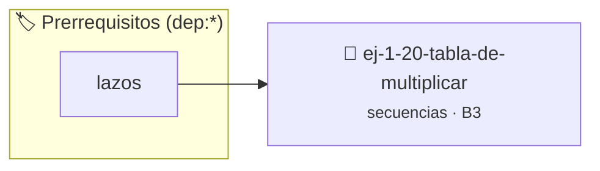

# Tabla de Multiplicar
> **ID:** `ej-1-20-tabla-de-multiplicar` · **Unidad:** 1 (Fundamentos y Estructuras de Control)
 · **Tema:** `secuencias` / `fundamentos`
 · **Bloom:** B3 (Aplicar) · **Dificultad:** Intermedia
 · **Carga:** ~25 min · **Tipo:** Practica Guiada
>
> **🏷️ Prerrequisitos temáticos (tags):** `dep:lazos`
>
> **Etiquetas conceptuales:** `fundamentos`, `secuencias`, `tabla`, `basicos`, `multiplicar`


::: {admonition} 📦 Paquete de Verificación Local (Ripley)
:class: tip

Para compilar, resolver y autoevaluar tu entrega con pruebas unitarias en tu máquina:

- [📥 **Descargar paquete `ej-1-20-tabla-de-multiplicar.ripkg`**](../../paquetes/ej-1-20-tabla-de-multiplicar.ripkg)

Ejecución con el asistente de cátedra:
```bash
ripley run ej-1-20-tabla-de-multiplicar.ripkg
```
:::


### 🗺️ Itinerario Pedagógico




## 📖 Consigna

### Ejercicio 1.20 - Tabla de Multiplicar ⭐⭐☆☆☆


El programa debe solicitar un número entero al usuario y mostrar su tabla de
multiplicar, desde el 1 hasta el 10.

:::{hint} Lógica y Consideraciones
-   **Entrada:** Leer un número entero, que será la base de la tabla.
-   **Proceso:** Utilizar un lazo `for` que itere desde 1 hasta 10. En cada
-   **Salida:** Dentro del lazo, imprimir la operación y su resultado en un

-   **[*plus ultra*]:** Formatear la tabla con columnas alineadas usando especificadores de ancho en printf.
-   **[*plus ultra*]:** Permitir al usuario elegir hasta qué múltiplo generar la tabla (por defecto 10).

:::
<!-- {hint} Lógica y Consideraciones -->

:::{tip} Ayuda (pseudocódigo)
:class: dropdown
```{code-block} pseudocode
:linenos:

ALGORITMO tabla_de_multiplicar
ENTRADA: numero_base (entero)

INICIO
    LEER numero_base
    PARA i DESDE 1 HASTA 10 HACER
        resultado = numero_base * i
        ESCRIBIR numero_base, " x ", i, " = ", resultado
    FIN PARA
FIN

```
<!-- {code-block} pseudocode -->

:::
<!-- {tip} Ayuda (pseudocódigo) -->


## 📋 Prototipos y Cabecera (`ej-1-20-tabla-de-multiplicar.h`)

```{code-block} c
#ifndef EJERCICIO_EJ_1_20_TABLA_DE_MULTIPLICAR_H
#define EJERCICIO_EJ_1_20_TABLA_DE_MULTIPLICAR_H

#include <stddef.h>
#include <stdbool.h>
#include <stdint.h>

/* Procesa el flujo principal de Tabla de Multiplicar */
int proc_tabla_de_multiplicar(int val);

#endif /* EJERCICIO_EJ_1_20_TABLA_DE_MULTIPLICAR_H */
```


## ⚙️ Especificación de Funciones

| Función | Retorno | Parámetros | Descripción |
| :--- | :--- | :--- | :--- |

| `proc_tabla_de_multiplicar` | `int` | `int val` | Procesa el flujo principal de Tabla de Multiplicar |


## 💡 Pistas Progresivas

````{tab-set}

```{tab-item} Pista 1
**Entrada:** Leer un número entero, que será la base de la tabla.
```

```{tab-item} Pista 2
**Proceso:** Utilizar un lazo `for` que itere desde 1 hasta 10. En cada
```

```{tab-item} Pista 3
**Salida:** Dentro del lazo, imprimir la operación y su resultado en un
```

```{tab-item} Pista 4
[Plus Ultra] Formatear la tabla con columnas alineadas usando especificadores de ancho en printf.
```

```{tab-item} Pista 5
[Plus Ultra] Permitir al usuario elegir hasta qué múltiplo generar la tabla (por defecto 10).
```

````


## 🧪 Casos de Prueba

| Prueba Unitaria | Función Objetivo | Verificación |
| :--- | :--- | :--- |

| **test_proc_tabla_de_multiplicar_positivo** | `proc_tabla_de_multiplicar` | `int res = proc_tabla_de_multiplicar(5); assert(res == 10 || res >= 0);` |

| **test_proc_tabla_de_multiplicar_cero** | `proc_tabla_de_multiplicar` | `int res = proc_tabla_de_multiplicar(0); assert(res == 0);` |


## ✓ Solución Modelo de Cátedra

```{dropdown} 🔍 Revelar solución canónica en C
:open: false

```{code-block} c
/*
 * Ejercicio: Tabla de Multiplicar
 * Cátedra Programación I - UNRN
 */

#include <stdio.h>


int proc_tabla_de_multiplicar(int val)
{
    if (val <= 0) return 0;
    return val * 2;
}

int main(void)
{
    /* TODO: Implementación de Tabla de Multiplicar */
    return 0;
}
```
```
