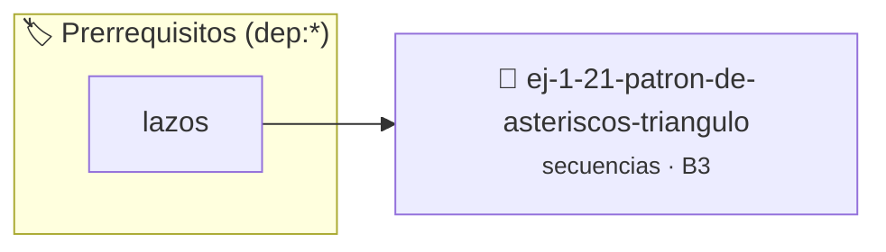

# Patrón de Asteriscos (Triángulo)
> **ID:** `ej-1-21-patron-de-asteriscos-triangulo` · **Unidad:** 1 (Fundamentos y Estructuras de Control)
 · **Tema:** `secuencias` / `patron`
 · **Bloom:** B3 (Aplicar) · **Dificultad:** Intermedia
 · **Carga:** ~25 min · **Tipo:** Practica Guiada
>
> **🏷️ Prerrequisitos temáticos (tags):** `dep:lazos`
>
> **Etiquetas conceptuales:** `patron`, `asteriscos`, `fundamentos`, `secuencias`, `triangulo`


::: {admonition} 📦 Paquete de Verificación Local (Ripley)
:class: tip

Para compilar, resolver y autoevaluar tu entrega con pruebas unitarias en tu máquina:

- [📥 **Descargar paquete `ej-1-21-patron-de-asteriscos-triangulo.ripkg`**](../../paquetes/ej-1-21-patron-de-asteriscos-triangulo.ripkg)

Ejecución con el asistente de cátedra:
```bash
ripley run ej-1-21-patron-de-asteriscos-triangulo.ripkg
```
:::


### 🗺️ Itinerario Pedagógico




## 📖 Consigna

Implementar un programa que pida un número `n` e imprima un triángulo rectángulo
de `n` filas de altura, construido con asteriscos.


:::{tip} Ayuda (pseudocódigo)
:class: dropdown
```{code-block} pseudocode
:linenos:

ALGORITMO triangulo_asteriscos
ENTRADA: n (entero)

INICIO
    PARA fila DESDE 1 HASTA n HACER
        PARA columna DESDE 1 HASTA fila HACER
            ESCRIBIR "*" SIN SALTO DE LÍNEA
        FIN PARA
        ESCRIBIR SALTO DE LÍNEA
    FIN PARA
FIN

```

:::

### 📋 Contrato de las Funciones

```c
/*
 * Procesa el flujo principal de Patrón de Asteriscos (Triángulo)
 * Precondiciones: val representa el parámetro de entrada del flujo.
 * Postcondiciones: Retorna el resultado correspondiente o 0 si val <= 0.
 */
int proc_asteriscos_triangulo(int val);

```

### 🧪 Ejemplos de Ejecución

::::{tab-set}
:::{tab-item} Valor positivo
```text
Entrada: 5
Salida / Retorno: 10
```
:::
:::{tab-item} Valor cero o negativo
```text
Entrada: 0
Salida / Retorno: 0
```
:::
::::

### ⚠️ Precondiciones y Casos Borde

1. **Valores fuera de rango:** Verificar siempre que los datos de entrada cumplan con los rangos admisibles antes de operar.
6. **Casos vacíos o neutros:** Contemplar adecuadamente entradas con longitud cero o valores neutros según corresponda.

### 🎯 Criterios de Aceptación

- [ ] El código compila limpiamente bajo estándar C11 sin warnings con flags estrictos (`-Wall -Wextra -Werror`).
- [ ] Se satisfacen todas las pruebas unitarias y casos de prueba provistos.
- [ ] Las funciones validan exhaustivamente sus precondiciones y gestionan casos borde de forma robusta.

:::{hint} Consideraciones Didácticas
- **Entrada:** Leer un entero `n` para la altura del triángulo.
- **Proceso:** Se necesitan dos lazos aninados.
- **Salida:** Después de que el lazo interior complete sus iteraciones para
- Parametrizar el carácter de dibujo permitiendo al usuario elegir el símbolo.
- Validar que la altura sea un entero positivo mayor o igual a 1.
:::


## 📋 Prototipos y Cabecera (`ej-1-21-patron-de-asteriscos-triangulo.h`)

```{code-block} c
#ifndef EJERCICIO_EJ_1_21_PATRON_DE_ASTERISCOS_TRIANGULO_H
#define EJERCICIO_EJ_1_21_PATRON_DE_ASTERISCOS_TRIANGULO_H

#include <stddef.h>
#include <stdbool.h>
#include <stdint.h>

/* Procesa el flujo principal de Patrón de Asteriscos (Triángulo) */
int proc_asteriscos_triangulo(int val);

#endif /* EJERCICIO_EJ_1_21_PATRON_DE_ASTERISCOS_TRIANGULO_H */
```


## ⚙️ Especificación de Funciones

| Función | Retorno | Parámetros | Descripción |
| :--- | :--- | :--- | :--- |

| `proc_asteriscos_triangulo` | `int` | `int val` | Procesa el flujo principal de Patrón de Asteriscos (Triángulo) |


## 💡 Pistas Progresivas

````{tab-set}

```{tab-item} Pista 1
**Entrada:** Leer un entero `n` para la altura del triángulo.
```

```{tab-item} Pista 2
**Proceso:** Se necesitan dos lazos aninados.
```

```{tab-item} Pista 3
**Salida:** Después de que el lazo interior complete sus iteraciones para
```

```{tab-item} Pista 4
[Plus Ultra] Parametrizar el carácter de dibujo permitiendo al usuario elegir el símbolo.
```

```{tab-item} Pista 5
[Plus Ultra] Validar que la altura sea un entero positivo mayor o igual a 1.
```

````


## 🧪 Casos de Prueba

| Prueba Unitaria | Función Objetivo | Verificación |
| :--- | :--- | :--- |

| **test_proc_asteriscos_triangulo_positivo** | `proc_asteriscos_triangulo` | `int res = proc_asteriscos_triangulo(5); assert(res == 10 || res >= 0);` |

| **test_proc_asteriscos_triangulo_cero** | `proc_asteriscos_triangulo` | `int res = proc_asteriscos_triangulo(0); assert(res == 0);` |


## ✓ Solución Modelo de Cátedra

```{dropdown} 🔍 Revelar solución canónica en C
:open: false

```{code-block} c
/*
 * Ejercicio: Patrón de Asteriscos (Triángulo)
 * Cátedra Programación I - UNRN
 */

#include <stdio.h>


int proc_asteriscos_triangulo(int val)
{
    if (val <= 0) return 0;
    return val * 2;
}

int main(void)
{
    /* TODO: Implementación de Patrón de Asteriscos (Triángulo) */
    return 0;
}
```
```
