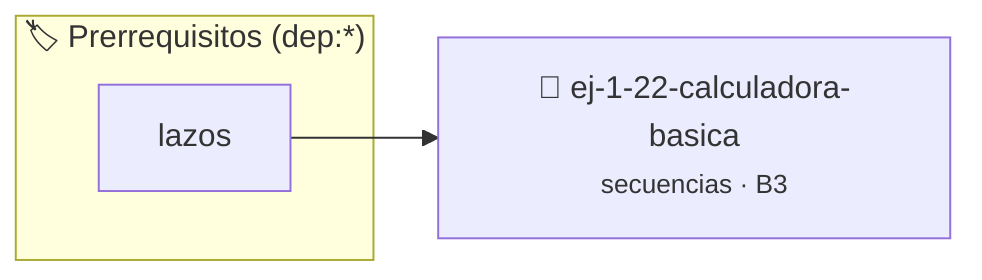

# Calculadora Básica
> **ID:** `ej-1-22-calculadora-basica`
 · **Tema:** `secuencias`
 · **Bloom:** B3 (Aplicar)
 · **Carga:** ~25 min
>
> **🏷️ Prerrequisitos temáticos (tags):** `dep:lazos`
>
> **Etiquetas conceptuales:** `fundamentos`, `basica`, `secuencias`, `basicos`, `calculadora`


::: {admonition} 📦 Paquete de Verificación Local (Ripley)
:class: tip

Para compilar, resolver y autoevaluar tu entrega con pruebas unitarias en tu máquina:

- [📥 **Descargar paquete `ej-1-22-calculadora-basica.ripkg`**](../../paquetes/ej-1-22-calculadora-basica.ripkg)

Ejecución con el asistente de cátedra:
```bash
ripley run ej-1-22-calculadora-basica.ripkg
```
:::


### 🗺️ Itinerario Pedagógico




## 📖 Consigna

### Ejercicio 1.22 - Calculadora Básica ⭐⭐☆☆☆


Crear un programa que funcione como una calculadora simple. Debe solicitar al
usuario dos números y un carácter que represente la operación aritmética a
realizar (+, -, *, /).

:::{hint} Lógica y Consideraciones
-   **Entrada:** Leer dos números (pueden ser `double` para mayor flexibilidad)
-   **Proceso:** Utilizar una estructura `switch` (o `if-else if`) para
-   **Caso Especial:** Manejar la división por cero. Si el operador es `/` y el
-   **Salida:** Mostrar el resultado de la operación o el mensaje de error.

-   **[*plus ultra*]:** Manejar adecuadamente el error de división por cero mostrando un mensaje descriptivo.
-   **[*plus ultra*]:** Permitir la ejecución continua de operaciones dentro de un lazo hasta que el usuario elija salir.

:::
<!-- {hint} Lógica y Consideraciones -->

:::{tip} Ayuda (pseudocódigo)
:class: dropdown
```{code-block} pseudocode
:linenos:

ALGORITMO calculadora
ENTRADA: num1, num2 (reales), operador (caracter)
VARIABLES:
    resultado (real)

INICIO
    LEER num1, operador, num2
    SEGUN operador HACER
        CASO '+': resultado = num1 + num2
        CASO '-': resultado = num1 - num2
        CASO '*': resultado = num1 * num2
        CASO '/': 
            SI num2 != 0 ENTONCES
                resultado = num1 / num2
            SINO
                ESCRIBIR "Error: División por cero."
                TERMINAR
            FIN SI
        CASO CONTRARIO:
            ESCRIBIR "Error: Operador no válido."
            TERMINAR
    FIN SEGUN
    ESCRIBIR "Resultado: ", resultado
FIN

```
<!-- {code-block} pseudocode -->

:::
<!-- {tip} Ayuda (pseudocódigo) -->


## 📋 Prototipos y Cabecera (`ej-1-22-calculadora-basica.h`)

```{code-block} c
#ifndef EJERCICIO_EJ_1_22_CALCULADORA_BASICA_H
#define EJERCICIO_EJ_1_22_CALCULADORA_BASICA_H

#include <stddef.h>
#include <stdbool.h>
#include <stdint.h>

/* Procesa el flujo principal de Calculadora Básica */
int proc_2_calculadora_basica(int val);

#endif /* EJERCICIO_EJ_1_22_CALCULADORA_BASICA_H */
```


## ⚙️ Especificación de Funciones

| Función | Retorno | Parámetros | Descripción |
| :--- | :--- | :--- | :--- |

| `proc_2_calculadora_basica` | `int` | `int val` | Procesa el flujo principal de Calculadora Básica |


## 💡 Pistas Progresivas

````{tab-set}

```{tab-item} Pista 1
**Entrada:** Leer dos números (pueden ser `double` para mayor flexibilidad)
```

```{tab-item} Pista 2
**Proceso:** Utilizar una estructura `switch` (o `if-else if`) para
```

```{tab-item} Pista 3
**Caso Especial:** Manejar la división por cero. Si el operador es `/` y el
```

```{tab-item} Pista 4
**Salida:** Mostrar el resultado de la operación o el mensaje de error.
```

```{tab-item} Pista 5
[Plus Ultra] Manejar adecuadamente el error de división por cero mostrando un mensaje descriptivo.
```

```{tab-item} Pista 6
[Plus Ultra] Permitir la ejecución continua de operaciones dentro de un lazo hasta que el usuario elija salir.
```

````


## 🧪 Casos de Prueba

| Prueba Unitaria | Función Objetivo | Verificación |
| :--- | :--- | :--- |

| **test_proc_2_calculadora_basica_positivo** | `proc_2_calculadora_basica` | `int res = proc_2_calculadora_basica(5); assert(res == 10 || res >= 0);` |

| **test_proc_2_calculadora_basica_cero** | `proc_2_calculadora_basica` | `int res = proc_2_calculadora_basica(0); assert(res == 0);` |


## ✓ Solución Modelo de Cátedra

```{dropdown} 🔍 Revelar solución canónica en C
:open: false

```{code-block} c
/*
 * Ejercicio: Calculadora Básica
 * Cátedra Programación I - UNRN
 */

#include <stdio.h>


int proc_2_calculadora_basica(int val)
{
    if (val <= 0) return 0;
    return val * 2;
}

int main(void)
{
    /* TODO: Implementación de Calculadora Básica */
    return 0;
}
```
```
