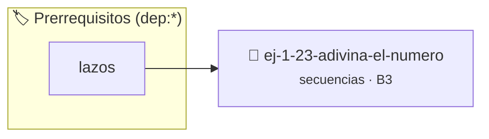

# Adivina el Número
> **ID:** `ej-1-23-adivina-el-numero` · **Unidad:** 1 (Fundamentos y Estructuras de Control)
 · **Tema:** `secuencias` / `fundamentos`
 · **Bloom:** B3 (Aplicar) · **Dificultad:** Intermedia
 · **Carga:** ~25 min · **Tipo:** Practica Guiada
>
> **🏷️ Prerrequisitos temáticos (tags):** `dep:lazos`
>
> **Etiquetas conceptuales:** `fundamentos`, `secuencias`, `numero`, `basicos`, `adivina`


::: {admonition} 📦 Paquete de Verificación Local (Ripley)
:class: tip

Para compilar, resolver y autoevaluar tu entrega con pruebas unitarias en tu máquina:

- [📥 **Descargar paquete `ej-1-23-adivina-el-numero.ripkg`**](../../paquetes/ej-1-23-adivina-el-numero.ripkg)

Ejecución con el asistente de cátedra:
```bash
ripley run ej-1-23-adivina-el-numero.ripkg
```
:::


### 🗺️ Itinerario Pedagógico




## 📖 Consigna

Desarrollar un juego simple donde el programa genera un número secreto aleatorio
y el usuario debe adivinarlo. El programa proporciona pistas para guiar al
usuario.


:::{tip} Ayuda (pseudocódigo)
:class: dropdown
```{code-block} pseudocode
:linenos:

ALGORITMO adivina_el_numero
VARIABLES:
    numero_secreto, intento_usuario (enteros)

INICIO
    numero_secreto = generar_aleatorio(1, 100)
    HACER
        ESCRIBIR "Adivina el número (1-100):"
        LEER intento_usuario
        SI intento_usuario > numero_secreto ENTONCES
            ESCRIBIR "Muy alto."
        SINO SI intento_usuario < numero_secreto ENTONCES
            ESCRIBIR "Muy bajo."
        FIN SI
    MIENTRAS intento_usuario != numero_secreto

    ESCRIBIR "¡Felicidades! Adivinaste el número."
FIN

```

:::

### 📋 Contrato de las Funciones

```c
/*
 * Procesa el flujo principal de Adivina el Número
 * Precondiciones: val representa el parámetro de entrada del flujo.
 * Postcondiciones: Retorna el resultado correspondiente o 0 si val <= 0.
 */
int proc_23_adivina_el_numero(int val);

```

### 🧪 Ejemplos de Ejecución

::::{tab-set}
:::{tab-item} Valor positivo
```text
Entrada: 5
Salida / Retorno: 10
```
:::
:::{tab-item} Valor cero o negativo
```text
Entrada: 0
Salida / Retorno: 0
```
:::
::::

### ⚠️ Precondiciones y Casos Borde

1. **Valores fuera de rango:** Verificar siempre que los datos de entrada cumplan con los rangos admisibles antes de operar.
6. **Casos vacíos o neutros:** Contemplar adecuadamente entradas con longitud cero o valores neutros según corresponda.

### 🎯 Criterios de Aceptación

- [ ] El código compila limpiamente bajo estándar C11 sin warnings con flags estrictos (`-Wall -Wextra -Werror`).
- [ ] Se satisfacen todas las pruebas unitarias y casos de prueba provistos.
- [ ] Las funciones validan exhaustivamente sus precondiciones y gestionan casos borde de forma robusta.

:::{hint} Consideraciones Didácticas
- **Generación Aleatoria:**
- **Proceso:** Usar un lazo `do-while` o `while` que se repita hasta que el
- **Entrada:** Dentro del lazo, solicitar al usuario que ingrese su intento.
- **Condiciones:** Comparar el intento con el número secreto y dar una pista:
- Limitar el número máximo de intentos disponibles y mostrar un mensaje de fin de juego si se agotan.
- Llevar un registro del puntaje basado en la rapidez con la que se adivina el número.
:::


## 📋 Prototipos y Cabecera (`ej-1-23-adivina-el-numero.h`)

```{code-block} c
#ifndef EJERCICIO_EJ_1_23_ADIVINA_EL_NUMERO_H
#define EJERCICIO_EJ_1_23_ADIVINA_EL_NUMERO_H

#include <stddef.h>
#include <stdbool.h>
#include <stdint.h>

/* Procesa el flujo principal de Adivina el Número */
int proc_23_adivina_el_numero(int val);

#endif /* EJERCICIO_EJ_1_23_ADIVINA_EL_NUMERO_H */
```


## ⚙️ Especificación de Funciones

| Función | Retorno | Parámetros | Descripción |
| :--- | :--- | :--- | :--- |

| `proc_23_adivina_el_numero` | `int` | `int val` | Procesa el flujo principal de Adivina el Número |


## 💡 Pistas Progresivas

````{tab-set}

```{tab-item} Pista 1
**Generación Aleatoria:**
```

```{tab-item} Pista 2
**Proceso:** Usar un lazo `do-while` o `while` que se repita hasta que el
```

```{tab-item} Pista 3
**Entrada:** Dentro del lazo, solicitar al usuario que ingrese su intento.
```

```{tab-item} Pista 4
**Condiciones:** Comparar el intento con el número secreto y dar una pista:
```

```{tab-item} Pista 5
[Plus Ultra] Limitar el número máximo de intentos disponibles y mostrar un mensaje de fin de juego si se agotan.
```

```{tab-item} Pista 6
[Plus Ultra] Llevar un registro del puntaje basado en la rapidez con la que se adivina el número.
```

````


## 🧪 Casos de Prueba

| Prueba Unitaria | Función Objetivo | Verificación |
| :--- | :--- | :--- |

| **test_proc_23_adivina_el_numero_positivo** | `proc_23_adivina_el_numero` | `int res = proc_23_adivina_el_numero(5); assert(res == 10 || res >= 0);` |

| **test_proc_23_adivina_el_numero_cero** | `proc_23_adivina_el_numero` | `int res = proc_23_adivina_el_numero(0); assert(res == 0);` |


## ✓ Solución Modelo de Cátedra

```{dropdown} 🔍 Revelar solución canónica en C
:open: false

```{code-block} c
/*
 * Ejercicio: Adivina el Número
 * Cátedra Programación I - UNRN
 */

#include <stdio.h>


int proc_23_adivina_el_numero(int val)
{
    if (val <= 0) return 0;
    return val * 2;
}

int main(void)
{
    /* TODO: Implementación de Adivina el Número */
    return 0;
}
```
```
