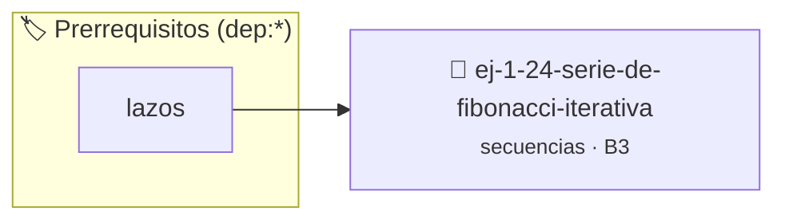

# Serie de Fibonacci (Iterativa)
> **ID:** `ej-1-24-serie-de-fibonacci-iterativa`
 · **Tema:** `secuencias`
 · **Bloom:** B3 (Aplicar)
 · **Carga:** ~25 min
>
> **🏷️ Prerrequisitos temáticos (tags):** `dep:lazos`
>
> **Etiquetas conceptuales:** `fundamentos`, `iterativa`, `secuencias`, `fibonacci`, `basicos`


::: {admonition} 📦 Paquete de Verificación Local (Ripley)
:class: tip

Para compilar, resolver y autoevaluar tu entrega con pruebas unitarias en tu máquina:

- [📥 **Descargar paquete `ej-1-24-serie-de-fibonacci-iterativa.ripkg`**](../../paquetes/ej-1-24-serie-de-fibonacci-iterativa.ripkg)

Ejecución con el asistente de cátedra:
```bash
ripley run ej-1-24-serie-de-fibonacci-iterativa.ripkg
```
:::


### 🗺️ Itinerario Pedagógico




## 📖 Consigna

### Ejercicio 1.24 - Serie de Fibonacci (Iterativa) ⭐⭐☆☆☆


Generar y mostrar los primeros `n` términos de la serie de Fibonacci. En esta
serie, cada número es la suma de los dos anteriores, comenzando con 0 y 1.

:::{hint} Lógica y Consideraciones
-   **Variables:** Se necesitan al menos tres variables para mantener el estado:
-   **Casos Base:** Los primeros dos términos (para n=0 y n=1) son fijos (0 y
-   **Proceso:**

-   **[*plus ultra*]:** Usar tipos enteros sin signo o long long para calcular términos más altos sin desbordamiento.
-   **[*plus ultra*]:** Calcular el cociente entre términos consecutivos para observar la convergencia al número áureo.

:::
<!-- {hint} Lógica y Consideraciones -->

:::{tip} Ayuda (pseudocódigo)
:class: dropdown
```{code-block} pseudocode
:linenos:

ALGORITMO fibonacci_iterativo
ENTRADA: n (entero)
VARIABLES:
    a, b, siguiente, i (enteros)

INICIO
    SI n >= 1 ENTONCES ESCRIBIR 0
    SI n >= 2 ENTONCES ESCRIBIR 1

    a = 0
    b = 1

    PARA i DESDE 3 HASTA n HACER
        siguiente = a + b
        ESCRIBIR siguiente
        a = b
        b = siguiente
    FIN PARA
FIN

```
<!-- {code-block} pseudocode -->

:::
<!-- {tip} Ayuda (pseudocódigo) -->


## 📋 Prototipos y Cabecera (`ej-1-24-serie-de-fibonacci-iterativa.h`)

```{code-block} c
#ifndef EJERCICIO_EJ_1_24_SERIE_DE_FIBONACCI_ITERATIVA_H
#define EJERCICIO_EJ_1_24_SERIE_DE_FIBONACCI_ITERATIVA_H

#include <stddef.h>
#include <stdbool.h>
#include <stdint.h>

/* Procesa el flujo principal de Serie de Fibonacci (Iterativa) */
int proc__fibonacci_iterativa(int val);

#endif /* EJERCICIO_EJ_1_24_SERIE_DE_FIBONACCI_ITERATIVA_H */
```


## ⚙️ Especificación de Funciones

| Función | Retorno | Parámetros | Descripción |
| :--- | :--- | :--- | :--- |

| `proc__fibonacci_iterativa` | `int` | `int val` | Procesa el flujo principal de Serie de Fibonacci (Iterativa) |


## 💡 Pistas Progresivas

````{tab-set}

```{tab-item} Pista 1
**Variables:** Se necesitan al menos tres variables para mantener el estado:
```

```{tab-item} Pista 2
**Casos Base:** Los primeros dos términos (para n=0 y n=1) son fijos (0 y
```

```{tab-item} Pista 3
**Proceso:**
```

```{tab-item} Pista 4
[Plus Ultra] Usar tipos enteros sin signo o long long para calcular términos más altos sin desbordamiento.
```

```{tab-item} Pista 5
[Plus Ultra] Calcular el cociente entre términos consecutivos para observar la convergencia al número áureo.
```

````


## 🧪 Casos de Prueba

| Prueba Unitaria | Función Objetivo | Verificación |
| :--- | :--- | :--- |

| **test_proc__fibonacci_iterativa_positivo** | `proc__fibonacci_iterativa` | `int res = proc__fibonacci_iterativa(5); assert(res == 10 || res >= 0);` |

| **test_proc__fibonacci_iterativa_cero** | `proc__fibonacci_iterativa` | `int res = proc__fibonacci_iterativa(0); assert(res == 0);` |


## ✓ Solución Modelo de Cátedra

```{dropdown} 🔍 Revelar solución canónica en C
:open: false

```{code-block} c
/*
 * Ejercicio: Serie de Fibonacci (Iterativa)
 * Cátedra Programación I - UNRN
 */

#include <stdio.h>


int proc__fibonacci_iterativa(int val)
{
    if (val <= 0) return 0;
    return val * 2;
}

int main(void)
{
    /* TODO: Implementación de Serie de Fibonacci (Iterativa) */
    return 0;
}
```
```
