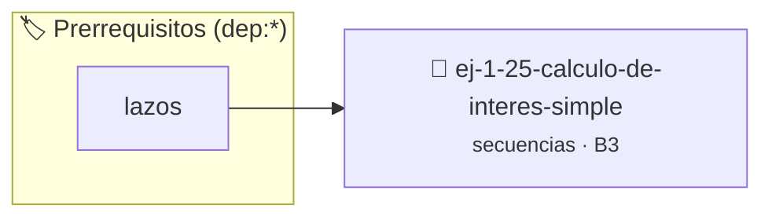

# Cálculo de Interés Simple
> **ID:** `ej-1-25-calculo-de-interes-simple` · **Unidad:** 1 (Fundamentos y Estructuras de Control)
 · **Tema:** `secuencias` / `fundamentos`
 · **Bloom:** B3 (Aplicar) · **Dificultad:** Intermedia
 · **Carga:** ~25 min · **Tipo:** Practica Guiada
>
> **🏷️ Prerrequisitos temáticos (tags):** `dep:lazos`
>
> **Etiquetas conceptuales:** `fundamentos`, `calculo`, `interes`, `secuencias`, `basicos`


::: {admonition} 📦 Paquete de Verificación Local (Ripley)
:class: tip

Para compilar, resolver y autoevaluar tu entrega con pruebas unitarias en tu máquina:

- [📥 **Descargar paquete `ej-1-25-calculo-de-interes-simple.ripkg`**](../../paquetes/ej-1-25-calculo-de-interes-simple.ripkg)

Ejecución con el asistente de cátedra:
```bash
ripley run ej-1-25-calculo-de-interes-simple.ripkg
```
:::


### 🗺️ Itinerario Pedagógico




## 📖 Consigna

### Ejercicio 1.25 - Cálculo de Interés Simple ⭐☆☆☆☆


Implementar una función que calcule el monto final y el interés simple ganado a
partir de un capital inicial, una tasa de interés anual y un período de tiempo
en años.

:::{hint} Lógica y Consideraciones
-   **Entrada:** Solicitar tres valores: capital (`P`), tasa de interés anual
-   **Proceso:**
-   **Salida:** Mostrar tanto el interés ganado como el monto total acumulado.

-   **[*plus ultra*]:** Validar que capital, tasa y tiempo sean valores numéricos positivos.
-   **[*plus ultra*]:** Mostrar el desglose anual del interés acumulado en cada período.

:::
<!-- {hint} Lógica y Consideraciones -->

:::{tip} Ayuda (pseudocódigo)
:class: dropdown
```{code-block} pseudocode
:linenos:

ALGORITMO interes_simple
ENTRADA: capital, tasa_anual, anios (reales)
VARIABLES:
    interes_ganado, monto_final (reales)

INICIO
    LEER capital, tasa_anual, anios
    // Asegurarse que la tasa esté en formato decimal
    tasa_decimal = tasa_anual / 100
    interes_ganado = capital * tasa_decimal * anios
    monto_final = capital + interes_ganado

    ESCRIBIR "Interés ganado: ", interes_ganado
    ESCRIBIR "Monto final: ", monto_final
FIN

```
<!-- {code-block} pseudocode -->

:::
<!-- {tip} Ayuda (pseudocódigo) -->


## 📋 Prototipos y Cabecera (`ej-1-25-calculo-de-interes-simple.h`)

```{code-block} c
#ifndef EJERCICIO_EJ_1_25_CALCULO_DE_INTERES_SIMPLE_H
#define EJERCICIO_EJ_1_25_CALCULO_DE_INTERES_SIMPLE_H

#include <stddef.h>
#include <stdbool.h>
#include <stdint.h>

/* Procesa el flujo principal de Cálculo de Interés Simple */
int proc_lo_de_interes_simple(int val);

#endif /* EJERCICIO_EJ_1_25_CALCULO_DE_INTERES_SIMPLE_H */
```


## ⚙️ Especificación de Funciones

| Función | Retorno | Parámetros | Descripción |
| :--- | :--- | :--- | :--- |

| `proc_lo_de_interes_simple` | `int` | `int val` | Procesa el flujo principal de Cálculo de Interés Simple |


## 💡 Pistas Progresivas

````{tab-set}

```{tab-item} Pista 1
**Entrada:** Solicitar tres valores: capital (`P`), tasa de interés anual
```

```{tab-item} Pista 2
**Proceso:**
```

```{tab-item} Pista 3
**Salida:** Mostrar tanto el interés ganado como el monto total acumulado.
```

```{tab-item} Pista 4
[Plus Ultra] Validar que capital, tasa y tiempo sean valores numéricos positivos.
```

```{tab-item} Pista 5
[Plus Ultra] Mostrar el desglose anual del interés acumulado en cada período.
```

````


## 🧪 Casos de Prueba

| Prueba Unitaria | Función Objetivo | Verificación |
| :--- | :--- | :--- |

| **test_proc_lo_de_interes_simple_positivo** | `proc_lo_de_interes_simple` | `int res = proc_lo_de_interes_simple(5); assert(res == 10 || res >= 0);` |

| **test_proc_lo_de_interes_simple_cero** | `proc_lo_de_interes_simple` | `int res = proc_lo_de_interes_simple(0); assert(res == 0);` |


## ✓ Solución Modelo de Cátedra

```{dropdown} 🔍 Revelar solución canónica en C
:open: false

```{code-block} c
/*
 * Ejercicio: Cálculo de Interés Simple
 * Cátedra Programación I - UNRN
 */

#include <stdio.h>


int proc_lo_de_interes_simple(int val)
{
    if (val <= 0) return 0;
    return val * 2;
}

int main(void)
{
    /* TODO: Implementación de Cálculo de Interés Simple */
    return 0;
}
```
```
