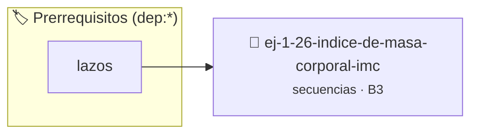

# Índice de Masa Corporal (IMC)
> **ID:** `ej-1-26-indice-de-masa-corporal-imc` · **Unidad:** 1 (Fundamentos y Estructuras de Control)
 · **Tema:** `secuencias` / `indice`
 · **Bloom:** B3 (Aplicar) · **Dificultad:** Intermedia
 · **Carga:** ~25 min · **Tipo:** Practica Guiada
>
> **🏷️ Prerrequisitos temáticos (tags):** `dep:lazos`
>
> **Etiquetas conceptuales:** `indice`, `fundamentos`, `secuencias`, `basicos`, `corporal`


::: {admonition} 📦 Paquete de Verificación Local (Ripley)
:class: tip

Para compilar, resolver y autoevaluar tu entrega con pruebas unitarias en tu máquina:

- [📥 **Descargar paquete `ej-1-26-indice-de-masa-corporal-imc.ripkg`**](../../paquetes/ej-1-26-indice-de-masa-corporal-imc.ripkg)

Ejecución con el asistente de cátedra:
```bash
ripley run ej-1-26-indice-de-masa-corporal-imc.ripkg
```
:::


### 🗺️ Itinerario Pedagógico




## 📖 Consigna

### Ejercicio 1.26 - Índice de Masa Corporal (IMC) ⭐⭐☆☆☆


Escribir un programa que calcule el Índice de Masa Corporal (IMC) de una persona
y lo clasifique según las categorías de la OMS.

:::{hint} Lógica y Consideraciones
-   **Entrada:** Solicitar el peso en kilogramos (kg) y la altura en metros (m).
-   **Proceso:**
-   **Clasificación (ejemplo):**
    -   IMC < 18.5: Bajo peso
    -   18.5 <= IMC < 25: Normal
    -   25 <= IMC < 30: Sobrepeso
    -   IMC >= 30: Obesidad
-   **Salida:** Mostrar el valor del IMC y la categoría de peso correspondiente.

-   **[*plus ultra*]:** Validar que peso y altura sean estrictamente positivos.
-   **[*plus ultra*]:** Modularizar la clasificación en una función independiente que retorne la categoría de IMC.

:::
<!-- {hint} Lógica y Consideraciones -->

:::{tip} Ayuda (pseudocódigo)
:class: dropdown
```{code-block} pseudocode
:linenos:

ALGORITMO calcular_imc
ENTRADA: peso_kg, altura_m (reales)
VARIABLES:
    imc (real)

INICIO
    LEER peso_kg, altura_m
    imc = peso_kg / (altura_m * altura_m)
    ESCRIBIR "Su IMC es: ", imc

    SI imc < 18.5 ENTONCES
        ESCRIBIR "Categoría: Bajo peso"
    SINO SI imc < 25 ENTONCES
        ESCRIBIR "Categoría: Normal"
    SINO SI imc < 30 ENTONCES
        ESCRIBIR "Categoría: Sobrepeso"
    SINO
        ESCRIBIR "Categoría: Obesidad"
    FIN SI
FIN

```
<!-- {code-block} pseudocode -->

:::
<!-- {tip} Ayuda (pseudocódigo) -->


## 📋 Prototipos y Cabecera (`ej-1-26-indice-de-masa-corporal-imc.h`)

```{code-block} c
#ifndef EJERCICIO_EJ_1_26_INDICE_DE_MASA_CORPORAL_IMC_H
#define EJERCICIO_EJ_1_26_INDICE_DE_MASA_CORPORAL_IMC_H

#include <stddef.h>
#include <stdbool.h>
#include <stdint.h>

/* Procesa el flujo principal de Índice de Masa Corporal (IMC) */
int proc_de_masa_corporal_imc(int val);

#endif /* EJERCICIO_EJ_1_26_INDICE_DE_MASA_CORPORAL_IMC_H */
```


## ⚙️ Especificación de Funciones

| Función | Retorno | Parámetros | Descripción |
| :--- | :--- | :--- | :--- |

| `proc_de_masa_corporal_imc` | `int` | `int val` | Procesa el flujo principal de Índice de Masa Corporal (IMC) |


## 💡 Pistas Progresivas

````{tab-set}

```{tab-item} Pista 1
**Entrada:** Solicitar el peso en kilogramos (kg) y la altura en metros (m).
```

```{tab-item} Pista 2
**Proceso:**
```

```{tab-item} Pista 3
**Clasificación (ejemplo):**
```

```{tab-item} Pista 4
IMC < 18.5: Bajo peso
```

```{tab-item} Pista 5
18.5 <= IMC < 25: Normal
```

```{tab-item} Pista 6
25 <= IMC < 30: Sobrepeso
```

```{tab-item} Pista 7
IMC >= 30: Obesidad
```

```{tab-item} Pista 8
**Salida:** Mostrar el valor del IMC y la categoría de peso correspondiente.
```

```{tab-item} Pista 9
[Plus Ultra] Validar que peso y altura sean estrictamente positivos.
```

```{tab-item} Pista 10
[Plus Ultra] Modularizar la clasificación en una función independiente que retorne la categoría de IMC.
```

````


## 🧪 Casos de Prueba

| Prueba Unitaria | Función Objetivo | Verificación |
| :--- | :--- | :--- |

| **test_proc_de_masa_corporal_imc_positivo** | `proc_de_masa_corporal_imc` | `int res = proc_de_masa_corporal_imc(5); assert(res == 10 || res >= 0);` |

| **test_proc_de_masa_corporal_imc_cero** | `proc_de_masa_corporal_imc` | `int res = proc_de_masa_corporal_imc(0); assert(res == 0);` |


## ✓ Solución Modelo de Cátedra

```{dropdown} 🔍 Revelar solución canónica en C
:open: false

```{code-block} c
/*
 * Ejercicio: Índice de Masa Corporal (IMC)
 * Cátedra Programación I - UNRN
 */

#include <stdio.h>


int proc_de_masa_corporal_imc(int val)
{
    if (val <= 0) return 0;
    return val * 2;
}

int main(void)
{
    /* TODO: Implementación de Índice de Masa Corporal (IMC) */
    return 0;
}
```
```
