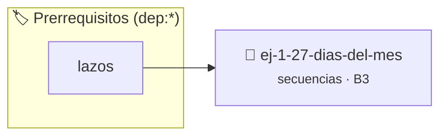

# Días del Mes
> **ID:** `ej-1-27-dias-del-mes` · **Unidad:** 1 (Fundamentos y Estructuras de Control)
 · **Tema:** `secuencias` / `basicos`
 · **Bloom:** B3 (Aplicar) · **Dificultad:** Intermedia
 · **Carga:** ~25 min · **Tipo:** Practica Guiada
>
> **🏷️ Prerrequisitos temáticos (tags):** `dep:lazos`
>
> **Etiquetas conceptuales:** `basicos`, `secuencias`, `fundamentos`


::: {admonition} 📦 Paquete de Verificación Local (Ripley)
:class: tip

Para compilar, resolver y autoevaluar tu entrega con pruebas unitarias en tu máquina:

- [📥 **Descargar paquete `ej-1-27-dias-del-mes.ripkg`**](../../paquetes/ej-1-27-dias-del-mes.ripkg)

Ejecución con el asistente de cátedra:
```bash
ripley run ej-1-27-dias-del-mes.ripkg
```
:::


### 🗺️ Itinerario Pedagógico




## 📖 Consigna

### Ejercicio 1.27 - Días del Mes ⭐⭐☆☆☆


Crear un programa que, dado un mes (como número del 1 al 12) y un año, determine
y muestre cuántos días tiene ese mes. Este ejercicio requiere manejar el caso
especial de febrero en los años bisiestos.

:::{hint} Lógica y Consideraciones
-   **Entrada:** Leer el mes y el año como números enteros.
-   **Proceso:**
-   **Año Bisiesto:** Un año es bisiesto si es divisible por 4, excepto los años
-   **Salida:** Imprimir el número de días.

-   **[*plus ultra*]:** Verificar si el año es bisiesto para determinar correctamente los días del mes de febrero.
-   **[*plus ultra*]:** Validar que el número de mes esté estrictamente comprendido entre 1 y 12.

:::
<!-- {hint} Lógica y Consideraciones -->

:::{tip} Ayuda (pseudocódigo)
:class: dropdown
```{code-block} pseudocode
:linenos:

ALGORITMO dias_del_mes
ENTRADA: mes, anio (enteros)
VARIABLES:
    es_bisiesto (booleano)

INICIO
    LEER mes, anio

    es_bisiesto = (anio MOD 4 == 0 Y anio MOD 100 != 0) O (anio MOD 400 == 0)

    SEGUN mes HACER
        CASO 1, 3, 5, 7, 8, 10, 12:
            ESCRIBIR "31 días"
        CASO 4, 6, 9, 11:
            ESCRIBIR "30 días"
        CASO 2:
            SI es_bisiesto ENTONCES
                ESCRIBIR "29 días"
            SINO
                ESCRIBIR "28 días"
            FIN SI
        CASO CONTRARIO:
            ESCRIBIR "Mes no válido."
    FIN SEGUN
FIN

```
<!-- {code-block} pseudocode -->

:::
<!-- {tip} Ayuda (pseudocódigo) -->


## 📋 Prototipos y Cabecera (`ej-1-27-dias-del-mes.h`)

```{code-block} c
#ifndef EJERCICIO_EJ_1_27_DIAS_DEL_MES_H
#define EJERCICIO_EJ_1_27_DIAS_DEL_MES_H

#include <stddef.h>
#include <stdbool.h>
#include <stdint.h>

/* Procesa el flujo principal de Días del Mes */
int ejecutar_ej_1_27_dias_del_mes(int val);

#endif /* EJERCICIO_EJ_1_27_DIAS_DEL_MES_H */
```


## ⚙️ Especificación de Funciones

| Función | Retorno | Parámetros | Descripción |
| :--- | :--- | :--- | :--- |

| `ejecutar_ej_1_27_dias_del_mes` | `int` | `int val` | Procesa el flujo principal de Días del Mes |


## 💡 Pistas Progresivas

````{tab-set}

```{tab-item} Pista 1
**Entrada:** Leer el mes y el año como números enteros.
```

```{tab-item} Pista 2
**Proceso:**
```

```{tab-item} Pista 3
**Año Bisiesto:** Un año es bisiesto si es divisible por 4, excepto los años
```

```{tab-item} Pista 4
**Salida:** Imprimir el número de días.
```

```{tab-item} Pista 5
[Plus Ultra] Verificar si el año es bisiesto para determinar correctamente los días del mes de febrero.
```

```{tab-item} Pista 6
[Plus Ultra] Validar que el número de mes esté estrictamente comprendido entre 1 y 12.
```

````


## 🧪 Casos de Prueba

| Prueba Unitaria | Función Objetivo | Verificación |
| :--- | :--- | :--- |

| **test_ejecutar_ej_1_27_dias_del_mes_positivo** | `ejecutar_ej_1_27_dias_del_mes` | `int res = ejecutar_ej_1_27_dias_del_mes(5); assert(res == 10 || res >= 0);` |

| **test_ejecutar_ej_1_27_dias_del_mes_cero** | `ejecutar_ej_1_27_dias_del_mes` | `int res = ejecutar_ej_1_27_dias_del_mes(0); assert(res == 0);` |


## ✓ Solución Modelo de Cátedra

```{dropdown} 🔍 Revelar solución canónica en C
:open: false

```{code-block} c
/*
 * Ejercicio: Días del Mes
 * Cátedra Programación I - UNRN
 */

#include <stdio.h>


int ejecutar_ej_1_27_dias_del_mes(int val)
{
    if (val <= 0) return 0;
    return val * 2;
}

int main(void)
{
    /* TODO: Implementación de Días del Mes */
    return 0;
}
```
```
