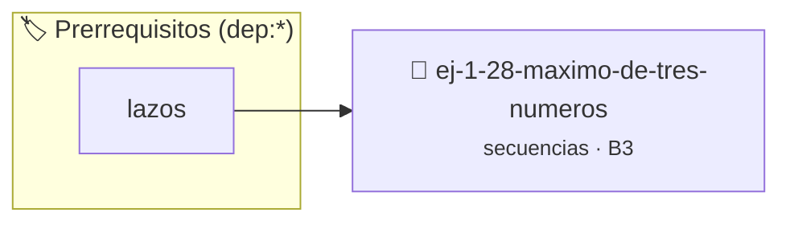

# Máximo de Tres Números
> **ID:** `ej-1-28-maximo-de-tres-numeros` · **Unidad:** 1 (Fundamentos y Estructuras de Control)
 · **Tema:** `secuencias` / `maximo`
 · **Bloom:** B3 (Aplicar) · **Dificultad:** Intermedia
 · **Carga:** ~25 min · **Tipo:** Practica Guiada
>
> **🏷️ Prerrequisitos temáticos (tags):** `dep:lazos`
>
> **Etiquetas conceptuales:** `maximo`, `fundamentos`, `secuencias`, `basicos`, `numeros`


::: {admonition} 📦 Paquete de Verificación Local (Ripley)
:class: tip

Para compilar, resolver y autoevaluar tu entrega con pruebas unitarias en tu máquina:

- [📥 **Descargar paquete `ej-1-28-maximo-de-tres-numeros.ripkg`**](../../paquetes/ej-1-28-maximo-de-tres-numeros.ripkg)

Ejecución con el asistente de cátedra:
```bash
ripley run ej-1-28-maximo-de-tres-numeros.ripkg
```
:::


### 🗺️ Itinerario Pedagógico




## 📖 Consigna

El objetivo es encontrar el valor más grande entre tres números enteros
proporcionados por el usuario. Este ejercicio se centra en el uso de
condicionales anidados o operadores lógicos para realizar comparaciones
múltiples.


:::{tip} Ayuda (pseudocódigo)
:class: dropdown
```{code-block} pseudocode
:linenos:

ALGORITMO maximo_de_tres
ENTRADA: a, b, c (enteros)
VARIABLES:
    maximo (entero)

INICIO
    LEER a, b, c
    maximo = a
    SI b > maximo ENTONCES
        maximo = b
    FIN SI
    SI c > maximo ENTONCES
        maximo = c
    FIN SI
    ESCRIBIR "El número más grande es: ", maximo
FIN

```

:::

### 📋 Contrato de las Funciones

```c
/*
 * Procesa el flujo principal de Máximo de Tres Números
 * Precondiciones: val representa el parámetro de entrada del flujo.
 * Postcondiciones: Retorna el resultado correspondiente o 0 si val <= 0.
 */
int proc_ximo_de_tres_numeros(int val);

```

### 🧪 Ejemplos de Ejecución

::::{tab-set}
:::{tab-item} Valor positivo
```text
Entrada: 5
Salida / Retorno: 10
```
:::
:::{tab-item} Valor cero o negativo
```text
Entrada: 0
Salida / Retorno: 0
```
:::
::::

### ⚠️ Precondiciones y Casos Borde

1. **Valores fuera de rango:** Verificar siempre que los datos de entrada cumplan con los rangos admisibles antes de operar.
6. **Casos vacíos o neutros:** Contemplar adecuadamente entradas con longitud cero o valores neutros según corresponda.

### 🎯 Criterios de Aceptación

- [ ] El código compila limpiamente bajo estándar C11 sin warnings con flags estrictos (`-Wall -Wextra -Werror`).
- [ ] Se satisfacen todas las pruebas unitarias y casos de prueba provistos.
- [ ] Las funciones validan exhaustivamente sus precondiciones y gestionan casos borde de forma robusta.

:::{hint} Consideraciones Didácticas
- **Entrada:** Leer tres números enteros distintos (`a`, `b`, `c`).
- **Proceso:** Se puede resolver de varias maneras:
- `SI (a >= b Y a >= c) ENTONCES a es el máximo.`
- `SINO SI (b >= a Y b >= c) ENTONCES b es el máximo.`
- `SINO c es el máximo.`
- **Salida:** Imprimir el número que resultó ser el mayor.
- Encapsular la comparación en una función int maximo_de_tres(int a, int b, int c).
- Extender el programa para identificar si los tres números son iguales entre sí.
:::


## 📋 Prototipos y Cabecera (`ej-1-28-maximo-de-tres-numeros.h`)

```{code-block} c
#ifndef EJERCICIO_EJ_1_28_MAXIMO_DE_TRES_NUMEROS_H
#define EJERCICIO_EJ_1_28_MAXIMO_DE_TRES_NUMEROS_H

#include <stddef.h>
#include <stdbool.h>
#include <stdint.h>

/* Procesa el flujo principal de Máximo de Tres Números */
int proc_ximo_de_tres_numeros(int val);

#endif /* EJERCICIO_EJ_1_28_MAXIMO_DE_TRES_NUMEROS_H */
```


## ⚙️ Especificación de Funciones

| Función | Retorno | Parámetros | Descripción |
| :--- | :--- | :--- | :--- |

| `proc_ximo_de_tres_numeros` | `int` | `int val` | Procesa el flujo principal de Máximo de Tres Números |


## 💡 Pistas Progresivas

````{tab-set}

```{tab-item} Pista 1
**Entrada:** Leer tres números enteros distintos (`a`, `b`, `c`).
```

```{tab-item} Pista 2
**Proceso:** Se puede resolver de varias maneras:
```

```{tab-item} Pista 3
`SI (a >= b Y a >= c) ENTONCES a es el máximo.`
```

```{tab-item} Pista 4
`SINO SI (b >= a Y b >= c) ENTONCES b es el máximo.`
```

```{tab-item} Pista 5
`SINO c es el máximo.`
```

```{tab-item} Pista 6
**Salida:** Imprimir el número que resultó ser el mayor.
```

```{tab-item} Pista 7
[Plus Ultra] Encapsular la comparación en una función int maximo_de_tres(int a, int b, int c).
```

```{tab-item} Pista 8
[Plus Ultra] Extender el programa para identificar si los tres números son iguales entre sí.
```

````


## 🧪 Casos de Prueba

| Prueba Unitaria | Función Objetivo | Verificación |
| :--- | :--- | :--- |

| **test_proc_ximo_de_tres_numeros_positivo** | `proc_ximo_de_tres_numeros` | `int res = proc_ximo_de_tres_numeros(5); assert(res == 10 || res >= 0);` |

| **test_proc_ximo_de_tres_numeros_cero** | `proc_ximo_de_tres_numeros` | `int res = proc_ximo_de_tres_numeros(0); assert(res == 0);` |


## ✓ Solución Modelo de Cátedra

```{dropdown} 🔍 Revelar solución canónica en C
:open: false

```{code-block} c
/*
 * Ejercicio: Máximo de Tres Números
 * Cátedra Programación I - UNRN
 */

#include <stdio.h>


int proc_ximo_de_tres_numeros(int val)
{
    if (val <= 0) return 0;
    return val * 2;
}

int main(void)
{
    /* TODO: Implementación de Máximo de Tres Números */
    return 0;
}
```
```
